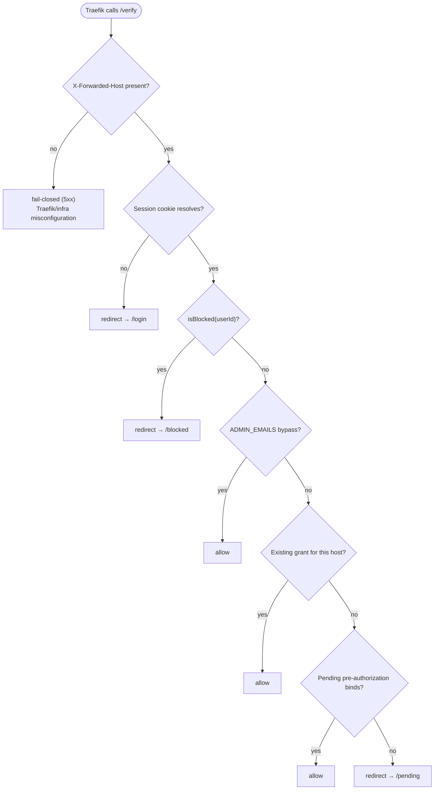
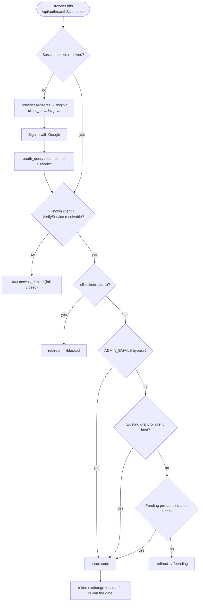

# @lilnas/auth

Self-hosted ForwardAuth provider for lilnas. Every gated `*.lilnas.io` (and `*.dev.lilnas.io`) router delegates its authentication decision to this app instead of running its own login flow. Sign-in is Google OAuth via [Better Auth](https://www.better-auth.com/); access to each individual service is a separate, admin-managed grant.

## Request flow

1. A browser requests a Traefik-routed host that carries the `lilnas-auth` middleware (see `infra/proxy.yml`).
2. Traefik's ForwardAuth check calls this app's **backend** directly — `http://auth:8081/verify` — before the real request is ever forwarded. This bypasses the Next.js frontend entirely; the frontend only ever serves pages a human browses to directly (`/login`, `/pending`, `/blocked`, `/admin`).
3. Traefik forwards `X-Forwarded-Host` / `X-Forwarded-Proto` / `X-Forwarded-Uri` and the original `Cookie` header on that subrequest. `VerifyController` reads them and calls `VerifyService.decide()` (`src/verify/verify.service.ts`).
4. `decide()` returns one of three outcomes:
   - **Allow** — Traefik lets the real request through. The response also carries `X-Forwarded-User` / `X-Forwarded-User-Id` (`authResponseHeaders` in `infra/proxy.yml`), so a downstream service can read the caller's identity without doing its own lookup. It also carries a `Cookie` header: the request's own cookies minus every `lilnas-auth.` one, which replaces the request's `Cookie` header, so the service never sees the session cookie (see [Cookie forwarding](#cookie-forwarding)).
   - **Redirect** — an absolute `Location` back to this app's own `/login`, `/pending`, or `/blocked` page. Absolute is load-bearing: Traefik's `preserveLocationHeader` defaults to `false`, so a relative redirect out of `/verify` would otherwise be rewritten into a container-internal, browser-unreachable URL.
   - **Fail-closed (5xx)** — only when `X-Forwarded-Host` itself is missing, which means Traefik/infra is misconfigured, not that the caller is anonymous. `/verify` never fails open.

## Cookie forwarding

The session cookie is `__Secure-lilnas-auth.session_token`, scoped to `.lilnas.io`, so a browser sends it to every `*.lilnas.io` host. Who receives it from there:

- **Gated backends never do.** On an allow, `/verify` returns the request's cookies without any `lilnas-auth.` cookie, and the `lilnas-auth` middleware lists `Cookie` in `authResponseHeaders`, so Traefik forwards that sanitized `Cookie` header instead of the browser's.
- **Routers with no auth can opt in to the same strip.** They carry the `lilnas-cookie-strip` middleware (forwardAuth to `http://auth:8081/strip-cookie`, which always allows). A router with it returns errors while the auth backend is down or restarting.
- **Still receiving the cookie from a signed-in browser:**
  - `auth.lilnas.io`, which needs it.
  - `emby.lilnas.io`, `immich.lilnas.io` and `turbo.lilnas.io`, left independent of auth uptime.
  - `rocky-roads.lilnas.io` (compose project `hop-road`, outside this repo).
  - Any dev route exposed without `lilnas-auth` or `lilnas-cookie-strip`.
- **Rollback rule.** Once `Cookie` is in `authResponseHeaders`, the auth image must not be rolled back to one that predates the sanitized header, or gated backends lose all their cookies. Roll back by reverting on `main`.

## The `/verify` decision

`VerifyService.decide()`'s branch order is load-bearing — each check runs only after the ones above it have been ruled out:

Two orderings are deliberate, not incidental:

- **Blocked beats admin bypass.** A blocked `ADMIN_EMAILS` address is denied exactly like any other blocked account — blocking takes effect before the unconditional admin allowance is ever considered. (This is the opposite of `AdminGuard`'s own posture on `/admin`, which is intentionally independent of blocked/grant state so an admin can never lock themselves out of the one place that can undo a block. See `admin.guard.ts` and `verify.service.ts`'s own header comments for the full rationale.)
- **Grant beats pre-authorization bind.** A pre-authorization only ever binds on the already-rare "no grant found" branch, and only once — see `AccessCacheService.bindPreAuthorizedGrant()`'s own header comment for why this runs lazily here instead of from an auth-time hook (the direct approach is circular: the hook would need `AccessCacheService` injected into the module that constructs `AccessCacheService`).

## OIDC provider

lilnas-auth is also an OpenID Connect provider (Better Auth's `jwt` + `@better-auth/oauth-provider` plugins, `src/auth/auth.ts`), so apps without ForwardAuth support can sign in through it. The registered clients are listed in `OIDC_CLIENTS` in `src/oidc/clients.ts`; today that is Immich (`immich`). The issuer is `AUTH_HOST` — `https://auth.lilnas.io` in prod, a bare origin with no path. id_tokens are signed RS256 (`jwt({ jwks: { keyPairConfig: { alg: 'RS256' } } })`).

| Endpoint                                                                       | Notes                                                                                                                                                                        |
| ------------------------------------------------------------------------------ | ---------------------------------------------------------------------------------------------------------------------------------------------------------------------------- |
| `/.well-known/openid-configuration`, `/.well-known/oauth-authorization-server` | Discovery, at the issuer root. `next.config.js` rewrites both unchanged to the backend, where `OidcWellKnownController` hands them to Better Auth (it only answers at root). |
| `/api/auth/oauth2/authorize`, `/oauth2/token`, `/oauth2/userinfo`              | Authorization-code flow only; scopes `openid profile email`.                                                                                                                 |
| `/api/auth/jwks`                                                               | Public signing key (stored in the `jwks` table).                                                                                                                             |

### Adding a client

Clients are seeded, never self-registered: dynamic registration is off and the client CRUD endpoints always 401. To add one:

1. Append one entry to `OIDC_CLIENTS` in `src/oidc/clients.ts`: `clientId`, display `name` (shown on the login page), `host`, `redirectUris`, and `secretEnvKey`.
2. Add the matching `OIDC_<NAME>_CLIENT_SECRET` key to `.env.example` / `.env.prod` (generate with `openssl rand -hex 32`). No `EnvKeys` entry is needed; `secretEnvKey` is a plain string.

`OidcClientsService` upserts every entry into `oauth_client` on each boot (refreshing the secret hash and redirect URIs) and throws if a client's secret env var is unset. Only `base64url(sha256(secret))` is stored. The client's `host` is the **grant key**: signing in to a client requires the user to be granted that host, exactly like visiting it behind forward-auth. A non-loopback issuer is forced to `https://` by the plugin, so a dev `AUTH_HOST` should be `http://localhost…` or `https://`.

### The gate

Access reuses the `/verify` decision after the session check: `VerifyService.authorizeHost()` (blocked → admin bypass → grant, literal or `*.suffix` → pre-authorization bind → pending) is called with the client's host, via `src/oidc/oidc-gate.ts`.

- **Authorize.** A blocked or ungranted user is redirected to `/blocked` or `/pending` (with `?redirect=https://<host>/`) and no code is issued. This is `hooks.before` in `auth.ts`.
- **Backstop.** The post-login resume (below) skips endpoint hooks, so the same gate also runs when the code is exchanged (`customIdTokenClaims`, which fails the token request) and on `/oauth2/userinfo` (`customUserInfoClaims`). A user never granted, or whose grant was revoked after the code was issued, gets no id_token and no userinfo.
- **Denials** return a generic 403 `access_denied`; the reason is only in the `OidcGate` log.

### Post-login resume

An authorize with no session is redirected to `/login` carrying the signed authorize query (`client_id`, `redirect_uri`, `state`, `exp`, `sig`). `src/app/login/oidc-prompt.ts` detects it (both `client_id` and `sig` must be present) and the page names the client (`name` from `clients.ts`). The Google callback is a browser navigation, so the plugin's `after` hook reads the `oauth_query` it stashed during sign-in, re-runs the authorize, and the callback's `302 Location` lands on the client's `redirect_uri` — no second click. A tampered `sig` is rejected with 400 `invalid_signature`.

### Registering a client

- Add an entry to `OIDC_CLIENTS` in `src/oidc/clients.ts` (`clientId`, `name`, lilnas `host`, `redirectUris`, `secretEnvKey`), put the plaintext secret in `apps/auth/.env.prod` and `.env.example` under that key (`openssl rand -hex 32`), and add the host to `src/app/service-meta.ts`.
- `OidcClientsService` upserts listed clients at every boot and **deletes** any stored client not listed, which cascades to its tokens and consents. Removing an entry therefore revokes the client on the next restart.
- The relying party sends the secret in the token request body (`client_secret_post`).

## Two-process topology

This app is **two Node processes**: a Next.js frontend and a NestJS backend. Production runs them as **two containers** from one image; dev runs them in **one container**.

| Process  | Framework | Port | Production service | Role                                                                                                                                                  |
| -------- | --------- | ---- | ------------------ | ----------------------------------------------------------------------------------------------------------------------------------------------------- |
| Frontend | Next.js   | 8080 | `auth-frontend`    | Public-facing. Serves `/login`, `/pending`, `/blocked`, `/admin`. The only service with a Traefik router.                                             |
| Backend  | NestJS    | 8081 | `auth`             | Internal only. Owns `/verify`, `/strip-cookie`, `/api/auth/*` (Better Auth), `/.well-known/*` (OIDC discovery), `/requests/*`, `/admin/*`, `/health`. |

`/strip-cookie` is the always-allow twin of `/verify` for routers with no auth: it answers 200 to every request and only returns the request's `Cookie` header minus lilnas-auth's own cookies, so a service that is not gated still never receives the lilnas-auth session. It does no session lookup and records nothing in `/admin`, and it has no `next.config.js` rewrite, so it is reachable on the backend port only.

### Production: two containers

`deploy.yml` defines both services from the same image (`ghcr.io/codemonkey800/lilnas-auth`). The `Dockerfile`'s default `ENTRYPOINT` (`pnpm start`) runs both processes; each service overrides it with `node` directly, so the process is PID 1 and receives SIGTERM:

| Service         | `entrypoint`                        | Holds                                                                                                   |
| --------------- | ----------------------------------- | ------------------------------------------------------------------------------------------------------- |
| `auth`          | `node dist/main`                    | `env_file` (signing secret, Google client secret), the writable SQLite volume, the compose-file mounts. |
| `auth-frontend` | `node frontend/apps/auth/server.js` | Literal `environment:` values only. No `env_file`, no `volumes`, no `ports`.                            |

- The frontend is the only part of auth the internet reaches before login, so it is the part that must not share a container with the secrets. `src/services/__tests__/frontend-isolation.spec.ts` fails if it gains an `env_file`, a volume, a port, a `${...}` value or an unlisted environment key.
- `auth` keeps its name and has no Traefik labels. Traefik's forwardAuth address (`http://auth:8081/verify`, `infra/proxy.yml`) and other containers' calls to `http://auth:8081` are unchanged. `auth-frontend` carries the `auth` router and service labels (host `auth.lilnas.io`, port 8080).
- There is no `depends_on` either way. The frontend serves `/login` without the backend, and `/verify` never waits on the frontend, so a crashed or restarting frontend does not interrupt `/verify` for any gated service.
- `auth` is healthchecked on `:8081/health`. `auth-frontend` is healthchecked on `GET :8080/login` returning 200, with `start_interval: 2s`: Traefik's Docker provider does not route to a container whose health is `starting`, so without it `auth.lilnas.io` would be unrouted for up to 30 s after every deploy.
- The frontend reaches the backend at `AUTH_BACKEND_URL` (`http://auth:8081`, set in `deploy.yml`; see `src/app/lib/backend-url.ts`). The `next.config.js` rewrites bake the same origin in at build time (`PROD_BACKEND_ORIGIN`), and the `Dockerfile` fails the image build if the built `routes-manifest.json` lacks `http://auth:8081` or contains `localhost:8081`. `frontend-isolation.spec.ts` checks that `AUTH_BACKEND_URL` equals `PROD_BACKEND_ORIGIN` and has the same origin as the forwardauth address.

### Dev: one container

`deploy.dev.yml` stays a single container running `pnpm --filter=auth dev`, which races `dev:backend` and `dev:frontend` via `run-p`. Dev has no real secrets to isolate, and in dev the rewrites and `backendUrl()` use `http://localhost:8081`, which only resolves when both processes share a network namespace. `AUTH_BACKEND_URL` is unset in dev; `backendUrl()` falls back to `http://localhost:${BACKEND_PORT}`.

### How the frontend reaches the backend

- **Server Components / Server Actions** call the backend with a plain server-side fetch to `backendUrl(path)` (`src/app/lib/backend-url.ts`): `AUTH_BACKEND_URL` when set (production), else `http://localhost:${BACKEND_PORT}` (dev). They forward the incoming `Cookie` header and never touch the browser. This is how `/admin` and `/pending` server-side mutations work.
- **`next.config.js` rewrites** proxy four specific browser-facing paths straight to the backend, preserving the path (non-stripping, unlike `apps/download`'s app-wide rewrite). The origin is `http://auth:8081` in production builds and `http://localhost:8081` under `next dev`:
  - `/api/auth/:path*` → `/api/auth/:path*` — Better Auth's own mount. Non-stripping is what lets `basePath` and the internally-derived router prefix agree on both sides with no URL-rewriting middleware in between.
  - `/.well-known/openid-configuration` and `/.well-known/oauth-authorization-server` → the same paths — OIDC discovery at the issuer root (see [OIDC provider](#oidc-provider)).
  - `/api/sse/:path*` → `/sse/:path*` — the pending page's live `EventSource` connection, which the browser opens directly and so needs an actual browser-reachable route.
- **Traefik's ForwardAuth check** talks to the backend directly (`http://auth:8081/verify`) and never touches the frontend at all — see [Request flow](#request-flow) above.

One env var quirk worth knowing: `.env.example` documents `FRONTEND_PORT=8080`, but nothing in `src/` ever reads it — there is no `EnvKeys.FRONTEND_PORT`. In dev, the frontend's port is hardcoded via `next dev -p 8080` (`package.json`). In production, `start:frontend` runs `next`'s standalone-build `server.js`, which reads the standard `PORT` env var (default `3000`) — that ends up `8080` because the `lilnas-nextjs-runtime` base image (`infra/base-images/lilnas-node-runtime.Dockerfile`) sets `ENV PORT=8080`, not because of anything this app's own config does. `BACKEND_PORT` is the backend's listen port (`src/bootstrap.ts`) and the dev fallback for `backendUrl()`.

### Rollback

- `LILNAS_TAG=<older sha> docker compose up -d auth` (in `/opt/lilnas`, see `docs/deploy.md`) works for `auth`: an older backend image runs the same way.
- It does **not** work for `auth-frontend` across the split. An image built before it has rewrites pointing at `localhost:8081`, which in a separate frontend container is not the backend. Roll the split itself back by reverting the change on `main` and letting CI redeploy.
- `/verify` does not depend on the frontend, so signed-in users keep working while the frontend is down. Only sign-in, `/pending`, `/admin` and OIDC discovery are unavailable.

### Residual risk

The split protects the signing secret, the Google client secret and the database. It does not make a compromised frontend harmless: it still sees the cookies of every user who visits `auth.lilnas.io`, and, like any container on the compose network, it can call the backend's unauthenticated routes (`/verify`, `/strip-cookie`, `/health`) on `http://auth:8081`. It holds no internal token, and production sets `INTERNAL_TOKEN_ENFORCE=true`, so it gets 401 from `/admin/check` and `/internal/*` (see [Internal routes](#internal-routes)).

## Internal routes

`/admin/check` and `/internal/*` are server-to-server routes on the backend port (8081), which has no Traefik router and no published port. Every container on the compose network can reach them, so `InternalTokenGuard` (`src/internal/internal-token.guard.ts`) identifies the caller by a bearer token and checks that it holds the route's scope. In production these routes require a token: `deploy.yml` sets `INTERNAL_TOKEN_ENFORCE=true` on the `auth` service, so a call without a valid caller token is rejected. The dev stack (`deploy.dev.yml`) does not set it and runs in observe mode.

| Caller            | Token env var (in auth)          | Scopes                                                       |
| ----------------- | -------------------------------- | ------------------------------------------------------------ |
| `download`        | `INTERNAL_TOKEN_DOWNLOAD`        | `admin-check`, `discord-link:read`, `discord-identity:write` |
| `icloud-backup`   | `INTERNAL_TOKEN_ICLOUD_BACKUP`   | `admin-check`                                                |
| `dev`             | `INTERNAL_TOKEN_DEV`             | `host-activity:read`                                         |
| `dev-idle-reaper` | `INTERNAL_TOKEN_DEV_IDLE_REAPER` | `host-activity:read`                                         |

| Scope                    | Route                             |
| ------------------------ | --------------------------------- |
| `admin-check`            | `GET /admin/check`                |
| `discord-link:read`      | `GET /internal/discord-link`      |
| `discord-identity:write` | `POST /internal/discord-identity` |
| `host-activity:read`     | `GET /internal/host-activity`     |

- **Header:** callers send `Authorization: Bearer <token>`, reading the token from their own `AUTH_INTERNAL_TOKEN`. The scheme is case-insensitive; any other shape is `invalid`.
- **Tokens:** a caller's token is the value of its env var. Unset or shorter than 32 characters disables that caller. Two callers with the same value are both disabled, and one error is logged at startup. The guard never fails the boot. Tokens are compared in constant time over SHA-256 digests.
- **Observe mode** (default and dev, `INTERNAL_TOKEN_ENFORCE` unset or anything but `true`): every request is allowed. Each one logs `{ event: 'internal-auth', outcome, caller, scope, enforced, remoteAddress }`, at info for `ok` and warn for `missing`, `invalid` and `forbidden`. Check the log for anything but `ok` before enforcing.
- **Enforce mode** (production, `INTERNAL_TOKEN_ENFORCE=true`, exactly): `missing` and `invalid` are 401, `forbidden` (a known caller without the scope) is 403.
- `/verify`, `/strip-cookie`, `/health`, `/me`, `/requests/*`, the session-guarded `/admin/*` routes and `/sse/*` take no token.

### Adding a caller

1. Add `INTERNAL_TOKEN_<NAME>` to `EnvKeys` in `src/env.ts`.
2. Add a row to `INTERNAL_CALLERS` in `src/internal/internal-callers.ts` with the fewest scopes it needs. A new route also needs a scope in `INTERNAL_SCOPES` and `@RequireInternalScope()` on its handler; a guarded handler without one is 403 for everyone.
3. Generate a token (`openssl rand -hex 32`), set it in auth's `.env.prod` and as `AUTH_INTERNAL_TOKEN` in the caller's env (`pnpm exec dotenvx set ...`, see `docs/deploy.md`).
4. Update the tables above and the contract spec (`src/internal/__tests__/internal-token.guard.spec.ts`).

## Environment variables

Source of truth for keys: `src/env.ts`'s `EnvKeys`. Source of truth for dev values: `.env.example`.

| Variable                         | Dev value               | Prod value                                                     | Purpose                                                                                                                                                                                                                                                            |
| -------------------------------- | ----------------------- | -------------------------------------------------------------- | ------------------------------------------------------------------------------------------------------------------------------------------------------------------------------------------------------------------------------------------------------------------ |
| `BACKEND_PORT`                   | `8081`                  | `8081`                                                         | NestJS backend's own listen port; also how the frontend addresses it (`callBackend()`).                                                                                                                                                                            |
| `AUTH_BACKEND_URL`               | _(unset)_               | `http://auth:8081` (literal in `deploy.yml`'s `auth-frontend`) | Origin the Next server uses to reach the backend (`backendUrl()`): http(s) scheme + host + port, no path, query or credentials. Unset means `http://localhost:${BACKEND_PORT}`. Read by the frontend only; must match `PROD_BACKEND_ORIGIN` in `next.config.js`.   |
| `DATABASE_PATH`                  | `./lilnas-auth.db`      | `/data/lilnas-auth.db` (set in `deploy.yml`, not `.env.prod`)  | SQLite file path.                                                                                                                                                                                                                                                  |
| `NODE_ENV`                       | `development`           | `production`                                                   | Standard Node environment flag.                                                                                                                                                                                                                                    |
| `AUTH_HOST`                      | `http://auth.localhost` | `https://auth.lilnas.io`                                       | This app's own full origin — scheme + host, no path, no trailing slash. Reused verbatim everywhere this app builds a URL against itself (redirect validation's own-host guard, `/verify`'s absolute `Location` headers, Better Auth's `baseURL`/`trustedOrigins`). |
| `GOOGLE_CLIENT_ID`               | `changeme`              | real client ID                                                 | Google OAuth client.                                                                                                                                                                                                                                               |
| `GOOGLE_CLIENT_SECRET`           | `changeme`              | real client secret                                             | Google OAuth client.                                                                                                                                                                                                                                               |
| `BETTER_AUTH_SECRET`             | `changeme`              | generated secret (e.g. `openssl rand -base64 32`)              | Session-signing secret, unrelated to Google.                                                                                                                                                                                                                       |
| `COOKIE_DOMAIN`                  | `.localhost`            | `.lilnas.io`                                                   | `Domain` attribute for the cross-subdomain session cookie (`advanced.crossSubDomainCookies`). Not hardcoded in code since dev sign-in runs on `*.localhost`.                                                                                                       |
| `REDIRECT_ALLOWED_SUFFIX`        | `localhost`             | `lilnas.io`                                                    | Domain family a post-sign-in `redirect` candidate's hostname must equal or be a subdomain of. Already covers `*.dev.lilnas.io` in prod, since that's a nested subdomain of `lilnas.io`.                                                                            |
| `SSE_KEEPALIVE_MS`               | `25000`                 | `25000`                                                        | Keepalive interval for the pending page's live SSE channel.                                                                                                                                                                                                        |
| `SSE_MAX_STREAMS_PER_USER`       | _(unset)_               | _(unset)_                                                      | Most SSE streams one user may hold open at once, counted across `/sse/pending` and `/sse/admin`; one more gets 429. Unset, or not an integer of at least 1, means `6`.                                                                                             |
| `ADMIN_EMAILS`                   | `changeme@example.com`  | real comma-separated list                                      | Admin allowlist. Read independently by `AdminGuard` (throws if unset — only breaks `/admin`) and `VerifyService` (defaults to `''` — must never throw, since it gates every request on the hot path).                                                              |
| `INTERNAL_TOKEN_DOWNLOAD`        | _(unset)_               | from `.env.prod`                                               | Bearer token of the `download` caller on the internal routes. Unset or under 32 characters disables the caller. See [Internal routes](#internal-routes).                                                                                                           |
| `INTERNAL_TOKEN_ICLOUD_BACKUP`   | _(unset)_               | from `.env.prod`                                               | Bearer token of the `icloud-backup` caller.                                                                                                                                                                                                                        |
| `INTERNAL_TOKEN_DEV`             | _(unset)_               | from `.env.prod`                                               | Bearer token of the `dev` caller (`apps/dev`).                                                                                                                                                                                                                     |
| `INTERNAL_TOKEN_DEV_IDLE_REAPER` | _(unset)_               | from `.env.prod`                                               | Bearer token of the `dev-idle-reaper` caller.                                                                                                                                                                                                                      |
| `INTERNAL_TOKEN_ENFORCE`         | _(unset)_               | `true` (literal in `deploy.yml`)                               | Exactly `true` makes the internal routes reject (401/403). Anything else only logs: observe mode. The dev stack leaves it unset.                                                                                                                                   |

`.env` (dev) and `.env.prod` (prod) are both gitignored; copy `.env.example` to start either one. See root `CLAUDE.md`'s Environment Variables section for the general convention.

### Session cookie name

Better Auth's cookie prefix is `lilnas-auth` (`advanced.cookiePrefix`, `src/auth/cookie-names.ts`), so the session cookie is `lilnas-auth.session_token` over http (dev) and `__Secure-lilnas-auth.session_token` over https (prod), with `Domain=COOKIE_DOMAIN`. The default `better-auth` prefix is shared with other Better Auth apps under `*.lilnas.io` (e.g. `apps/tdr-code`); `/verify` matches only the two `lilnas-auth` names, exactly. Migration `0007_revoke_sessions_cookie_rename` runs `DELETE FROM session` once at the first boot after the rename, so every user signs in again one time.

## Fix identifiers

Comments throughout `src/` cite short IDs from a structured code review of this app, each mapping to a real git commit — `git log --oneline | grep <id>` finds it:

| ID  | Fix                                                                       |
| --- | ------------------------------------------------------------------------- |
| S1  | Narrow compose bind mounts to individual files                            |
| S2a | `isBlocked` beats the admin bypass on `/verify`                           |
| S2b | Admin-initiated session revocation                                        |
| S3  | Validate admin request bodies with Zod                                    |
| S4  | One host-normalization rule for the grant keyspace                        |
| S5  | Rate limit `/admin`, `/requests`, `/me`, excluding the `/verify` hot path |
| S6  | Block/unblock must not lie about nonexistent users                        |
| S7  | Enforce the `authResponseHeaders` invariant with a test                   |
| P1  | Dedup concurrent `resolveSession()` calls for the same cookie             |
| P2  | Key the session cache on the session cookie, not the whole header         |
| P3  | Count prior decisions instead of fetching full rows                       |
| M1  | Comment-density pass + this README                                        |
| M2  | Split Add-person / Edit-access modals into their own files                |
| M3  | Batch access-change writes, drop optimistic UI state                      |
| M4  | Make `test:cov`'s coverage table deterministic                            |
| M5  | Dedupe `jest.config.js`'s shared project config                           |
| M6  | Delete dead seed-whitelist code                                           |

If you spot an older `U<n>` / `R<n>` / `AE<n>`-style tag instead (e.g. `U9`, `R15`, `AE6`), that's a leftover from this app's original, now-archived build-out plan (`docs/archive/`) — a different, unrelated numbering scheme, not a typo'd version of the table above. Those tags don't resolve to anything a current reader can follow up on; treat them as historical noise and prefer whatever technical explanation surrounds them in the same comment.
