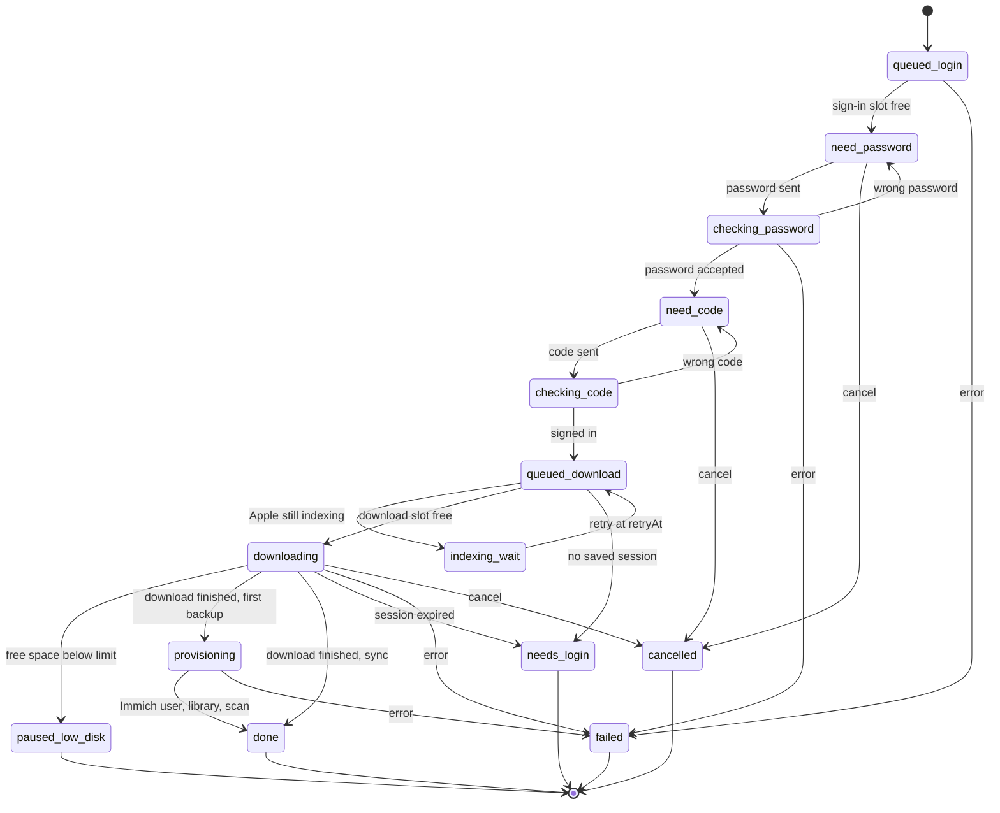

# icloud-backup

Backs up a family member's iCloud Photos and videos to `/storage/photos/icloud-users/<name>` with
[icloudpd](https://github.com/icloud-photos-downloader/icloud_photos_downloader). When the first
backup finishes it creates an Immich user and an external library on that folder and starts a scan.
A "Sync now" button re-runs the backup with the saved Apple session, and the service is served at
`https://icloud-backup.lilnas.io` behind lilnas-auth.

Identity comes from Traefik's `X-Forwarded-User` / `X-Forwarded-User-Id` headers (the lilnas-auth
email); `GET /health` is the only unguarded route. The folder name is the part of the email before
the `@`, cleaned.

## A job's states

Every backup or sync is a job. The states are `BACKUP_STATES` in `src/shared/contract.ts`; the
terminal ones (`TERMINAL_STATES`) get no more events.



Notes on the diagram:

- Only one person signs in at a time (`queued_login` shows a "you're next" position); up to
  `MAX_DOWNLOADS` downloads run at once.
- A failed job carries an `errorCode`: `wrong_password`, `login_timeout`, `interrupted_login`,
  `apple_access_denied`, `apple_indexing`, `icloudpd_error`, `immich_error` or `internal`.
- The diagram shows the usual paths, not every edge; `src/shared/contract.ts` is the authority for
  which states exist.

## Two containers, one image

`deploy.yml` runs three services; two share one image (`ghcr.io/codemonkey800/lilnas-icloud-backup`):

| Service                  | Runs                               | Holds                                                                         |
| ------------------------ | ---------------------------------- | ----------------------------------------------------------------------------- |
| `icloud-backup-frontend` | Next.js on :8080                   | Nothing: no `env_file`, no volumes, no secret. Only it carries Traefik labels |
| `icloud-backup`          | NestJS on :8081 and icloudpd       | The Immich API key, the DB password, the session cookies and the photo mount  |
| `icloud-backup-db`       | Postgres 18, for jobs and accounts | The `icloud-backup-db` data directory                                         |

**Why the backend owns port 8080.** icloudpd's sign-in web form is fixed to port 8080 on all
interfaces, and the backend drives it over loopback (`ICLOUDPD_WEBUI_URL`, default
`http://127.0.0.1:8080`). Next also wants 8080, so the frontend runs in its own container, where
8080 is free, and reaches the backend over the compose network. This also keeps the one
internet-facing container free of secrets, cookies and photos.

The frontend rewrites `/api/:path*` and `/ws` to `http://icloud-backup:8081`. That address is baked
into the build (`next.config.js`), so the backend service must stay named `icloud-backup`.

## Environment

Production values live in `.env.prod`, committed encrypted with dotenvx (`docs/deploy.md`, Secrets).
Keys with no default are required in production or have no effect when unset.

| Key                     | Default                    | Meaning                                                                        |
| ----------------------- | -------------------------- | ------------------------------------------------------------------------------ |
| `BACKEND_PORT`          | `8081`                     | Port the NestJS backend listens on                                             |
| `FRONTEND_PORT`         | `8080`                     | Port `next dev` listens on (dev script only)                                   |
| `NODE_ENV`              | none                       | `production` in the image                                                      |
| `POSTGRES_HOST`         | `icloud-backup-db`         | Database host (backend only)                                                   |
| `POSTGRES_PORT`         | `5432`                     | Database port                                                                  |
| `POSTGRES_USER`         | `icloud_backup`            | Database user                                                                  |
| `POSTGRES_PASSWORD`     | none                       | Database password (secret)                                                     |
| `POSTGRES_DB`           | `icloud_backup`            | Database name                                                                  |
| `ICLOUDPD_BIN`          | `/usr/local/bin/icloudpd`  | The icloudpd binary                                                            |
| `ICLOUDPD_WEBUI_URL`    | `http://127.0.0.1:8080`    | icloudpd's sign-in form, loopback only                                         |
| `ICLOUDPD_RECENT`       | unset                      | Adds `--recent N` to a download. Dry runs only                                 |
| `PHOTOS_ROOT`           | `/photos`                  | Where each person's photos land                                                |
| `STATE_ROOT`            | `/state`                   | icloudpd session cookies live under `<STATE_ROOT>/cookies/<name>`              |
| `MIN_FREE_BYTES`        | `200000000000` (200 GB)    | No job starts below this much free space on the photos disk; a download pauses |
| `MAX_DOWNLOADS`         | `2`                        | Downloads that run at once                                                     |
| `IMMICH_URL`            | `http://immich:2283`       | Immich, container to container                                                 |
| `IMMICH_API_KEY`        | none                       | Immich API key (secret); see below                                             |
| `IMMICH_EXTERNAL_URL`   | `https://immich.lilnas.io` | Immich address handed to a browser                                             |
| `IMMICH_IMPORT_ROOT`    | `/icloud-users`            | `PHOTOS_ROOT` as the Immich container sees it                                  |
| `IMMICH_EMAIL_PLUS_TAG` | unset                      | `a@b.c` becomes `a+<tag>@b.c` in Immich. Dry runs only                         |
| `ACCOUNT_SLUG_PREFIX`   | unset                      | Prefixes the folder name. Dry runs only                                        |
| `DEV_USER_EMAIL`        | unset                      | Dev-only identity fallback. Never set in production                            |
| `DEV_USER_ID`           | unset                      | Dev-only identity fallback. Never set in production                            |

`.env.example` lists the same keys. `deploy.yml` sets `BACKEND_PORT`, `POSTGRES_HOST`, `IMMICH_URL`,
`IMMICH_EXTERNAL_URL` and `TZ` itself; the rest come from `.env.prod`.

## Where data lives

| On the host                                      | In the container        | Holds                                           |
| ------------------------------------------------ | ----------------------- | ----------------------------------------------- |
| `/storage/photos/icloud-users/<name>`            | `icloud-backup:/photos` | One person's photos and videos; Immich reads it |
| `/storage/app-data/icloud-backup/cookies/<name>` | `icloud-backup:/state`  | icloudpd's saved Apple session for that person  |
| `/storage/app-data/icloud-backup-db`             | `icloud-backup-db`      | Postgres data (jobs, accounts, Immich links)    |

Create the two `app-data` directories before the first deploy, writable by the containers
(`postgres:18-alpine` runs as uid 70, the backend as the image's `node` user). Immich mounts
`/storage/photos/icloud-users` read-only at `/icloud-users`.

## The pinned icloudpd

The Dockerfile installs one icloudpd release, downloaded and checked by `scripts/fetch-icloudpd.sh`.
Two variables at the top of that script pin it:

- `ICLOUDPD_VERSION`
- `ICLOUDPD_SHA256` (of the `linux-amd64` binary for that version)

To upgrade, change both, and change the version in the Dockerfile's
`icloudpd --version | grep -q 'version:<x.y.z>'` line. The build fails on a checksum mismatch or if
the installed binary does not report the pinned version.

## Immich API key

The backend talks to Immich with one API key in `IMMICH_API_KEY`. Create it in Immich as an admin
(Account Settings, API Keys) with exactly these seven permissions:

- `adminUser.create`
- `adminUser.read`
- `adminUser.update`
- `library.create`
- `library.read`
- `library.update`
- `library.statistics`

The service uses them to find or create the Immich user, create the external library on the
person's folder, start a scan and read its statistics, and reset a temporary password for users it
created.

The key never needs `all`. Immich's `POST /api/libraries/:id/validate` is admin-only with no
permission name, so the service does not call it; it checks the person's folder on its own mount
before creating anything.

## What is never stored

- **Apple passwords.** Held in memory just long enough to post to icloudpd's form, then dropped.
  Not in the database, not in logs, not in job rows. icloudpd runs with an allowlisted environment,
  so it never sees the DB password or the Immich key.
- **Verification codes.** Same: posted once, never kept.
- **Immich passwords.** A new Immich user gets a random password nobody sees. A button resets it and
  shows the new one once, only for users this service created.

What is stored: the Apple ID (email), icloudpd's session cookies under `STATE_ROOT`, job progress
and the Immich user and library ids.

## Giving a family member access

Access is a lilnas-auth grant. In the auth admin page (`https://auth.lilnas.io/admin`), give the
person a grant for `icloud-backup.lilnas.io`. They sign in to lilnas-auth with that email, and
the app uses it for their folder and Immich account. lilnas-auth admins also see a read-only admin
page listing everyone's backup.

## Dry-run stack

`deploy.dev.yml` runs the built image (not hot reload, because the sign-in form needs port 8080 and
the backend/frontend split has to be exercised as deployed) at
`https://icloud-backup.dev.lilnas.io`:

```bash
docker compose -p lilnas-dev -f apps/icloud-backup/deploy.dev.yml up -d --build
docker compose -p lilnas-dev -f apps/icloud-backup/deploy.dev.yml down
```

It shares `/storage/photos/icloud-users` and the live Immich with production, so three variables
keep the dry run apart:

| Variable                | Dry-run value       | Effect                                                         |
| ----------------------- | ------------------- | -------------------------------------------------------------- |
| `ICLOUDPD_RECENT`       | `25`                | Downloads only the 25 most recent items                        |
| `ACCOUNT_SLUG_PREFIX`   | `dev-`              | Folders are `dev-<name>`, apart from production's              |
| `IMMICH_EMAIL_PLUS_TAG` | `icloud-backup-dev` | Immich users are `a+icloud-backup-dev@b.c`, not the real email |

An optional, gitignored `.env.dev-remote` supplies `IMMICH_API_KEY`. Session cookies go to
`/storage/app-data/icloud-backup-dev`. Delete the `dev-*` folders and the `+icloud-backup-dev`
Immich users afterwards.

## Known limits

- No SMS codes: icloudpd's web form only takes the code from a trusted Apple device.
- No security keys.
- One Apple ID per person.
- No schedule: a backup runs when someone presses "Sync now".
- No notice when Apple's session expires; the next sync asks for a sign-in again (`needs_login`).
- Advanced Data Protection blocks the web path (`apple_access_denied`).

## Layout

| Path            | Purpose                                               |
| --------------- | ----------------------------------------------------- |
| `src/shared/`   | Wire contract (zod), imported by backend and frontend |
| `src/auth/`     | Forwarded-user identity and admin guards              |
| `src/db/`       | Drizzle schema, migrations and the database module    |
| `src/icloudpd/` | Running and supervising icloudpd                      |
| `src/immich/`   | Immich API client                                     |
| `src/jobs/`     | Backup job state machine and queue                    |
| `src/api/`      | User-facing HTTP and WebSocket API                    |
| `src/admin/`    | Admin endpoints                                       |
| `scripts/`      | `fetch-icloudpd.sh`, used by the Dockerfile           |

For local development against your own services:

```bash
pnpm --filter @lilnas/utils build
pnpm --filter @lilnas/ui build
pnpm --filter @lilnas/icloud-backup dev
```
