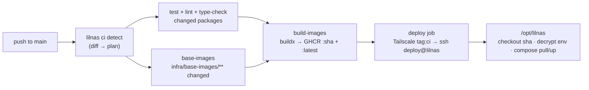

# Deploying lilnas

Production runs from `/opt/lilnas` (owned by the `deploy` user) and is deployed
by pushing to `main`. `/home/jeremy/lilnas` is a dev checkout only. Images are
built on GitHub-hosted runners and published to `ghcr.io/codemonkey800/lilnas-<name>`;
production secrets are committed to git, encrypted with dotenvx.

## How a push deploys



`.github/workflows/ci.yml` runs on every PR and on pushes to `main`. The
`detect` job runs `pnpm lilnas ci detect --json --base <before> --head <sha>`
and turns the diff into a plan: which packages to test, which images to build,
which services to `pull` / `up` / `--force-recreate`, and whether to re-decrypt
env files. PRs stop after tests. On `main`, images are built and pushed, then
the `deploy` job joins the tailnet and runs the forced command
`deploy <sha> [--decrypt] [--pull a,b] [--up c,d] [--force-recreate e,f]` on
the host. The `summary` job is the single required status check.

What a change does (rules are unioned; a service whose image is rebuilt is
pulled and dropped from the other lists):

| Change                                                                               | Action                                                                                                                                     |
| ------------------------------------------------------------------------------------ | ------------------------------------------------------------------------------------------------------------------------------------------ |
| `apps/<x>/**` (source, Dockerfile, `deploy.yml`, `.env.prod`)                        | Rebuild `lilnas-<x>`; `compose pull` + `up -d` its services                                                                                |
| `packages/<p>/**` that an app lists in `dependencies`                                | Rebuild every app whose workspace `dependencies` graph reaches `<p>` (transitive). `devDependencies` such as `@lilnas/cli` rebuild nothing |
| `pnpm-lock.yaml`, root `package.json`, `pnpm-workspace.yaml`, `.npmrc`, `turbo.json` | Rebuild every image                                                                                                                        |
| `apps/<x>/deploy.yml`, `infra/<name>.yml`                                            | `up -d` every service that compose file defines (compose recreates only what actually changed)                                             |
| Bind-mounted `infra/<name>/**` (config files mounted into a container)               | `up -d --force-recreate` the services that mount the path                                                                                  |
| Encrypted env file (`apps/<x>/.env.prod`, `infra/.env*`)                             | Re-decrypt on the host, then `up -d` every service that loads it                                                                           |
| `infra/base-images/**` (except `lilnas-dev.Dockerfile`)                              | Rebuild and push the four base images, then every app image `FROM` one                                                                     |
| `.github/workflows/**` or root `docker-compose.yml`                                  | Full: every image, every service, decrypt all                                                                                              |
| `apps/tdr-code/**`                                                                   | Tests only. tdr-code is host-native; it is never built or deployed by CI                                                                   |
| Upstream `:latest` image (immich, traefik, …)                                        | Nothing. `up -d` does not re-pull a tag that is already present; bump the tag in `infra/<name>.yml` to upgrade                             |

Preview the plan for any range locally:

```bash
pnpm lilnas ci detect --base main --head HEAD
pnpm lilnas ci detect --base <sha> --head <sha> --json
```

## Manual deploys

Deploy everything from GitHub (what a push would do, but for every service):

```bash
gh workflow run ci.yml -f dry_run=false -f full=true
gh run watch
```

Dispatch inputs: `dry_run` (default **true** — the host prints the compose
commands instead of running them), `full`, `build_base_images`. A dispatch
diffs against `HEAD~1` of the chosen ref unless `full=true`.

Run the same thing on the host without GitHub (Jeremy, with sudo). The
entrypoint reads its arguments from `SSH_ORIGINAL_COMMAND`, exactly as sshd
would pass them:

```bash
# Dry run first
sudo -u deploy env SSH_ORIGINAL_COMMAND="deploy $(git rev-parse HEAD) --dry-run --full" \
  /home/deploy/bin/lilnas-deploy-entry

# Real: one service, or everything
sudo -u deploy env SSH_ORIGINAL_COMMAND="deploy <sha> --pull download" \
  /home/deploy/bin/lilnas-deploy-entry
sudo -u deploy env SSH_ORIGINAL_COMMAND="deploy <sha> --full" \
  /home/deploy/bin/lilnas-deploy-entry
```

`<sha>` must be a 40-hex commit reachable from some `origin/*` ref (the
entrypoint fetches first). `--pull` is for services whose image CI already
pushed, `--up` recreates from the current compose config, `--force-recreate`
also restarts unchanged containers, `--decrypt` re-decrypts env files. The
entrypoint takes `/opt/lilnas/.deploy.lock`, so a manual run waits for an
in-flight CI deploy.

Emergency, bypassing CI entirely: build and run from the dev tree. This ships
the working tree (uncommitted changes included) and leaves the service on a
local image until the next CI deploy pulls `:latest` again:

```bash
cd /home/jeremy/lilnas
pnpm lilnas secrets decrypt          # compose reads *.decrypted
docker compose up -d --build <svc>
```

Rollback a service to an earlier image (CI tags every image `:<sha>`):

```bash
cd /opt/lilnas
sudo -u deploy env LILNAS_TAG=<sha> docker compose up -d <svc>
```

The next CI deploy of that service puts it back on `:latest`. For a lasting
rollback, revert the commit on `main`.

## Secrets

The 15 env files compose loads in production are committed, encrypted with
[dotenvx](https://dotenvx.com) 2.38.0 (a root devDependency). Each value is
`KEY=encrypted:…`, plus a `DOTENV_PUBLIC_KEY*` line that lets anyone add or
change a value without the private key. Compose never reads these files
directly: it reads a gitignored `<file>.decrypted` sibling that
`lilnas secrets decrypt` (dev) or `scripts/deploy/decrypt-env.sh` (host)
writes with mode 0600, dotenvx's header comment and the `DOTENV_PUBLIC_KEY`
line stripped, so the container env is identical to the old plaintext files.

Discovery rule (`listEncryptedEnvFiles` in `packages/cli/src/utils/secrets.ts`
and `decrypt-env.sh --list`): tracked files matching `apps/*/.env.prod`,
`infra/.env`, `infra/.env.*`, excluding `*.example` and `*.decrypted`. Today:
`apps/{auth,download,equations,me-token-tracker,tdr-bot,theater}/.env.prod`,
`infra/.env` (immich) and `infra/.env.{design,l4d2,nexus-code,palworld,storage,traefik,turbo,valheim}`.

### `.env.keys`

One file holds every private key. dotenvx names keys after the file suffix,
keeping hyphens as written:

| File                    | Private key                        |
| ----------------------- | ---------------------------------- |
| `apps/*/.env.prod`      | `DOTENV_PRIVATE_KEY_PROD` (shared) |
| `infra/.env`            | `DOTENV_PRIVATE_KEY`               |
| `infra/.env.nexus-code` | `DOTENV_PRIVATE_KEY_NEXUS-CODE`    |
| `infra/.env.<name>`     | `DOTENV_PRIVATE_KEY_<NAME>`        |

- Locations: `/home/jeremy/lilnas/.env.keys` (dev, 0600), `/opt/lilnas/.env.keys`
  (deploy user, 0600, copied by the installer), backup in
  `/storage/backups/lilnas-secrets/` (a different disk). `.env.keys` is
  gitignored at every depth; never commit it, never paste it into a chat or log.
- Blast radius: whoever holds this file can decrypt every production secret in
  the repo's history. Losing it means every value has to be re-entered and
  re-encrypted with fresh keys. Rotate a key by decrypting, deleting the
  `DOTENV_PUBLIC_KEY*` line, re-running `dotenvx encrypt`, and updating both
  copies plus the backup.

### Change a value

```bash
pnpm exec dotenvx set KEY value -fk .env.keys -f apps/download/.env.prod
pnpm lilnas secrets verify
git commit -m "chore(download): rotate KEY" -- apps/download/.env.prod
git push
```

Values with leading dashes: `pnpm exec dotenvx set KEY -fk .env.keys -f <file> -- "---value"`.
The push re-decrypts on the host and `up -d`s every service that loads the
file. Run `pnpm lilnas secrets decrypt` locally so your dev tree's
`.decrypted` copy matches.

### Add a new env file

1. Write the plaintext file at the path the discovery rule expects
   (`apps/<x>/.env.prod` or `infra/.env.<name>`). For an `.env.prod`, copy the
   `DOTENV_PUBLIC_KEY_PROD="…"` line from an existing `apps/*/.env.prod` first
   so dotenvx reuses the shared PROD key instead of minting a new one.
2. `pnpm exec dotenvx encrypt -fk .env.keys -f <file>` — the file is now
   encrypted in place; a new `DOTENV_PRIVATE_KEY_<NAME>` is appended to
   `.env.keys` if the file did not share an existing key.
3. Point compose at the decrypted sibling: `env_file: ./.env.prod.decrypted`
   (or `infra/.env.<name>.decrypted`), never at the encrypted file.
4. `pnpm lilnas secrets verify && pnpm lilnas secrets decrypt`, then validate:
   `docker compose -f docker-compose.yml config -q`.
5. Copy the new key to the host and the backup — the installer's copy step,
   idempotent: `sudo install -o deploy -g deploy -m 0600 /home/jeremy/lilnas/.env.keys /opt/lilnas/.env.keys`
   (or re-run `sudo scripts/deploy/install-host.sh`, which does the same and
   nothing else when the rest is in place), and refresh
   `/storage/backups/lilnas-secrets/`.
6. Commit the encrypted file and the compose change; push. The deploy
   decrypts before `compose config`, so a missing key fails the deploy before
   anything restarts.

### Commands

| Command                                       | Does                                                                                                        |
| --------------------------------------------- | ----------------------------------------------------------------------------------------------------------- |
| `pnpm lilnas secrets decrypt`                 | Writes every `<file>.decrypted` from the committed files using `./.env.keys` (`--keys <path>`, `--dry-run`) |
| `pnpm lilnas secrets verify`                  | Exits 1 and names the keys if any committed env file holds a plaintext value (an empty value counts)        |
| `pnpm exec dotenvx ext precommit --install`   | Installs `.git/hooks/pre-commit`, refusing to commit a plaintext `.env*` anywhere in the repo               |
| `scripts/deploy/decrypt-env.sh [root] [keys]` | Host twin of `secrets decrypt`, run by the deploy script; `--list [root]` prints the discovered files       |

Install the pre-commit guard once per clone. Do **not** use `dotenvx protect`
(2.38.0 writes absolute machine paths into `~/.gitconfig`). Why the
`.decrypted` files exist at all: docker compose has no decrypt hook, dotenvx's
`run` wrapper would have to wrap compose itself, and keeping the plaintext in
a gitignored sibling means the committed file is never readable and a stale
sibling is regenerated by the next deploy.

## Dev checkout after this lands

`/home/jeremy/lilnas` still has plaintext `.env.prod` / `infra/.env*` files,
untracked, at paths `main` now tracks. `git pull` refuses to overwrite them, so
move each to its `.decrypted` name first — those are gitignored and are exactly
what compose now reads:

```bash
cd /home/jeremy/lilnas
for f in apps/*/.env.prod infra/.env infra/.env.*; do
  case "$f" in *.example | *.decrypted) continue ;; esac
  [ -f "$f" ] && mv "$f" "$f.decrypted"
done
git pull
pnpm install
pnpm exec dotenvx ext precommit --install
pnpm lilnas secrets decrypt        # regenerates every .decrypted from git
docker compose -f docker-compose.yml config -q
```

`apps/tdr-bot/deploy.dev.yml` also loads `.env.prod.decrypted`, so the dev
tree needs the decrypted tdr-bot file even for `lilnas-dev`. Plain dev files
(`apps/*/.env`, `.env.dev-remote`, `apps/tdr-code/.env`) are untouched.

## Host setup reference

`scripts/deploy/install-host.sh`, run once as root from a checkout
(`sudo scripts/deploy/install-host.sh`; it copies the entrypoint from its own
directory), is idempotent and:

- creates the system user `deploy` (home `/home/deploy`, bash, `docker` group);
- clones the repo to `/opt/lilnas` owned by `deploy` (left alone if present);
- installs `/opt/lilnas/.env.keys` from `/home/jeremy/lilnas/.env.keys`
  (`deploy:deploy`, 0600) — this is the "copy step" to re-run after adding a key;
- installs `/home/deploy/bin/lilnas-deploy-entry` (from
  `scripts/deploy/lilnas-deploy-entry.sh`) outside the repo, so a bad commit
  can never change what CI is allowed to run;
- generates `/home/deploy/.ssh/ci-deploy-key` and writes `authorized_keys`
  with `command="/home/deploy/bin/lilnas-deploy-entry",restrict`;
- appends `deploy` to `AllowUsers` in `/etc/ssh/sshd_config.d/10-hardening.conf`
  and reloads sshd (warns and skips if there is no `AllowUsers` line).

It ends by printing the follow-ups: store the private key with
`sudo cat /home/deploy/.ssh/ci-deploy-key | gh secret set DEPLOY_SSH_KEY -R codemonkey800/lilnas`,
then `sudo shred -u` the host copy.

The entrypoint accepts only `deploy <40-hex-sha> [--dry-run] [--full] [--decrypt] [--pull a,b] [--up c,d] [--force-recreate e,f]`
or `deploy --help`; anything else exits 2. It fetches, checks the sha is on an
`origin/*` ref, checks it out detached, and runs a temp copy of
`scripts/deploy/lilnas-deploy.sh`, which decrypts (when asked, under `--full`,
or when any `.decrypted` sibling is missing), runs `docker compose config -q`,
then pulls / ups / force-recreates, prunes dangling images and prints
`docker compose ps`. Both log to syslog under `lilnas-deploy-entry` /
`lilnas-deploy`.

Tailscale (admin console):

- `tagOwners`: `"tag:ci": ["autogroup:admin"]`.
- ACL: `{ "action": "accept", "src": ["tag:ci"], "dst": ["100.110.234.82:22"] }`
  (this node is `lilnas` / `lilnas.tail77e8b0.ts.net` / `100.110.234.82`).
- OAuth client with scope `auth_keys` (write) and tag `tag:ci`; the workflow
  uses `tailscale/github-action@v4` to join as an ephemeral node, then plain
  OpenSSH to `deploy@lilnas.tail77e8b0.ts.net` with the pinned host key in
  `scripts/deploy/known_hosts`.

GitHub (`codemonkey800/lilnas`):

- Secrets: `TS_OAUTH_CLIENT_ID`, `TS_OAUTH_SECRET`, `DEPLOY_SSH_KEY`
  (`gh secret set <NAME>`).
- A `production` environment (the deploy job runs under it; protection rules
  are optional — a required reviewer gates every deploy, including no-ops).
- Branch protection on `main`: required check `summary`.
- GHCR packages are created **private** on first push and the host pulls
  unauthenticated, so flip each `lilnas-*` package to public in the GitHub UI
  (profile → Packages); there is no API for it. Confirm with
  `docker pull ghcr.io/codemonkey800/lilnas-auth:latest` after `docker logout ghcr.io`.

## Base images

CI publishes `ghcr.io/codemonkey800/lilnas-{node-base,monorepo-builder,node-runtime,nextjs-runtime}`
(`:latest` and `:<sha>`) whenever `infra/base-images/**` changes, or on a
dispatch with `build_base_images=true`; app images are built with `pull: true`
so a freshly pushed base is picked up in the same run. `lilnas-dev` is never
pushed.

Manual bootstrap or local rebuild:

```bash
./infra/base-images/build-base-images.sh              # local tags only (incl. lilnas-dev)
docker login ghcr.io
./infra/base-images/build-base-images.sh --push        # also push the four GHCR images
./infra/base-images/build-base-images.sh --push --tag "$(git rev-parse HEAD)"
```

Every app Dockerfile is `FROM ghcr.io/codemonkey800/lilnas-<x>:latest`, so a
local `docker build` pulls from GHCR unless the script has been run once
locally (it also creates the GHCR-named tags without pushing).
