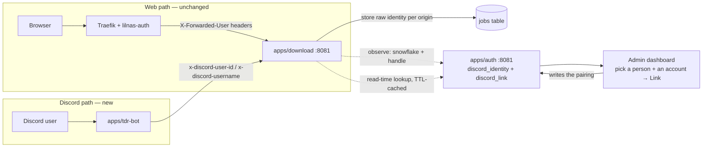
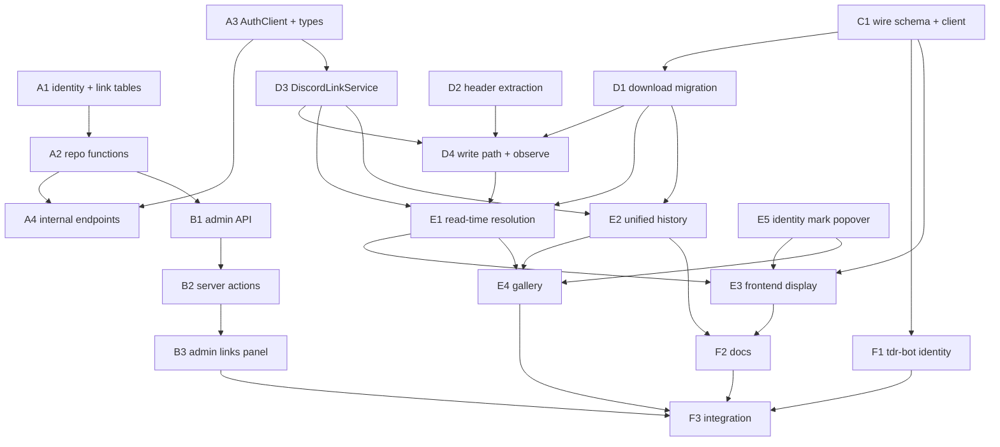

# Discord-triggered downloads are anonymous — give jobs dual attribution and let admins link accounts

> **Overview — written for a human.** Everything below this section is written for the
> executing agents; this part is the map.

Today a download job knows who asked for it only when the request came through the
browser: Traefik's forward-auth stamps `X-Forwarded-User` / `X-Forwarded-User-Id`, and
`apps/download` records them as `requester`. Jobs created by `apps/tdr-bot` (the
Discord `/download` command) arrive with no headers at all and persist as
`requester: null` / `origin: 'service'` — anonymous, forever.

This plan makes attribution **dual**:

- **tdr-bot sends the Discord identity it already has** (`interaction.user.id` +
  `interaction.user.username`) on two new headers, via a `withDiscordIdentity()`
  sibling to the existing `withForwardedIdentity()`.
- **`apps/download` stores it raw** on the job (`discord_user_id`,
  `discord_username`, `origin: 'discord'`) — never resolved at write time.
- **`apps/auth` owns the link** — a `discord_link` join table (lilnas user ↔ Discord
  snowflake, one-to-one, storing **no name at all**) plus a `discord_identity` roster
  it fills by observation, an admin UI that links by **picking one row from each of
  two lists**, and an internal, Docker-network-only lookup endpoint mirroring
  `/admin/check`.
- **`apps/download` resolves the link at read time** (TTL-cached, mirroring
  `AdminCheckService`). A linked Discord job displays as the same person as their web
  jobs — **including every past job**, because resolution happens on display, not on
  write. History and profile views unify: one person's downloads show up together
  regardless of surface — and the link reads **both ways**, so a linked person's web
  jobs show their Discord handle too.



**Shape:** one doc, **20 tasks in groups A–F**, seven waves. Work lands on
`jeremy/download` in this worktree, matching plans 001–016 — no separate branch, no
rollout section (see [How to work this plan](#how-to-work-this-plan)).

**Key decisions** (full rationale in [Design decisions](#design-decisions)):

- **Resolution lives in `apps/download`, at read time, not in tdr-bot at write
  time.** Retroactive unification requires it. [Why](#resolution-happens-in-download-at-read-time)
- **Storage stays mutually exclusive** — a row is `web` XOR `discord` XOR `service`;
  "one person, both surfaces" is a read-time projection, not a wider row.
  [Why](#storage-stays-mutually-exclusive)
- **The link is admin-made, not OAuth.** `apps/auth` keeps Google as its only
  provider. [Why](#the-link-is-admin-made-not-oauth)
- **Nobody ever types a Discord handle or snowflake.** Both sides of the picker are
  observed — people on first web sign-in, Discord accounts on first `/download` — so
  the link keys on the immutable snowflake and a rename is a non-event.
  [Why](#both-sides-of-the-link-are-observed-never-typed)
- **The internal endpoint mirrors `/admin/check`** — query-param lookup, no guard,
  Docker-network topology as the trust boundary; the caller caches with the
  `AdminCheckService` pattern, failing open to "unlinked".
  [Why](#internal-lookup-mirrors-admincheck)
- **Masking still works:** `hiddenAttribution` hides the Discord identity exactly as
  it hides the lilnas one, through the same `projectJobForViewer` choke point.
  [Why](#masking-covers-both-identities)
- **The Discord mark is a click/tap disclosure, not a hover tooltip** — it opens a
  small popover carrying the raw snowflake _and_ the current handle, reusing
  `FilterPanel`'s non-modal popover so it behaves the same on a phone as on a desktop.
  [Why](#the-discord-mark-is-a-disclosure-not-a-tooltip)

**Read next:** [Decisions confirmed](#decisions-confirmed) ·
[Design decisions](#design-decisions) · [Shared Context Pack](#shared-context-pack) ·
[Task List](#task-list) · [Sequencing](#sequencing) · [Final report](#final-report)

---

## Decisions confirmed

✅ **HC1 is cleared (2026-09-19).** Both questions this plan deliberately left open have
been answered by the human. Wave 1 may start.

| Question                                                                              | Answer                                                                                                                                                                  |
| ------------------------------------------------------------------------------------- | ----------------------------------------------------------------------------------------------------------------------------------------------------------------------- |
| Where does Discord→lilnas resolution happen?                                          | **In `apps/download`, at read time** — as recommended. [Why](#resolution-happens-in-download-at-read-time)                                                              |
| Is reverse display (a linked person's Discord handle on their **web** jobs) in scope? | **Yes — in scope for v1.** ⚠️ This **overrides** the plan's original "defer it" recommendation. [What it costs](#reverse-display-a-linked-person-shows-both-identities) |

> **Also settled earlier (2026-09-19):** how an admin picks the pair. The first draft
> had the admin **type** a snowflake and a username into the Edit Access modal. That
> was rejected — a typed handle rots when someone renames themselves, and a typo
> produces a link that matches nothing. Replaced with two observed lists and a
> pick-one-from-each picker; the link row now stores no name at all. See
> [Both sides of the link are observed, never typed](#both-sides-of-the-link-are-observed-never-typed),
> which also records why the full Discord server roster was declined as the source.

Two scope cuts remain in force and were **not** overridden — the leaderboard/facets
aggregates and pre-linking an unseen account. See [Scope cuts](#scope-cuts-in-v1).

---

## How to work this plan

**All work lands on `jeremy/download`**, in the existing worktree at
`/home/jeremy/.nexus-code/worktrees/lilnas/jeremy-download`. This matches every prior
plan in this directory.

> ⚠️ **Never switch this branch.** The production download container's `/data` volume
> is wired to a checkout of `jeremy/download`; moving it off is a known way to take
> the live service down at boot with `SQLITE_CANTOPEN`.

**Before task 1:** commit this plan doc by itself —
`docs(download): add the plan for discord attribution and account linking` (precedent:
plan 016's own commit).

**Per task:**

1. Work tasks in wave order (see [Sequencing](#sequencing)). Never start a task before
   its dependencies are green.
2. Implement → write or update tests → run **from the package the task touches**
   (some tasks touch two — run in both):
   - `pnpm test`
   - `pnpm lint`
   - `pnpm type-check`
3. **`/commit`** — one task, one commit. Pass an explicit scope naming the files this
   task touched. Commit scopes: `feat(auth)`, `feat(download)`, `feat(tdr-bot)`,
   `feat(utils)` per the dominant package; conventional, lowercase, imperative.
4. Check the box below and append the commit hash.

**Markers:**

| Marker              | Means                                                          |
| ------------------- | -------------------------------------------------------------- |
| `- [ ]`             | Not started                                                    |
| `- [x]` … `abc1234` | Done, with the commit that did it                              |
| ⚠️ **PARTIAL**      | Landed with scope narrowed — say what was left and why, inline |
| ⏭️ **DROPPED**      | Not doing it — say why. Never delete a task                    |
| 🚧 / ⏳             | Blocked. Do not implement                                      |

**When reality disagrees with this plan,** add a short **Findings** note under the
task, then update the downstream tasks that finding invalidates.

---

## Instructions for the orchestrator agent

**Do**

- Delegate every task to a sub-agent — implementation, tests and the commit included.
  One sub-agent per task.
- Write **self-contained** delegation prompts: the task's full text, the relevant parts
  of the [Shared Context Pack](#shared-context-pack), and the
  [Definition of Done](#definition-of-done). When a task depends on an earlier one,
  paste that sub-agent's **reported** exported names and signatures into the prompt.
- Respect the wave order. ⚠️ **E1 and E2 both edit `download.controller.ts` and the
  read path** — they must not run concurrently. ⚠️ **E4 edits `jobs.repo.ts` after E2
  does** — same rule.
- ✅ [HC1 is already cleared](#decisions-confirmed) — do not re-ask it. Resolution
  stays in `apps/download` at read time and reverse display is **in scope**. Wave 1 is
  unblocked.

**Don't**

- ❌ Read or edit source, tests or config yourself. The only file you may edit is _this
  plan_, to check off tasks and record outcomes.
- ❌ Let sub-agents read this plan.
- ❌ Perform [HC2–HC4](#human-checkpoints) — production backup, deploy, and live
  verification are human checkpoints.
- ❌ `git checkout`, `git switch`, rebase, or push.

⚠️ **Other sessions commit on this branch.** Every task's commit must stage **only its
own paths** and use a pathspec-limited `git commit -- <paths>`. If a `/commit`
preflight instructs a `git reset`, **refuse it** — it would destroy another session's
work. Take the repo mutex first:

```bash
until mkdir /tmp/lilnas-download-commit.lock 2>/dev/null; do sleep 5; done
# ... stage only your own paths, commit, verify with: git show --stat HEAD
rmdir /tmp/lilnas-download-commit.lock   # release even on failure or abort
```

---

## Design decisions

### Resolution happens in download, at read time

**Chosen:** jobs store the raw Discord identity; `apps/download` resolves
Discord → lilnas through auth's internal endpoint **when serving reads**, with a
60s-TTL cache. **Ruled out:** (a) tdr-bot resolving before calling download — can't be
retroactive, and every future Discord surface would re-implement it; (b) a one-time
backfill that rewrites old rows on link — destroys provenance, breaks on unlink, and
races with in-flight jobs. Read-time resolution makes link/unlink instantly and
symmetrically visible across all history with zero data migration.

### Storage stays mutually exclusive

**Chosen:** `origin` grows a third value — `JOB_ORIGINS = ['service', 'web',
'discord']` — and the `jobs_origin_matches_requester` CHECK is rewritten so exactly
one identity column-pair is populated per row (`web` ⇒ requester pair, `discord` ⇒
discord pair, `service` ⇒ neither). "A job may have one or both" identities is
satisfied at read time: a linked Discord job is _served_ with both `discordRequester`
(stored) and `requester` (resolved). **Ruled out:** allowing both pairs on one row —
nothing writes both today (a request carrying both header sets is a caller bug; the
forwarded pair wins, warn-logged), and a wider CHECK would let the pairs drift.

### The link is admin-made, not OAuth

`apps/auth`'s Better Auth config is Google-only and its own comments call out "no
second linkable provider" (`apps/auth/src/auth/auth.ts:36-41`). The feature explicitly
asks for admin-managed linking. So `discord_link` is a plain table written through the
admin API — no Better Auth `account` rows, no Discord OAuth app, no self-serve flow.
`apps/tdr-code`'s `git_identity` table is the borrowed shape precedent (snowflake as
`text`), but nothing is shared with it.

### Both sides of the link are observed, never typed

**Chosen:** an admin links by **picking one row from each of two lists**, and the link
row stores nothing but the pairing — `user.id` ↔ snowflake. Each side of the roster
fills itself in:

| Side            | Becomes linkable when                                                                              | Already exists?     |
| --------------- | -------------------------------------------------------------------------------------------------- | ------------------- |
| lilnas person   | they sign into the web app for the first time (Better Auth writes the `user` row)                  | ✅ yes, free        |
| Discord account | they run `/download` for the first time, which observes the snowflake into `discord_identity` (D4) | ➕ new in this plan |

**Ruled out: a text input for the snowflake or the handle.** A typed handle is a
snapshot that silently rots — Discord usernames are changeable, so a name captured at
link time stops matching the person it names, and a typo produces a link that silently
matches nothing. Keying purely on the immutable snowflake means a rename is a
non-event: the same `discord_identity` row updates its `username` the next time that
person runs a command (A2's `upsertIdentity`), and every existing link keeps working
untouched. It also removes the "which snowflake is this?" copy-paste chore entirely.

**Consequences, accepted:** a Discord account cannot be linked before its owner's
first `/download`, and the accounts list is empty on day one. That is survivable
precisely because [resolution is retroactive](#resolution-happens-in-download-at-read-time)
— the person downloads, appears in the list, gets linked, and the job they _already_
made displays as them. The list therefore reads as a work queue of exactly the people
who need attention, rather than a directory to search.

**Ruled out: syncing the full Discord server roster from tdr-bot.** It is genuinely
cheap — tdr-bot already runs an internal-only NestJS server on `8081` with no Traefik
router (`apps/tdr-bot/deploy.yml:40-46`), already enables the privileged `GuildMembers`
intent (`apps/tdr-bot/src/app.module.ts:92`), and `ApiController`'s existing
`@Get('channels')` (`apps/tdr-bot/src/api/api.controller.ts:125-145`) is the exact
shape a `@Get('members')` would copy. It was still declined for v1: it fills the
picker with every server member who will never use the service, turning a short work
queue into a directory, and tdr-bot's port 8081 has **no** authentication of any kind
today (no guard anywhere in `apps/tdr-bot/src`; the declared `API_TOKEN` env key at
`apps/tdr-bot/src/env.ts:2` is never read) while its Next.js config blanket-rewrites
`/api/*` to 8081, so a member-roster route would also be reachable through
`tdr.lilnas.io`. If pre-linking is wanted later, this is the insertion point and the
two caveats to settle first.

### Internal lookup mirrors /admin/check

**Chosen:** `GET /internal/discord-link?discordUserId=…` (also `?userId=…` /
`?email=…` — exactly one param) on auth's NestJS app (port 8081), a separate
guard-less controller registered flat in `app.module.ts`, **no ThrottlerGuard** — the
same reachability model as `AdminCheckController`
(`apps/auth/src/admin/admin-check.controller.ts:18-32`): no Traefik router points at
8081, no host port is published, the Docker network is the trust boundary. Query
params rather than the sketched path param because the endpoint needs three lookup
directions and `/admin/check?email=` is the house style.

The response is a **two-part envelope** — `{ identity, user }`, each independently
nullable — rather than a single `link` field, because download needs both halves and
should not pay for two round trips: `user` carries the resolved lilnas identity when
linked, while `identity` carries the current Discord handle, which is what an
_unlinked_ Discord job renders. Keeping "unknown" a 200 also means an old auth deploy
(a 404) stays distinguishable from a genuine "not linked", so the caller can fail
open.

The same controller carries one **write** route, `POST /internal/discord-identity`,
which is how the roster fills ([above](#both-sides-of-the-link-are-observed-never-typed)).
It sits on the same trust boundary; its blast radius is a wrong display name on an
unlinked account, since it cannot create, move, or delete a link.

Consumer side: `AuthClient` gains the two methods, and download wraps them in a
`DiscordLinkService` cloning `AdminCheckService`'s cache (60s TTL, 10s failure TTL,
500-entry cap, fail-open — a lookup failure degrades to "unlinked", a registration
failure is swallowed entirely).

### Precedence and the dev fallback

If a request somehow carries both the forwarded pair and the Discord pair, the
forwarded identity wins and the Discord pair is dropped with a warn log. Separately:
`resolveForwardedUser`'s dev-only `DEV_USER_EMAIL` fallback must **not** fire when
Discord headers are present — otherwise every tdr-bot job in dev would be
mis-attributed to the dev web user. The fallback check gains a "no
`x-discord-user-id` header" condition (D2).

### Masking covers both identities

`hiddenAttribution` on a video job currently masks `requester` via
`projectJobForViewer` (`apps/download/src/download/attribution.ts:46-51`) — the single
read-path transform for REST and WS. It now nulls `discordRequester` too under the
same `showTrueAttribution` rule. No new rule, one more field through the same gate.

### The Discord mark is a disclosure, not a tooltip

An unlinked Discord requester renders as a handle plus a small Discord glyph. The
glyph says _which service_ this came from, but the two facts an admin actually needs
in order to do anything about it — the **raw snowflake** and the **current handle** —
have to be reachable from that mark, because the snowflake is what gets pasted into
`apps/auth`'s picker to link the account.

**Chosen:** the mark is a real `<button>` that toggles a small **non-modal popover**,
reusing `FilterPanel`'s popover mode (`apps/download/src/components/ui/filters.tsx`).
**Ruled out: `title=""` and every other hover-only affordance.** A native tooltip is
invisible until hovered, announces inconsistently across screen readers, and is simply
**unreachable on a touch device** — which is most of this app's real usage. An
affordance that silently doesn't exist on a phone is not an affordance.

Click/tap is therefore the **baseline**, not the fallback: one mechanism that behaves
identically at both breakpoints, rather than a hover path plus a bolted-on mobile
special case. Hover-to-open may be layered on top as a pointer-only nicety.

`FilterPanel` is the right precedent and not merely a convenient one: it is already
`role="dialog"`, non-modal, opened by an `aria-haspopup`/`aria-expanded` trigger,
dismissed on Escape (returning focus to the trigger), on an outside press (leaving
focus where the pointer put it), and on a tab-out — with focus moved to the panel
rather than its first control, and **deliberately not trapped**. All of that is
already covered by ten tests in `filters.spec.tsx`. `menu.tsx` is the wrong
precedent despite being the other popover in the repo: it is a `role="listbox"` for
_choosing_ an option, not for disclosing a fact.

> ⚠️ **Masking outranks disclosure.** When `showTrueAttribution` says to mask, the
> mark is not rendered at all — no trigger, no popover, no snowflake in the DOM. The
> disclosure is a view onto an identity the viewer is already allowed to see, never a
> way around [the masking gate](#masking-covers-both-identities).

Prototyped in `docs/features/download/designs/discord-attribution.html` (and its Pug
source `designs/src/pages/discord-attribution.pug`) across commits `7f0f170`,
`034044e`, `dfbde0b` — which is where the hover-only dead end was found and
discarded. Read the mockup before implementing E3/E5; the visual weight of the mark
is settled there.

### Reverse display: a linked person shows both identities

**Confirmed in scope for v1** ([HC1](#decisions-confirmed)), overriding this plan's
original recommendation to defer it. Once an admin links an account, that person's
**web** jobs show their Discord handle too — not just their Discord jobs showing their
email. Linking becomes visibly symmetric.

**Chosen: a separate `linkedDiscord` wire field**, not a reuse of `discordRequester`.
The two mean genuinely different things and conflating them destroys information:

| Field              | Means                                                       | Populated for                      |
| ------------------ | ----------------------------------------------------------- | ---------------------------------- |
| `discordRequester` | this job was **submitted from** this Discord account        | `origin: 'discord'` rows           |
| `linkedDiscord`    | the account **linked to** `requester`, whoever submitted it | any job whose requester has a link |

Overloading `discordRequester` would make a web job indistinguishable from a
Discord-submitted one at the type level, and E3's "unlinked, sent via Discord" branch
keys off exactly that distinction. `origin` would still carry the truth, but every
consumer would have to remember to consult it — a latent bug rather than a type.

`JobRequesterSchema` is deliberately **not** widened to nest the handle inside
`requester`, tempting as `job.requester.discord` reads: that schema is shared by
`GalleryItem.lastRequester`, `AuditLogEntry.actor` and `topRequesters`, so widening it
ripples into three surfaces this plan is not otherwise touching.

**The cost, stated plainly:** E1 now resolves in **both** directions, so a page of
web-origin jobs — the common case — triggers a lookup per distinct requester where
before it triggered none. Mitigations, all already in the design: distinct userIds are
deduped per batch, `DiscordLinkService` caches for 60s, and **a negative result ("this
person has no link") is cached for the full TTL just like a positive one** — which is
what keeps the common case cheap, since most users will never have a link. Auth being
slow or down degrades to "no handle shown", never an error.

### Scope cuts in v1

- **Leaderboard / gallery facets / `topRequesters`** keep grouping by
  `requesterEmail`. Discord-only (unlinked) jobs have no email and stay out of those
  aggregates; folding linked ones in means resolving inside SQL aggregation — deferred.
- **Gallery & recent-card attribution** (E4) resolves linked identities but renders
  unlinked Discord requesters as today's null treatment — and the whole task is
  droppable without breaking anything else.
- **Pre-linking someone who has never run `/download`** is not possible in v1, because
  the accounts list is built purely by observation. The tdr-bot roster sync that would
  enable it is specced-but-declined in
  [the observation decision](#both-sides-of-the-link-are-observed-never-typed) —
  including the two caveats (no auth on tdr-bot's `8081`, and its blanket `/api/*`
  rewrite) that must be settled before adding it.

---

## Shared Context Pack

> Pointers to **verify against current code** — the code is the truth, this pack is a
> map. Paste relevant parts into every delegation prompt.

### Repo & conventions

- pnpm monorepo, Turbo. Per-package commands: `pnpm test`, `pnpm lint`,
  `pnpm type-check` — run from the package dir (`apps/auth`, `apps/download`,
  `apps/tdr-bot`, `packages/utils`).
- Commits: conventional, scoped — `feat(download): …`, `test(auth): …`.
- **Prettier + eslint must pass on every written file.**
- Frontend classnames: `cns()` from `@lilnas/utils/cns` for **conditional** classes;
  static strings stay literal. Both apps use Tailwind v4.
- `packages/utils` has **no barrels** — deep imports (`@lilnas/utils/download/client`).
  Cross-dir imports _inside_ the package that land in emitted `.d.ts` must be relative
  (see the eslint-disable at `packages/utils/src/download/client.ts:1-7`).
- zod (v4) everywhere; **no class-validator, no global ValidationPipe** in auth (bodies
  are `@Body() body: unknown` + `parseBody(schema, body)`); download uses
  `createZodDto` (`nestjs-zod`) DTOs.
- Drizzle + better-sqlite3 in both auth and download. Migrations:
  `pnpm db:generate` (drizzle-kit) in the app dir; **applied automatically at boot**
  (`apps/auth/src/db/database.module.ts:49-55`,
  `apps/download/src/db/migrate.ts:98-106`). Next migration is `0002_*` in both apps.
- Schema conventions: camelCase TS props, explicit snake*case column names,
  `integer('…_at', { mode: 'timestamp_ms' })`, index names `<table>*<cols>_idx`/`\_unique_idx`, checks `<table>_<thing>\_check`, array-form second arg, heavy rationale
  comments on every table/column.

### The code this plan touches

| File                                                                                                                | Meaning                                                                                                                                                                                                                                                                                                                                                                                                          |
| ------------------------------------------------------------------------------------------------------------------- | ---------------------------------------------------------------------------------------------------------------------------------------------------------------------------------------------------------------------------------------------------------------------------------------------------------------------------------------------------------------------------------------------------------------- |
| `apps/auth/src/db/schema.ts`                                                                                        | auth tables; `user` at `:36` (`id`, `name`, `email` unique, …). Surrogate-PK precedent: `grant` `:165` uses bare `integer().primaryKey()`                                                                                                                                                                                                                                                                        |
| `apps/auth/src/db/__tests__/schema.spec.ts:36-45`                                                                   | hardcoded expected-table list — **breaks when a table is added** until updated                                                                                                                                                                                                                                                                                                                                   |
| `apps/auth/src/grants/grants.repo.ts`                                                                               | repo-layer style: plain exported functions taking `Executor` (`Pick<Db, 'select'\|'insert'\|'update'\|'delete'>`, `:18`), sync `.get()/.all()/.run()`                                                                                                                                                                                                                                                            |
| `apps/auth/src/admin/admin-check.controller.ts`                                                                     | **the internal-endpoint pattern to clone**: separate guard-less class, `@Controller('admin')`, no throttler, registered flat                                                                                                                                                                                                                                                                                     |
| `apps/auth/src/app.module.ts:109`                                                                                   | flat `controllers:` array — register new controllers here (no feature modules in auth)                                                                                                                                                                                                                                                                                                                           |
| `apps/auth/src/admin/admin.controller.ts`                                                                           | `@UseGuards(AdminGuard, ThrottlerGuard)` `@Controller('admin')`; `AdminUserEntry` `:51-70`; `parseBody` `:260-268`; POST-verb mutations (`/:userId/block`, `/remove`)                                                                                                                                                                                                                                            |
| `apps/auth/src/admin/admin.dto.ts`                                                                                  | zod body schemas + `z.infer` types                                                                                                                                                                                                                                                                                                                                                                               |
| `apps/auth/src/admin/users.service.ts`                                                                              | house rules: `db.transaction(tx => …, { behavior: 'immediate' })`, reads-before-writes inside `tx`, repo functions only, cache invalidation after commit, `notifyBus.publishAdminChange()` last and only on genuine change, zero-row update ⇒ `NotFoundException`                                                                                                                                                |
| `apps/auth/src/app/admin/page.tsx` → `require-admin.ts` → `admin-dashboard-client.tsx` → `actions.ts`               | admin UI data flow: RSC fetch to `http://localhost:8081` (cookie forwarded) → client component → server actions. `require-admin.ts` re-exports Nest types via `import type` aliases                                                                                                                                                                                                                              |
| `apps/auth/src/app/admin/actions.ts:29-53`                                                                          | **Server Actions are public endpoints** — every path-interpolated value must be narrowed (`requireUserId` rejects non-string / empty / `/`)                                                                                                                                                                                                                                                                      |
| `apps/auth/src/app/admin/{add-person,edit-access}-modal.tsx`                                                        | modal template: `modal-overlay is-open` pattern, `key`-based remount reset (load-bearing, documented at `add-person-modal.tsx:24-35`), `startTransition`/`isPending`/`showToast` passed down from the dashboard                                                                                                                                                                                                  |
| `apps/auth/src/app/styles/design-tokens.css`                                                                        | semantic classes: `.modal`, `.field`, `.field-error`, `.btn btn-primary/outline/ghost`, `.chip chip-neutral`, `.row`, `.stack`                                                                                                                                                                                                                                                                                   |
| `apps/auth/src/app/components/service-check-grid.tsx`                                                               | the existing selectable-list component (`.service-check-grid` of `.checkbox-row` labels) — closest precedent for B3 two pick-one lists, which differ only in being single-select                                                                                                                                                                                                                                 |
| `apps/auth/src/app/lib/time-ago.ts`                                                                                 | `timeAgo()` for B3 last-seen line. ⚠️ render it with `suppressHydrationWarning`, as the dashboard already does                                                                                                                                                                                                                                                                                                   |
| `apps/tdr-bot/src/api/api.controller.ts`                                                                            | tdr-bot internal API on 8081 (no guards anywhere in the app). `@Get('channels')` `:125-145` is the roster-endpoint precedent referenced by the declined roster-sync option — reference only, this plan adds nothing here                                                                                                                                                                                         |
| `packages/utils/src/auth/client.ts`                                                                                 | `AuthClient`, `dockerInstance` → `http://auth:8081`, 2s `AbortSignal.timeout`, runtime-validates response bodies; `checkIsAdmin` is the method pattern                                                                                                                                                                                                                                                           |
| `packages/utils/src/auth/types.ts`                                                                                  | `ForwardedUser`, `AdminCheckResponse`, `WhoamiResponse` — new shared auth types go here                                                                                                                                                                                                                                                                                                                          |
| `packages/utils/src/download/client.ts`                                                                             | `DownloadClient`; `dockerInstance` getter `:114-116`; `withForwardedIdentity` `:146-151` (returns a **new** client, merges headers in `request()` `:162-185`); `createJob` → `POST /download/videos`                                                                                                                                                                                                             |
| `packages/utils/src/download/schema.ts` + `types.ts`                                                                | zod schemas + `z.infer` types; `JobRequesterSchema` `:65-68`; `DownloadJobSchema.requester` nullable `:239`; `GalleryItemSchema.lastRequester` `:250`; `AuditLogEntrySchema` `:689-698` (`actor` nullable, `origin: z.enum(['service','web'])`); fields are alphabetized — keep that                                                                                                                             |
| `apps/download/src/db/schema.ts`                                                                                    | `jobs` `:90-192`: `requesterEmail/requesterUserId` nullable `:107-108`, `origin` `:109`, `hiddenAttribution` `:110-112`, CHECK `jobs_origin_matches_requester` `:161-167`; `audit_log` `:340-402` (`actorEmail/actorUserId`, CHECK `:385-391`); `JOB_ORIGINS` `:66`. ⚠️ **must not value-import zod/utils schemas** — enum tuples are duplicated locally and pinned via `AssertSameUnion` (`typePin` `:80` etc.) |
| `apps/download/src/db/job-row.ts`                                                                                   | `buildJobRow` `:16-46` — **the only place `origin` is derived** (`:32-34`); `hydrateJobRow` `:56-75`                                                                                                                                                                                                                                                                                                             |
| `apps/download/src/db/jobs.repo.ts`                                                                                 | `buildJobWhere` + `JobListFilter` (`requesterEmail?` `:45`, case-insensitive match `:83-85`); `requesterDateRange` `:444-460`; distinct-requester facets `:322-343`                                                                                                                                                                                                                                              |
| `apps/download/src/auth/forwarded-user.ts`                                                                          | `getForwardedUser` `:43-52`, `resolveForwardedUser` `:68-90` (dev fallback), trust-model comment `:8-19`                                                                                                                                                                                                                                                                                                         |
| `apps/download/src/auth/optional-current-user.decorator.ts`                                                         | `@OptionalCurrentUser()` — the decorator pattern to clone for Discord                                                                                                                                                                                                                                                                                                                                            |
| `apps/download/src/auth/admin-check.service.ts`                                                                     | **the TTL-cache pattern to clone**: 60s TTL, 10s failure TTL, 500-entry cap, oldest-first eviction, fail-closed; `AuthClient.dockerInstance` as a plain field                                                                                                                                                                                                                                                    |
| `apps/download/src/auth/auth.module.ts:88-93`                                                                       | providers + exports for auth-shaped services (imported by DownloadModule and AdminModule)                                                                                                                                                                                                                                                                                                                        |
| `apps/download/src/download/download.controller.ts`                                                                 | `POST /videos` `:995`, `POST /movies` `:1238`, `POST /shows` `:1331` — all `@OptionalCurrentUser()`, thread `user` into services + `auditLogService.record({ actor: user, … })`, return `projectJobForViewer(job, isAdmin)`; `GET /history` self-vs-admin rule `:319-352`                                                                                                                                        |
| `apps/download/src/download/download.service.ts:222-259` / `src/media/media-download.service.ts:93,138,298-329`     | `requester?: JobRequester \| null` threading into job construction                                                                                                                                                                                                                                                                                                                                               |
| `apps/download/src/download/attribution.ts`                                                                         | `showTrueAttribution` / `projectJobForViewer` — the single read-path mask, REST + WS                                                                                                                                                                                                                                                                                                                             |
| `apps/download/src/download/download-state.service.ts:471-473` + `src/download-gateway/download.gateway.ts:75-94`   | WS broadcast path: `broadcastPerViewer` re-resolves admin per distinct viewer email                                                                                                                                                                                                                                                                                                                              |
| `apps/download/src/download/profile.service.ts:64-68`                                                               | profile filters by `requesterEmail: email`                                                                                                                                                                                                                                                                                                                                                                       |
| `apps/download/src/audit/audit-log.service.ts`                                                                      | `record(event)` `:119` (`actor: ForwardedUser \| undefined` `:72`), row→wire collapse `:88-90`                                                                                                                                                                                                                                                                                                                   |
| `apps/download/src/components/activity/activity-requester.tsx`                                                      | **the one spelling of the attribution display rule** — `canViewRequesterProfile`, `requesterProfileHref`, `MASKED_REQUESTER_LABEL = 'hidden'`; every surface imports it                                                                                                                                                                                                                                          |
| `apps/download/src/components/ui/filters.tsx`                                                                       | **the popover pattern E5 reuses** — `FiltersButton` (`aria-haspopup`/`aria-expanded` trigger) and `FilterPanel`'s popover mode: `role="dialog"`, non-modal, Escape returns focus to the trigger, outside-press and tab-out dismiss, focus moved to the panel not its first control, **not** trapped. Its doc comments state the model explicitly — read them, don't re-derive it                                 |
| `apps/download/src/components/ui/__tests__/filters.spec.tsx`                                                        | the ten `FilterPanel` popover cases (open/close from trigger, Escape + focus return, outside press, tab-out, stays open while working inside) — the shape E5's spec should imitate                                                                                                                                                                                                                               |
| `apps/download/src/components/ui/menu.tsx`                                                                          | the repo's _other_ popover. ⚠️ Wrong precedent for E5: `role="listbox"`/`role="option"` with roving focus, built for _choosing_ an option rather than disclosing a fact                                                                                                                                                                                                                                          |
| `docs/features/download/designs/discord-attribution.html` + `designs/src/pages/discord-attribution.pug`             | the built prototype of every state E3/E4/E5 render, including the settled visual weight of the mark. Commits `7f0f170` → `034044e` → `dfbde0b` are the hover-only dead end and its correction                                                                                                                                                                                                                    |
| `apps/download/src/components/admin/admin-actor.tsx`                                                                | ⚠️ `null` here means **service** (renders `AUDIT_SERVICE_LABEL` chip), the opposite of `ActivityRequester`'s `null` (= masked)                                                                                                                                                                                                                                                                                   |
| `apps/download/src/components/detail/detail-header.tsx:148,183-196`                                                 | detail-page requester display (email local-part)                                                                                                                                                                                                                                                                                                                                                                 |
| `apps/download/src/components/gallery/gallery-item-card.tsx:122-162`, `src/components/home/recent-card.tsx:119-174` | `lastRequester` displays                                                                                                                                                                                                                                                                                                                                                                                         |
| `apps/tdr-bot/src/commands/download-command.service.ts`                                                             | `private client = DownloadClient.dockerInstance` `:71`; `createJob` call `:106-109`; `interaction.user.id`/`.username` already in hand `:94,:120`                                                                                                                                                                                                                                                                |
| `apps/tdr-code/src/db/schema.ts:571-589`                                                                            | **reference only, not shared**: snowflake stored as `text`, `git_identity` vs `github_credential` (`:596-630`) shows snowflake-PK vs user-id-PK tradeoff                                                                                                                                                                                                                                                         |

### ⚠️ Gotchas

- **SQLite can't ALTER a CHECK** — changing `jobs_origin_matches_requester` makes
  drizzle-kit generate a **table-recreate** migration (new table, `INSERT INTO …
SELECT`, drop, rename). Inspect the generated SQL: every existing column must be
  copied, and the recreate must run with `foreign_keys` handled (the auth migrator
  re-asserts the pragma after `migrate()` — download's `migrate.ts` is the place to
  confirm the same holds). Test against a copy of a real DB file, not just `:memory:`.
- `apps/download/src/db/migrate.ts` has `selfHealMigrationBookkeeping()` `:45-96` —
  don't be surprised by it; a new `0002_*` migration is unaffected.
- **`apps/auth/src/db/__tests__/schema.spec.ts` hardcodes the table list** — A1 must
  update it.
- Download controller tests: **`jest.mock('nanoid', …)` must be the first statement**
  (ESM-only package).
- tdr-bot's command test mocks `DownloadClient.dockerInstance` as a **static object**
  (`download-command.service.test.ts:69-74`) — F1 must extend that mock with
  `withDiscordIdentity`.
- Backend DB tests in both apps build a real `:memory:` DB and run the **real
  migrations** — never hand-written CREATE TABLE.
- Auth admin UI modals reset state via the **`key` remount trick** — copy it, don't
  switch to effects.
- `zod` schema fields in `packages/utils/src/download/schema.ts` are alphabetized;
  keep new fields in order.
- Discord snowflakes exceed `Number.MAX_SAFE_INTEGER` — always `text` in SQL, `string`
  in TS. Validate with `/^\d{17,20}$/`.
- Discord usernames (post-2023) are 2–32 chars of `a-z0-9._` — safe as raw header
  values; don't send display names.
- New internal auth route needs **no compose/Traefik change** (8081 already unrouted),
  but `apps/auth/src/services/__tests__/compose-mount-coverage.spec.ts` fails if any
  new compose file is added without a root mount — this plan adds none.
- Deploy-order safety: if download ships before auth, `AuthClient` gets a 404 from the
  missing endpoint → `DiscordLinkService` fails open to "unlinked". Nothing breaks;
  linking just doesn't display until auth deploys.

### Definition of Done

> **Done means:** implemented; tests written or updated following the package's
> existing conventions and passing; lint and type-check clean for every touched
> package; committed with `/commit`. Report back: files changed, exported names
> introduced, test summary, commit hash(es).

---

## Task List

### Group A — apps/auth: identity roster, link storage, internal endpoints

- [ ] **A1. `discord_identity` + `discord_link` tables + migration.** Edit
      `apps/auth/src/db/schema.ts`, adding **two** tables.

  `discordIdentity` (`'discord_identity'`) — the roster of Discord accounts auth has
  ever seen, populated by observation (D4) and never typed by hand:

  ```ts
  discordUserId: text('discord_user_id').primaryKey() // snowflake; TEXT, exceeds MAX_SAFE_INTEGER
  username: text('username').notNull() // current handle, refreshed on every observation
  displayName: text('display_name') // nullable; global/server display name
  firstSeenAt: integer('first_seen_at', { mode: 'timestamp_ms' }).notNull()
  lastSeenAt: integer('last_seen_at', { mode: 'timestamp_ms' }).notNull()
  ```

  `discordLink` (`'discord_link'`) — a **pure join**, carrying no name of any kind:

  ```ts
  id: integer().primaryKey()
  userId: text('user_id')
    .notNull()
    .references(() => user.id, { onDelete: 'cascade' })
  discordUserId: text('discord_user_id')
    .notNull()
    .references(() => discordIdentity.discordUserId, { onDelete: 'cascade' })
  createdAt: integer('created_at', { mode: 'timestamp_ms' }).notNull()
  ```

  Unique indexes on `discordLink.userId` and on `discordLink.discordUserId`
  (one-to-one in both directions), named per convention. Export `DiscordIdentityRow`
  and `DiscordLinkRow`. Write the rationale comments: why the link stores **no
  username** (handles change; the snowflake is the only stable identity), why the FK
  to `discord_identity` exists (you may only link an account that has actually been
  seen — the DB-level expression of the pick-from-a-list UI), why the snowflake is
  `text`. Run `pnpm db:generate` → `0002_*.sql`. Update the hardcoded table list in
  `apps/auth/src/db/__tests__/schema.spec.ts`. Tests: migrations apply; both unique
  indexes reject duplicates; the link FK rejects an unseen snowflake; cascade fires
  from both sides.

  ⚠️ **No table is needed for the lilnas half.** Better Auth already creates a `user`
  row on first Google sign-in, so "people without a Discord link" is a `LEFT JOIN`
  over the existing `user` table — that side of the roster is already observed today.

- [ ] **A2. Repo functions.** Create `apps/auth/src/db/discord-link.repo.ts` — plain
      exported functions taking `Executor`, in the style of `grants.repo.ts`:

  ```ts
  upsertIdentity(ex, { discordUserId, username, displayName }, now): 'inserted' | 'updated' | 'unchanged'
  findIdentity(ex, discordUserId): DiscordIdentityRow | undefined
  findLinkByDiscordUserId(ex, discordUserId): { userId; email; name } | undefined  // joins user
  findLinkByUserId(ex, userId): DiscordLinkRow | undefined
  findLinkByEmail(ex, email): { userId; discordUserId } | undefined                // normalizeEmail'd
  listUnlinkedUsers(ex): Array<{ userId; email; name }>                            // user LEFT JOIN link
  listUnlinkedIdentities(ex): DiscordIdentityRow[]                                 // identity LEFT JOIN link
  listLinks(ex): Array<{ userId; email; name; discordUserId; username; displayName; createdAt }>
  insertLink(ex, { userId, discordUserId }, now): void
  deleteLinkForUser(ex, userId): number   // rows changed
  ```

  `upsertIdentity` reports which of the three outcomes happened so the caller can skip
  a needless notify; it rewrites `username`/`displayName` whenever they differ (this
  is the rename-detection mechanism) and always bumps `lastSeenAt`. Email matching
  uses `normalizeEmail` (`apps/auth/src/admin/normalize-email.ts`).
  `listUnlinkedUsers` excludes blocked users (`blockedAt IS NULL`). Tests in
  `apps/auth/src/db/__tests__/discord-link.repo.spec.ts` against `:memory:` + real
  migrations: all three upsert outcomes including the rename case, both unlinked lists
  shrinking when a link lands, cascade behavior, case-insensitive email lookup.

- [ ] **A3. Shared contract: types + `AuthClient` methods.** Edit
      `packages/utils/src/auth/types.ts`:

  ```ts
  export interface DiscordIdentity {
    discordUserId: string
    username: string
    displayName: string | null
  }
  export interface DiscordLinkedUser {
    userId: string
    email: string
    name: string
  }
  /**
   * Both halves are independently nullable: an observed-but-unlinked account has an
   * `identity` and no `user`; a snowflake auth has never seen has neither.
   */
  export interface DiscordLinkLookupResponse {
    identity: DiscordIdentity | null
    user: DiscordLinkedUser | null
  }
  ```

  Edit `packages/utils/src/auth/client.ts`, adding two methods:

  ```ts
  getDiscordLink(params: { discordUserId } | { userId } | { email }): Promise<DiscordLinkLookupResponse>
  registerDiscordIdentity(identity: { discordUserId; username; displayName?: string | null }): Promise<void>
  ```

  `getDiscordLink` → `GET /internal/discord-link?<key>=<encoded>`, runtime-validating
  that the body carries both keys (object-or-null) the way `checkIsAdmin` validates
  `isAdmin`. `registerDiscordIdentity` → `POST /internal/discord-identity`. Both throw
  on non-ok and keep the existing 2s `AbortSignal.timeout`. Tests mirror the existing
  `AuthClient` suite: query encoding per lookup key, the both-null body passing
  through, a malformed body throwing, and the POST sending the right JSON.

- [ ] **A4. Internal endpoints.** Create
      `apps/auth/src/internal/discord-internal.controller.ts`: `@Controller('internal')`,
      **no guards, no throttler** — clone `AdminCheckController`'s class comment
      explaining the topology trust boundary (8081 has no Traefik router and publishes
      no host port; the Docker network is the boundary).
  - `@Get('discord-link')` — accepts exactly one of `discordUserId` | `userId` |
    `email` (zero or two+ → `BadRequestException`); returns
    `DiscordLinkLookupResponse`. An unseen snowflake is
    `{ identity: null, user: null }` at HTTP 200; an observed-but-unlinked one is
    `{ identity: {...}, user: null }`.
  - `@Post('discord-identity')` — body `{ discordUserId, username, displayName? }`
    validated by a zod schema (snowflake `/^\d{17,20}$/`, username 2–32 chars);
    upserts via A2, returns `{ ok: true }`. Idempotent — re-posting an unchanged
    identity is a cheap no-op. Because this is the one **write** endpoint on the
    internal surface, its comment must state plainly that any container on the network
    can call it and that the blast radius is a wrong display name on an unlinked
    account (it cannot create, delete, or move a link).

  Register both flat in `apps/auth/src/app.module.ts`'s `controllers` array. Tests
  (`apps/auth/src/internal/__tests__/`, direct instantiation + `:memory:` DB): each
  lookup direction, all three null-shapes, 400 on zero/two params, case-insensitive
  email, insert-then-rename through the POST, body validation rejecting a bad
  snowflake.

### Group B — apps/auth: admin linking surface

- [ ] **B1. Admin API: unlinked lists + link/unlink.** Edit
      `apps/auth/src/admin/admin.dto.ts`: add

  ```ts
  LinkDiscordBodySchema = z.object({
    userId: z.string().min(1),
    discordUserId: z.string().regex(/^\d{17,20}$/),
  })
  UnlinkDiscordBodySchema = z.object({ userId: z.string().min(1) })
  ```

  each with its inferred type. **No username field anywhere** — a handle is never
  admin-entered.

  Edit `apps/auth/src/admin/users.service.ts`: `linkDiscord(userId, discordUserId)`
  and `unlinkDiscord(userId)`, following every house rule (BEGIN IMMEDIATE, reads
  inside the `tx`, repo functions only, cache invalidation after commit,
  `notifyBus.publishAdminChange()` last and only on a genuine change). Edge cases:
  unknown `userId` or unseen `discordUserId` → `NotFoundException`; the snowflake
  already linked to a **different** person → `BadRequestException('Discord account
  already linked to <that email>')`; the person already linked to a **different**
  snowflake → `BadRequestException` telling the admin to unlink first (a silent
  replace is worse than an error when both sides came from a picker); re-linking the
  identical pair is a no-op success with no notify.

  Edit `apps/auth/src/admin/admin.controller.ts`:

  ```
  GET  /admin/discord/unlinked -> { people: DiscordUnlinkedPerson[]; accounts: DiscordUnlinkedAccount[] }
  GET  /admin/discord/links    -> DiscordLinkEntry[]
  POST /admin/discord/link     body { userId, discordUserId } -> { ok: true }
  POST /admin/discord/unlink   body { userId }                -> { ok: true }
  ```

  Export those three entry types next to `AdminUserEntry`, serializing dates with
  `.toISOString()` at the boundary as the rest of the controller does. Also extend
  `AdminUserEntry` with `discordUserId: string | null` and `discordUsername: string |
null`, populated by `GET /admin/users`, so the People table can render a chip. Tests
  (`:memory:` DB): both lists, link, unlink, each conflict branch, the no-op, and that
  a freshly linked pair disappears from both unlinked lists.

- [ ] **B2. Server actions + RSC fetches.** Edit
      `apps/auth/src/app/admin/require-admin.ts`: add `fetchDiscordUnlinked()` and
      `fetchDiscordLinks()` beside `fetchAdminUsers()`, re-exporting B1's entry types
      through the same `import type` aliasing the file already uses. Edit
      `apps/auth/src/app/admin/actions.ts`: add `linkDiscordAccount(userId,
discordUserId)` and `unlinkDiscordAccount(userId)` via `callBackend`. **Narrow every
      argument** per the `actions.ts:29-53` rationale (server actions compile to public
      POST endpoints and TS types are erased at runtime): reuse `requireUserId`, add
      `requireDiscordUserId` rejecting anything that is not a 17–20 digit string. Edit
      `apps/auth/src/app/admin/page.tsx` to fetch the two new payloads inside its
      existing `Promise.all` and pass them down. Tests: a spec for the new narrowing
      helper; extend `require-admin.spec.ts` for the new fetches.

- [ ] **B3. Admin UI: the Discord links panel.** Create
      `apps/auth/src/app/admin/discord-links-panel.tsx` and mount it in
      `apps/auth/src/app/admin/admin-dashboard-client.tsx` as a new `card` panel with a
      `panel-head`, styled with the semantic classes already in
      `apps/auth/src/app/styles/design-tokens.css`. **No text input for a snowflake or
      a username appears anywhere in this UI.** The panel holds:
  - **Two single-select lists, side by side** (stacking vertically on narrow screens):
    _People without a Discord link_ (name + email) and _Discord accounts without a
    lilnas link_ (`@username`, the display name when present, and a
    `timeAgo(lastSeenAt)` "last seen" line). Selecting a row highlights it; selecting
    another row in the same list replaces the selection.
  - A filter `input` above each list, rendered only when that list is long enough to
    warrant one.
  - A **Link** primary button, disabled until exactly one row on each side is
    selected, labelled with the pairing it will create — e.g.
    `Link alice@example.com ↔ @alice_h`. On success: `showToast` and clear both
    selections. On failure: the backend's message in a `role="alert"` line.
  - Empty states: for accounts, _"Discord accounts show up here the first time
    someone runs /download"_ — this is the expected day-one state, not an error; for
    people, _"Everyone who has signed in is already linked."_
  - An **existing links** table below: person (name + email), `@handle`, linked date,
    and an `Unlink` action (`btn btn-ghost` with the red hover treatment, behind a
    `window.confirm` like the dashboard's other destructive actions).

  Every mutation goes through `runAction`/`startTransition`, and the lists refresh via
  the existing SSE `admin-changed` → `router.refresh()` loop. Also edit
  `admin-dashboard-client.tsx` to show a `chip chip-neutral` carrying the linked
  `@username` on People rows — **both** the desktop table and the mobile
  `person-card`. Edit `apps/auth/src/app/admin/edit-access-modal.tsx` to show the
  current link **read-only** with an `Unlink` action; linking itself happens only in
  the panel. `cns()` for conditional classes only. jsdom tests
  (`apps/auth/src/app/admin/__tests__/discord-links-panel.spec.tsx`): Link stays
  disabled until both sides are chosen, fires the action with the selected pair,
  renders both empty states, unlink confirms then calls, the filter narrows a list.

### Group C — shared download wire contract + client

- [ ] **C1. Wire schema + `withDiscordIdentity`.** Edit
      `packages/utils/src/download/schema.ts`: add

  ```ts
  export const DiscordRequesterSchema = z.object({
    discordUserId: z.string(),
    discordUsername: z.string(),
  })
  ```

  with a doc comment mirroring `JobRequesterSchema`'s (headers
  `x-discord-user-id` / `x-discord-username`, set by tdr-bot). Add
  `discordRequester: DiscordRequesterSchema.nullable()` **and**
  `linkedDiscord: DiscordIdentitySchema.nullable()` to `DownloadJobSchema`, where
  `DiscordIdentitySchema = z.object({ discordUserId, discordUsername })` — a separate
  field from `discordRequester`, carrying the account **linked to** the requester
  rather than the account that **submitted** the job. The two must not be merged; see
  [the reverse-display decision](#reverse-display-a-linked-person-shows-both-identities).
  Add
  `lastDiscordRequester: DiscordRequesterSchema.nullable()` to `GalleryItemSchema`,
  and to `AuditLogEntrySchema`: `discordActor: DiscordRequesterSchema.nullable()` and
  widen `origin` to `z.enum(['service', 'web', 'discord'])` — all alphabetized. Edit
  `packages/utils/src/download/types.ts`: export `DiscordRequester`. Edit
  `packages/utils/src/download/client.ts`: add

  ```ts
  withDiscordIdentity(identity: {
    discordUserId: string
    discordUsername: string
    displayName?: string | null
  }): DownloadClient
  ```

  — new client, same `baseUrl`, headers `x-discord-user-id` / `x-discord-username`,
  plus `x-discord-display-name` **only when one was supplied** (composable with
  `withForwardedIdentity`'s spread pattern). The display name is deliberately **not**
  part of `DiscordRequesterSchema` and never reaches a job row: it exists solely to
  make auth's roster legible to the admin doing the linking (B3), so it rides the
  header and stops at D4's registration call. Tests: extend
  `client.spec.ts`'s `withForwardedIdentity` describe block (headers merge into every
  request, base URL preserved); schema specs for the new fields' nullability.
  ⚠️ Every added `DownloadJobSchema`/`GalleryItemSchema` field is nullable, so
  existing producers keep compiling — but **fixtures** that `satisfies DownloadJob`
  (utils `buildJob()`, download's `job-fixtures.ts`) need the new fields; update the
  utils one here, download's in D1.

### Group D — apps/download: storage + write path

- [ ] **D1. Jobs/audit schema migration + row mapping.** Edit
      `apps/download/src/db/schema.ts`: `JOB_ORIGINS = ['service', 'web', 'discord']`
      (the wire pin: no `AssertSameUnion` exists for origins — the audit wire enum widened
      in C1 must match; note it in a comment). `jobs`: add nullable
      `discordUserId: text('discord_user_id')`, `discordUsername:
text('discord_username')`; rewrite CHECK `jobs_origin_matches_requester`:

  ```sql
  (origin = 'web'     AND requester_email IS NOT NULL AND requester_user_id IS NOT NULL
                      AND discord_user_id IS NULL AND discord_username IS NULL) OR
  (origin = 'discord' AND discord_user_id IS NOT NULL AND discord_username IS NOT NULL
                      AND requester_email IS NULL AND requester_user_id IS NULL) OR
  (origin = 'service' AND requester_email IS NULL AND requester_user_id IS NULL
                      AND discord_user_id IS NULL AND discord_username IS NULL)
  ```

  Add `jobs_discord_user_id_idx`. Same treatment for `audit_log`
  (`actorDiscordUserId`, `actorDiscordUsername`, extended
  `audit_log_origin_matches_actor` CHECK). Run `pnpm db:generate` → `0002_*` and
  **inspect the recreate SQL** (see Gotchas). Edit `apps/download/src/db/job-row.ts`:
  `buildJobRow` derives `origin: record.requester ? 'web' : record.discordRequester ?
'discord' : 'service'` and maps the discord pair; `hydrateJobRow` rebuilds
  `discordRequester` only when both columns are non-null. Update
  `apps/download/src/audit/audit-log.service.ts`'s row↔wire collapse the same way
  (`discordActor`). Update fixtures (`job-fixtures.ts` etc.) for the new nullable
  fields. Tests: schema.spec CHECK matrix (all three origins × valid/invalid column
  combos), job-row round-trip, migration applies on a DB seeded with pre-existing
  `web`/`service` rows (recreate preserves data).

- [ ] **D2. Discord header extraction + decorator.** Create
      `apps/download/src/auth/discord-user.ts`: `getDiscordRequester(req: { headers:
IncomingHttpHeaders }): DiscordRequester | undefined` — reads `x-discord-user-id` /
      `x-discord-username`, both required, `firstHeaderValue` handling, trust-model
      comment mirroring `forwarded-user.ts:8-19`. Export a separate
      `getDiscordDisplayName(req): string | undefined` for the optional
      `x-discord-display-name` header — kept out of `DiscordRequester` because it is
      roster enrichment for auth (D4), never part of the job row. Create
      `apps/download/src/auth/optional-discord-user.decorator.ts`:
      `@OptionalDiscordUser()` cloning `optional-current-user.decorator.ts`. Edit
      `apps/download/src/auth/forwarded-user.ts`: `resolveForwardedUser` must **not**
      apply the dev fallback when `x-discord-user-id` is present (see
      [Design decisions](#precedence-and-the-dev-fallback)) — update its comment. Tests:
      extraction (missing-either → undefined, array headers), decorator spec cloning the
      existing one, dev-fallback suppression case added to `forwarded-user.spec.ts`.

- [ ] **D3. `DiscordLinkService` (TTL cache).** Create
      `apps/download/src/auth/discord-link.service.ts` cloning `AdminCheckService`'s
      shape (`AuthClient.dockerInstance` field, 60s TTL, 10s failure TTL, 500-entry cap,
      oldest-first eviction, **fail-open to `null`** — an auth outage degrades to
      "unlinked", warn-logged):

  ```ts
  resolveDiscordUser(discordUserId): Promise<DiscordLinkLookupResponse>  // { identity, user }
  getLinkedDiscordUserId(lilnasUserId): Promise<string | null>
  registerObservedIdentity(identity): void   // fire-and-forget; see below
  ```

  `registerObservedIdentity` **returns synchronously and never throws**: it kicks off
  `AuthClient.registerDiscordIdentity` and swallows any rejection with a debug log,
  because a roster write must never slow down or fail a download. It also keeps a
  short "already reported this snowflake at this handle" memo (a third keyspace in the
  same map) so a burst of commands from one person doesn't produce one POST per job —
  and because a **changed handle produces a different memo key**, a rename is reported
  immediately. That is the entire rename-detection path.

  ⚠️ **Cache a negative answer for the full 60s TTL**, not the 10s failure TTL. "This
  person has no linked Discord account" is a _successful_ lookup, and after E1's
  reverse direction lands it is the answer for most users on most page loads — treating
  it as a failure would re-hit auth for every unlinked requester on every request. Only
  a thrown error gets the short failure TTL.

  Three cache keyspaces (prefix keys, e.g. `d:<snowflake>` / `u:<userId>` /
  `seen:<snowflake>:<handle>`). Register in
  `apps/download/src/auth/auth.module.ts` providers + exports. Tests clone
  `admin-check.service.spec.ts` (mock `@lilnas/utils/auth/client`, fake timers for
  TTL, failure caching, eviction), plus: a registration rejection is swallowed, a
  repeat identity inside the memo window sends nothing, a changed handle sends again.

- [ ] **D4. Thread Discord identity through the write path.** Edit
      `apps/download/src/download/download.controller.ts`: the three create routes
      (`POST /videos` `:995`, `POST /movies` `:1238`, `POST /shows` `:1331`) gain
      `@OptionalDiscordUser() discordUser`. Precedence: if a forwarded user is present,
      ignore the discord pair (warn-log when both arrived). Thread into
      `DownloadService.createVideoDownloadJob` and
      `MediaDownloadService.requestMovie/requestShow` — extend their signatures with
      `discordRequester?: DiscordRequester | null` and set it on the constructed job
      record (mutually exclusive with `requester`). Extend
      `AuditLogService.record`'s `AuditEvent` with `discordActor?: DiscordRequester` and
      pass it at the three create-route `record()` calls (other mutating routes may
      follow the same pattern where trivially identical — but do not expand scope beyond
      routes tdr-bot actually calls: create + cancel + delete videos).

  **Also register the observation.** On any request that carried a Discord identity,
  call `DiscordLinkService.registerObservedIdentity({ discordUserId, username,
displayName })` — the username from the Discord requester pair, the display name from
  `getDiscordDisplayName(req)` (D2). This is the call that puts the account into
  auth's picker list and keeps its handle current; it is fire-and-forget, so it must
  sit **outside** anything the response awaits and must never affect the job's
  outcome. Fire it even when a forwarded user took precedence — the account is still
  worth knowing about.

  Tests: controller specs (nanoid mock first!) for each create route × (web headers /
  discord headers / both / neither), asserting persisted origin + identity columns and
  audit rows, that `registerObservedIdentity` is called with the right payload, and
  that a **throwing** registration still returns a successful job response.

### Group E — apps/download: read path + display

- [ ] **E1. Read-time link resolution + masking.** Edit
      `apps/download/src/download/attribution.ts`: `projectJobForViewer` masks
      `discordRequester` under the same `showTrueRequester` rule (both nulled together).
      Add resolution: give `DiscordLinkService` (or a thin
      `AttributionResolutionService` in `src/download/` if module cycles bite — executor's
      call, report it) a batch helper `resolveJobs<T>(jobs: T[]): Promise<T[]>` that, for
      each job with a `discordRequester` and no `requester`, looks the snowflake up
      (distinct snowflakes deduped per batch, the cache does the rest) and applies
      **both halves** of the `{ identity, user }` envelope:
  - `user` present → set `requester = { email, userId }`, so the job on the wire
    carries **both** identities and every downstream surface renders it as that
    person.
  - `identity` present → overwrite `discordRequester.discordUsername` with the
    roster's current handle, so a renamed-but-unlinked account displays under the name
    it goes by now rather than the one frozen on the job row. The stored column stays
    untouched — it remains the historical record of what they were called at the
    time, and it is what renders when auth is unreachable.
  - neither → pass through unchanged.

  **Then the reverse direction** (in scope per [HC1](#decisions-confirmed)): for each
  job that has a `requester` — whether stored that way or just resolved above — look up
  `requester.userId` and populate `linkedDiscord` from the envelope's `identity` when a
  link exists. Dedupe distinct userIds per batch exactly as the forward direction
  dedupes snowflakes, and resolve **both directions in one pass** over the batch so a
  page costs at most two rounds of cache lookups rather than two passes over the list.
  A job whose requester has no link keeps `linkedDiscord: null` and renders exactly as
  it does today.

  Wire it in at every
  job-serving boundary **before** `projectJobForViewer`: the list/page endpoints
  (activity, history, gallery items' `lastDiscordRequester`, single-job GETs, the
  create/mutate routes' returned jobs) and the WS broadcast
  (`DownloadStateService.broadcastJobEvent` → resolve once before
  `broadcastPerViewer`). Audit-log reads get the same resolution for `discordActor` →
  `actor`. **Enumerate the actual call sites from the code** — the controller has
  ~20 job-returning handlers; a shared private helper in the controller keeps this
  one-line per route. Tests: attribution.spec (masking covers both fields),
  resolution service spec (linked job gains requester, a **web** job by a linked person
  gains `linkedDiscord`, a web job by an unlinked person keeps it null, both directions
  resolve in one pass, unlinked untouched, auth
  failure → untouched), one controller-level spec proving a linked historical
  `discord` job serializes with the resolved `requester`.

- [ ] **E2. Unified history + profile.** Edit `apps/download/src/db/jobs.repo.ts`:
      `JobListFilter` gains `requesterDiscordUserId?: string`; `buildJobWhere` combines it
      with `requesterEmail` as an OR-arm
      (`lower(requester_email) = X OR discord_user_id = Y`) when both are set — and plain
      equality when only one is. Apply the same to `requesterDateRange`. Edit
      `apps/download/src/download/profile.service.ts`: resolve the viewer's linked
      snowflake via `DiscordLinkService.getLinkedDiscordUserId(viewer.userId)` and pass it
      into both filters. Edit the `GET /history` path in `download.controller.ts`
      (`:306-352`): when filtering by `?requester=<email>`, resolve that email's linked
      snowflake (`AuthClient` lookup by email via `DiscordLinkService` — add an
      email-keyed method if needed, same cache) and OR it in; the self-view uses the
      viewer's own link. ⚠️ The hidden-attribution leak guard around `requesterEmail`
      filtering (`jobs.repo.ts:35-45`) must apply identically to the discord arm. Facets /
      leaderboard / `topRequesters` are **explicitly unchanged** (see
      [Scope cuts](#scope-cuts-in-v1)). Tests: repo spec for the OR filter (email-only,
      discord-only, both, hidden-attribution interaction), profile + history endpoint
      specs with a linked viewer seeing jobs from both surfaces as one list.

- [ ] **E3. Frontend attribution display.** Edit
      `apps/download/src/components/activity/activity-requester.tsx` — the single display
      rule: accept the job's `discordRequester` alongside `requester`; rendering order:
      masked → `hidden` (unchanged); `requester` present → today's email rendering
      (linked Discord jobs land here automatically via E1); else `discordRequester`
      present → render `discordUsername` followed by **E5's `<DiscordIdentityMark>`**,
      initials-avatar from the username. Render that handle **as given** — E1 has
      already refreshed it to the roster's current value, so this component never needs
      to know a rename happened. Else → today's null treatment.

  ⚠️ **The mark is gated by masking, not merely placed beside it.** It renders only on
  the `discordRequester`-present branch, which the masked branch never reaches — so a
  masked job puts **no trigger and no snowflake in the DOM at all**. Assert that
  directly rather than inferring it from the `hidden` label, since this is the one
  place a disclosure affordance could leak an identity the viewer was not meant to
  see. See [the disclosure decision](#the-discord-mark-is-a-disclosure-not-a-tooltip).

  **Reverse display** (in scope per [HC1](#decisions-confirmed)): on the `requester`
  branch — which covers both a web job and a resolved Discord one — also render
  `linkedDiscord` when it is non-null, as the handle beside the email in the muted
  treatment. This is an _identity_ affordance, not a provenance one: it does **not**
  get E5's disclosure popover, because the viewer is already looking at the person and
  the snowflake is not the actionable fact here. Keep it visually quieter than the
  unlinked-Discord mark so the two never read as the same state.

  `canViewRequesterProfile`/`requesterProfileHref` stay email-based — an unlinked
  Discord requester has no profile link, and a linked handle never becomes one. Update the callers that pass requester props
  where the new field must flow: `activity-table.tsx`, `activity-list.tsx`,
  `detail-header.tsx` (+ `video-detail.tsx` prop threading), and
  `apps/download/src/components/admin/admin-actor.tsx` (⚠️ its `null` means _service_:
  an unlinked `discordActor` must render as the Discord identity **with the same
  mark**, **not** the service chip; keep the service chip only for true
  `origin: 'service'`). Use `cns()` for conditional classes.

  ⚠️ **Check the mark fits each surface before wiring it.** The mockup's first pass
  put a ~70px labelled pill here and it collided with the status chip in the activity
  table, the audit row's "what" column, and the gallery card — which is why it is now
  an icon-sized mark. A table cell, a 3-column audit row and a 158px card each have
  very little room; if a surface can't take it, report that rather than widening the
  column.

  jsdom tests: extend `activity-requester.spec.tsx` and `admin-actor.spec.tsx` with
  the states — web (no link), **web + linkedDiscord**, linked-discord,
  unlinked-discord, masked — asserting E5's mark is present only for
  unlinked-discord, **absent for masked**, that `linkedDiscord` renders its handle
  without a popover trigger, and that `admin-actor`'s service chip is untouched.
  ⚠️ A masked job renders **neither** identity — assert `linkedDiscord` is suppressed
  by masking too, not just `discordRequester`.

- [ ] **E4. Gallery + recent-card attribution.** (Droppable — see
      [Scope cuts](#scope-cuts-in-v1).) Extend the gallery grouped query
      (`jobs.repo.ts`) to select the last requester's discord pair alongside the email
      pair so `GalleryItemSchema.lastDiscordRequester` is populated; run E1's resolution
      over gallery pages; render in
      `apps/download/src/components/gallery/gallery-item-card.tsx` and
      `src/components/home/recent-card.tsx` with the same rule as E3, reusing **E5's
      `<DiscordIdentityMark>`** rather than a card-local variant (linked → resolved
      identity **plus its `linkedDiscord` handle if the card has room**; unlinked →
      username + the mark; masked → neither identity, no mark at all). ⚠️ At ~158px a card
      may not fit an email _and_ a handle — if it doesn't, drop the handle on this surface
      and say so in your report rather than shrinking the type or truncating the email. ⚠️ These
      cards are ~158px wide and the popover is wider than its trigger — verify it is
      not clipped by the card's own overflow, and report it instead of restyling the
      card if it is. Tests: repo spec for the grouped selection, component specs for
      the new states including the masked-renders-no-mark case.

- [ ] **E5. `DiscordIdentityMark` — the click-to-reveal disclosure.** Create
      `apps/download/src/components/activity/discord-identity-mark.tsx` and its spec. A
      self-contained presentational pair — a trigger carrying the Discord glyph, and a
      compact popover disclosing the two facts the glyph alone cannot:

  ```tsx
  <DiscordIdentityMark
    discordUserId="273145016936267776"
    discordUsername="sam.pham"
  />
  ```

  - **The trigger is a real `<button type="button">`**, never a bare `<span>`/`<svg>`
    — a decorative icon is unreachable by keyboard and invisible to a screen reader.
    It carries `aria-haspopup="dialog"`, `aria-expanded`, and an `aria-label` naming
    what it reveals (e.g. `Discord account details for sam.pham`).
  - **Dismissal and focus reuse `FilterPanel`'s popover mode**
    (`apps/download/src/components/ui/filters.tsx`) — pass `open`, `onOpenChange` and
    a `triggerRef`. Escape-closes-and-returns-focus, outside-press-closes,
    tab-out-closes, focus-to-the-panel-not-its-first-control and no-focus-trap are all
    already implemented there and covered by ten tests. Override only padding/width
    for a compact panel via `className`. The repo already has **two** copies of this
    model (`filters.tsx`, `menu.tsx`); a third hand-rolled copy is **not acceptable**
    — if the style override turns ugly, extract the dismissal effects into a shared
    hook consumed by both instead, and say in your report which route you took.
  - **Panel content — both fields are required.** The current handle and the raw
    snowflake, each labelled, the snowflake in the mono face and freely selectable: it
    is the value an admin copies into `apps/auth`'s picker. The ID without the handle
    is unreadable; the handle without the ID is unactionable. Include one short line
    of context ("No lilnas account linked yet"), which is what the mockup's tooltip
    text currently carries.
  - **Click/tap is the baseline**, identical at both breakpoints — never a hover path
    with a mobile special case. Hover-to-open may be layered on as a pointer-only
    nicety; if you add it, it must not become the only way in.

  jsdom tests (`apps/download/src/components/activity/__tests__/`): renders a
  `button` and not a bare span; no panel and no snowflake in the DOM while closed;
  a click opens and a second click closes; Escape closes and returns focus to the
  trigger; an outside press closes; the open panel contains **both** the exact
  snowflake string (asserted in full, unabbreviated) and the handle; the trigger's
  accessible name includes the handle.

  **Runs early.** It depends on nothing — it takes two strings — so it sits in Wave 1
  and E3/E4 consume it later. See [Sequencing](#sequencing).

### Group F — tdr-bot, docs, integration

- [ ] **F1. tdr-bot sends Discord identity.** Edit
      `apps/tdr-bot/src/commands/download-command.service.ts`: in `download()`, build a
      per-interaction client:

  ```ts
  this.client.withDiscordIdentity({
    discordUserId: interaction.user.id,
    discordUsername: interaction.user.username,
    displayName: interaction.user.globalName ?? undefined,
  })
  ```

  and use it for `createJob` only.

  > **Findings (2026-09-19, before execution):** this task was written against a
  > version of `download-command.service.ts` that no longer exists. Plan 018 landed
  > `6cc7cfe4`, which replaced the `checkJob` polling loop with a single
  > `waitForJob(jobId, { signal })` await (now around `:225`). **Read the file as it
  > is now.** What survives unchanged: `private client = DownloadClient.dockerInstance`
  > is still a plain field at `:71` and is still what needs wrapping, and the test's
  > `dockerInstance` mock is still a static object. What changed: there is no poller to
  > leave on the plain client — `waitForJob` and `cancelJob` are the calls that stay
  > unwrapped, because a wait and a cancel don't attribute anything. The test file was
  > rewritten too and now mocks `waitForJob`. `globalName` is the display name Discord
  > shows in most surfaces and is the field that makes an otherwise opaque handle
  > recognisable to the admin in B3's picker — it is nullable on the API, hence the
  > `?? undefined`. Update
  > `apps/tdr-bot/src/commands/__tests__/download-command.service.test.ts`: the
  > `dockerInstance` mock is a static object — add
  > `withDiscordIdentity: jest.fn().mockReturnThis()` (or return a nested mock) and
  > assert it is called with the interaction's id/username/globalName and that
  > `createJob` goes through the derived client. `createMockInteraction()` currently
  > builds `user: { id, username }` only, so add `globalName` there and cover the null
  > case.

- [ ] **F2. Docs.** Update `docs/features/download/spec.md`'s attribution sections
      (dual attribution model, origin `discord`, read-time link resolution, masking rule
      unchanged in shape), `apps/download/README.md` if it documents headers/identity,
      and `docs/features/download/local-verification.md` with a curl recipe for creating
      a discord-attributed job (`-H 'x-discord-user-id: …' -H 'x-discord-username: …'`,
      optionally `-H 'x-discord-display-name: …'`, against `localhost:8081`) and
      verifying both that the account lands in auth's roster and that linking resolves
      it. Note in each doc that `apps/auth` owns the two tables and the admin UI, that
      **a handle is never typed by an admin**, and that a rename is picked up on the
      renamed user's next command. No code.

- [ ] **F3. Integration checkpoint.** From the repo root: `pnpm run build`,
      `pnpm test`, `pnpm run lint`, `pnpm run type-check` — all green at the final
      commit, seeing every prior commit. Then a local end-to-end smoke via each app's
      test suite is not enough on its own: additionally run download's dev backend
      (`pnpm run dev:backend` in `apps/download`) and exercise the F2 curl recipe:
      create a discord-attributed job, confirm `origin: 'discord'` + raw identity in the
      DB, confirm the API serves it with `requester: null` before linking. (Live
      auth-linked verification is [HC4](#human-checkpoints) — do not attempt against
      prod.) Fix or re-delegate anything red; commit only if fixes were needed.

---

## Sequencing

### DAG



### Waves

| Wave | Run                    | Why it works                                                                                                                                                                                                                                                          |
| ---- | ---------------------- | --------------------------------------------------------------------------------------------------------------------------------------------------------------------------------------------------------------------------------------------------------------------- |
| 1    | A1 ∥ A3 ∥ C1 ∥ D2 ∥ E5 | Five independent foundation tasks: auth schema, `packages/utils/src/auth`, `packages/utils/src/download`, download's `src/auth` extraction files, and E5's brand-new component file. No shared file. E5 needs nothing but two strings, so it costs no wall-clock here |
| 2    | A2 ∥ D1 ∥ D3 ∥ F1      | A2 needs A1's tables; D1 needs C1's wire type for row mapping; D3 needs A3's client methods; F1 needs C1's `withDiscordIdentity`. Two apps plus utils, no overlap                                                                                                     |
| 3    | A4 ∥ B1 ∥ D4           | In auth, A4 adds a new controller + one `app.module.ts` line while B1 edits the admin dto/service/controller — disjoint files. D4 is in download entirely                                                                                                             |
| 4    | B2 ∥ E1                | B2 is auth's server-action/RSC layer; E1 owns download's read path alone this wave                                                                                                                                                                                    |
| 5    | B3 ∥ E2 ∥ E3           | B3 is auth UI; E2 edits `jobs.repo`/profile/history, E3 edits only download frontend components — all disjoint                                                                                                                                                        |
| 6    | E4 ∥ F2                | E4 re-enters `jobs.repo.ts` only after E2 has left it; F2 is docs only                                                                                                                                                                                                |
| 7    | F3                     | Integration checkpoint — must see every prior commit                                                                                                                                                                                                                  |

### Dependency table

| Task | Depends on     | Parallel with  |
| ---- | -------------- | -------------- |
| A1   | —              | A3, C1, D2     |
| A2   | A1             | D1, D3, F1     |
| A3   | —              | A1, C1, D2     |
| A4   | A2, A3         | B1, D4         |
| B1   | A1, A2         | A4, D4         |
| B2   | B1             | E1             |
| B3   | B2             | E2, E3         |
| C1   | —              | A1, A3, D2     |
| D1   | C1             | A2, D3, F1     |
| D2   | —              | A1, A3, C1     |
| D3   | A3             | A2, D1, F1     |
| D4   | D1, D2, D3     | A4, B1         |
| E1   | C1, D1, D3, D4 | B2             |
| E2   | D1, D3, E1\*   | B3, E3         |
| E3   | C1, E1, E5     | B3, E2         |
| E4   | E1, E2, E5     | F2             |
| E5   | —              | A1, A3, C1, D2 |
| F1   | C1             | A2, D1, D3     |
| F2   | E2, E3         | E4             |
| F3   | everything     | —              |

\* E2 has no hard export dependency on E1, but both edit `download.controller.ts` —
the wave split serializes them.

### Critical path

**A3 → D3 → D4 → E1 → E2 → E4 → F3** — seven tasks over seven waves, so nothing can
compress it further. `C1 → D1 → D4` converges into the same chain at wave 3.

**Start A3 and C1 first in Wave 1**: between them they define every contract the rest
of the plan compiles against — A3 the auth lookup/registration shapes that D3 and D4
consume, C1 the download wire shapes that D1, E3 and F1 consume. A1, D2 and E5 are the
slack in that wave.

### Human checkpoints

In order — the executor/orchestrator performs **none** of these:

1. ✅ **HC1 (before Wave 1) — CLEARED 2026-09-19.** Resolution stays in
   `apps/download` at read time; reverse display is **in scope**, overriding the
   plan's original recommendation. See [Decisions confirmed](#decisions-confirmed).
   Nothing further is needed here — Wave 1 may start.
2. **HC2 (before prod deploy):** back up both SQLite files on the prod host —
   `/storage/app-data/download/download.db` (D1's migration **recreates the `jobs`
   table**) and auth's database file. Copies, not moves; verify sizes.
3. **HC3 (deploy):** rebuild base images
   (`./infra/base-images/build-base-images.sh`), then from the repo root
   `docker-compose up -d --build auth download tdr-bot`. Prefer auth first (deploy
   order is safe either way — download fails open to "unlinked" until auth ships).
   Never run `apps/*/deploy.yml` standalone.
4. **HC4 (live verification):** in the admin dashboard, link a real lilnas user to
   their Discord snowflake; run `/download` in Discord as that user; confirm the job
   shows attributed to the person in the web UI, that a **pre-link** tdr-bot job now
   displays the same identity (retroactivity), and that unlinking reverts both.

---

## Final report

When the last box is checked, the executor reports — and stops:

1. Per-task outcome with commit hashes (including any ⚠️ PARTIAL / ⏭️ DROPPED and why).
2. Test results per package (`auth`, `download`, `tdr-bot`, `utils`) and repo-wide
   (`pnpm run build && pnpm test && pnpm run lint && pnpm run type-check` from root).
3. Deviations from the plan (Findings notes), and downstream tasks they changed.
4. Deferred items — explicitly restate the [scope cuts](#scope-cuts-in-v1) and every
   outstanding human checkpoint (HC2–HC4 will all be outstanding).
5. Open questions discovered during implementation.
6. **Do not deploy, push, merge, or touch production.** HC2–HC4 belong to a human.
