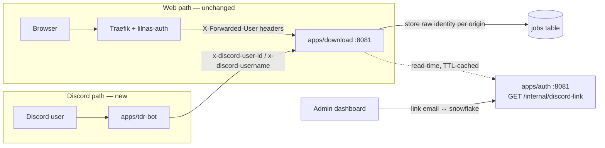
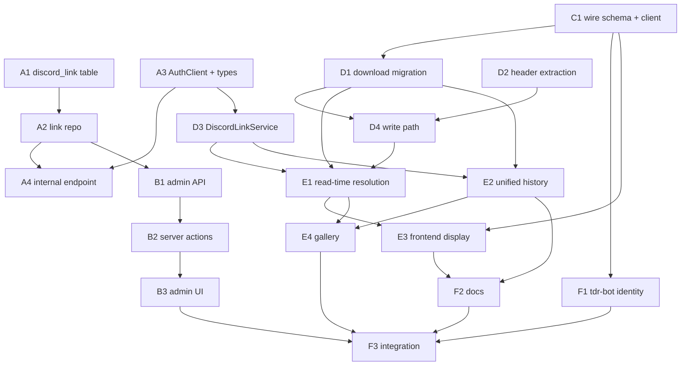

# Discord-triggered downloads are anonymous — give jobs dual attribution and let admins link accounts

> **Overview — written for a human.** Everything below this section is written for the
> executing agents; this part is the map.

Today a download job knows who asked for it only when the request came through the
browser: Traefik's forward-auth stamps `X-Forwarded-User` / `X-Forwarded-User-Id`, and
`apps/download` records them as `requester`. Jobs created by `apps/tdr-bot` (the
Discord `/download` command) arrive with no headers at all and persist as
`requester: null` / `origin: 'service'` — anonymous, forever.

This plan makes attribution **dual**:

- **tdr-bot sends the Discord identity it already has** (`interaction.user.id` +
  `interaction.user.username`) on two new headers, via a `withDiscordIdentity()`
  sibling to the existing `withForwardedIdentity()`.
- **`apps/download` stores it raw** on the job (`discord_user_id`,
  `discord_username`, `origin: 'discord'`) — never resolved at write time.
- **`apps/auth` owns a new `discord_link` table** (lilnas user ↔ Discord snowflake,
  one-to-one) with an admin-managed UI in the existing dashboard and an internal,
  Docker-network-only lookup endpoint mirroring `/admin/check`.
- **`apps/download` resolves the link at read time** (TTL-cached, mirroring
  `AdminCheckService`). A linked Discord job displays as the same person as their web
  jobs — **including every past job**, because resolution happens on display, not on
  write. History and profile views unify: one person's downloads show up together
  regardless of surface.



**Shape:** one doc, **19 tasks in groups A–F**, seven waves. Work lands on
`jeremy/download` in this worktree, matching plans 001–016 — no separate branch, no
rollout section (see [How to work this plan](#how-to-work-this-plan)).

**Key decisions** (full rationale in [Design decisions](#design-decisions)):

- **Resolution lives in `apps/download`, at read time, not in tdr-bot at write
  time.** Retroactive unification requires it. [Why](#resolution-happens-in-download-at-read-time)
- **Storage stays mutually exclusive** — a row is `web` XOR `discord` XOR `service`;
  "one person, both surfaces" is a read-time projection, not a wider row.
  [Why](#storage-stays-mutually-exclusive)
- **The link is admin-entered data, not OAuth.** `apps/auth` keeps Google as its only
  provider. [Why](#the-link-is-admin-entered-not-oauth)
- **The internal endpoint mirrors `/admin/check`** — query-param lookup, no guard,
  Docker-network topology as the trust boundary; the caller caches with the
  `AdminCheckService` pattern, failing open to "unlinked".
  [Why](#internal-lookup-mirrors-admincheck)
- **Masking still works:** `hiddenAttribution` hides the Discord identity exactly as
  it hides the lilnas one, through the same `projectJobForViewer` choke point.
  [Why](#masking-covers-both-identities)

**Read next:** [Open decisions to confirm](#open-decisions-to-confirm) ·
[Design decisions](#design-decisions) · [Shared Context Pack](#shared-context-pack) ·
[Task List](#task-list) · [Sequencing](#sequencing) · [Final report](#final-report)

---

## Open decisions to confirm

⚠️ **Human checkpoint HC1 — confirm these before Wave 1 starts.** The plan proceeds on
the recommendations below unless overridden; both were explicitly flagged as open by
the feature request.

### Q1 — Where does Discord→lilnas resolution happen?

**Recommendation: in `apps/download`, at read time (this plan's shape).**

- Resolving in tdr-bot at request time can never be retroactive — a job written before
  the admin links the accounts would stay anonymous forever, which contradicts the
  stated requirement that linking "retroactively appl[ies] to display of past jobs".
- Doing it in download means any future Discord-triggering surface (another bot,
  a webhook) gets identical behavior by setting two headers.
- Cost: download takes a runtime dependency on auth's internal endpoint for display —
  mitigated by the same TTL-cache + fail-open pattern `AdminCheckService` already uses
  (auth being down degrades to "unlinked", never an error).

If overridden to write-time resolution, Groups D/E change materially — stop and
re-plan before Wave 2.

### Q2 — Is reverse display (Discord handle on web-attributed jobs) in scope?

**Recommendation: out of scope for v1.**

- The **reverse lookup itself is in scope** — unified history requires it internally
  (viewer's lilnas userId → linked snowflake, to OR into the jobs filter). That lands
  in D3/E2 regardless.
- What's deferred is purely presentational: showing "also known as @snowflake" on jobs
  a person requested via the browser. No task builds it; adding it later is a
  frontend-only change on top of data E1 already returns.

Two smaller scope cuts made by this plan (not open questions, but flag if unwanted —
see [Scope cuts](#scope-cuts-in-v1)): the admin leaderboard / gallery uploader facets
keep grouping by `requesterEmail` only (Discord-only jobs stay out of those
aggregates in v1), and gallery/recent-card resolution is a separately droppable task
(E4).

---

## How to work this plan

**All work lands on `jeremy/download`**, in the existing worktree at
`/home/jeremy/.nexus-code/worktrees/lilnas/jeremy-download`. This matches every prior
plan in this directory.

> ⚠️ **Never switch this branch.** The production download container's `/data` volume
> is wired to a checkout of `jeremy/download`; moving it off is a known way to take
> the live service down at boot with `SQLITE_CANTOPEN`.

**Before task 1:** commit this plan doc by itself —
`docs(download): add the plan for discord attribution and account linking` (precedent:
plan 016's own commit).

**Per task:**

1. Work tasks in wave order (see [Sequencing](#sequencing)). Never start a task before
   its dependencies are green.
2. Implement → write or update tests → run **from the package the task touches**
   (some tasks touch two — run in both):
   - `pnpm test`
   - `pnpm lint`
   - `pnpm type-check`
3. **`/commit`** — one task, one commit. Pass an explicit scope naming the files this
   task touched. Commit scopes: `feat(auth)`, `feat(download)`, `feat(tdr-bot)`,
   `feat(utils)` per the dominant package; conventional, lowercase, imperative.
4. Check the box below and append the commit hash.

**Markers:**

| Marker              | Means                                                          |
| ------------------- | -------------------------------------------------------------- |
| `- [ ]`             | Not started                                                    |
| `- [x]` … `abc1234` | Done, with the commit that did it                              |
| ⚠️ **PARTIAL**      | Landed with scope narrowed — say what was left and why, inline |
| ⏭️ **DROPPED**      | Not doing it — say why. Never delete a task                    |
| 🚧 / ⏳             | Blocked. Do not implement                                      |

**When reality disagrees with this plan,** add a short **Findings** note under the
task, then update the downstream tasks that finding invalidates.

---

## Instructions for the orchestrator agent

**Do**

- Delegate every task to a sub-agent — implementation, tests and the commit included.
  One sub-agent per task.
- Write **self-contained** delegation prompts: the task's full text, the relevant parts
  of the [Shared Context Pack](#shared-context-pack), and the
  [Definition of Done](#definition-of-done). When a task depends on an earlier one,
  paste that sub-agent's **reported** exported names and signatures into the prompt.
- Respect the wave order. ⚠️ **E1 and E2 both edit `download.controller.ts` and the
  read path** — they must not run concurrently. ⚠️ **E4 edits `jobs.repo.ts` after E2
  does** — same rule.
- Confirm [HC1](#open-decisions-to-confirm) is answered (or its recommendations
  accepted) before delegating Wave 1.

**Don't**

- ❌ Read or edit source, tests or config yourself. The only file you may edit is _this
  plan_, to check off tasks and record outcomes.
- ❌ Let sub-agents read this plan.
- ❌ Perform [HC2–HC4](#human-checkpoints) — production backup, deploy, and live
  verification are human checkpoints.
- ❌ `git checkout`, `git switch`, rebase, or push.

⚠️ **Other sessions commit on this branch.** Every task's commit must stage **only its
own paths** and use a pathspec-limited `git commit -- <paths>`. If a `/commit`
preflight instructs a `git reset`, **refuse it** — it would destroy another session's
work. Take the repo mutex first:

```bash
until mkdir /tmp/lilnas-download-commit.lock 2>/dev/null; do sleep 5; done
# ... stage only your own paths, commit, verify with: git show --stat HEAD
rmdir /tmp/lilnas-download-commit.lock   # release even on failure or abort
```

---

## Design decisions

### Resolution happens in download, at read time

**Chosen:** jobs store the raw Discord identity; `apps/download` resolves
Discord → lilnas through auth's internal endpoint **when serving reads**, with a
60s-TTL cache. **Ruled out:** (a) tdr-bot resolving before calling download — can't be
retroactive, and every future Discord surface would re-implement it; (b) a one-time
backfill that rewrites old rows on link — destroys provenance, breaks on unlink, and
races with in-flight jobs. Read-time resolution makes link/unlink instantly and
symmetrically visible across all history with zero data migration.

### Storage stays mutually exclusive

**Chosen:** `origin` grows a third value — `JOB_ORIGINS = ['service', 'web',
'discord']` — and the `jobs_origin_matches_requester` CHECK is rewritten so exactly
one identity column-pair is populated per row (`web` ⇒ requester pair, `discord` ⇒
discord pair, `service` ⇒ neither). "A job may have one or both" identities is
satisfied at read time: a linked Discord job is _served_ with both `discordRequester`
(stored) and `requester` (resolved). **Ruled out:** allowing both pairs on one row —
nothing writes both today (a request carrying both header sets is a caller bug; the
forwarded pair wins, warn-logged), and a wider CHECK would let the pairs drift.

### The link is admin-entered, not OAuth

`apps/auth`'s Better Auth config is Google-only and its own comments call out "no
second linkable provider" (`apps/auth/src/auth/auth.ts:36-41`). The feature explicitly
asks for admin-managed linking. So `discord_link` is a plain table written through the
admin API — no Better Auth `account` rows, no Discord OAuth app, no self-serve flow.
`apps/tdr-code`'s `git_identity` table is the borrowed shape precedent (snowflake as
`text`), but nothing is shared with it.

### Internal lookup mirrors /admin/check

**Chosen:** `GET /internal/discord-link?discordUserId=…` (also `?userId=…` /
`?email=…` — exactly one param) on auth's NestJS app (port 8081), a separate
guard-less controller registered flat in `app.module.ts`, **no ThrottlerGuard** — the
same reachability model as `AdminCheckController`
(`apps/auth/src/admin/admin-check.controller.ts:18-32`): no Traefik router points at
8081, no host port is published, the Docker network is the trust boundary. Query
params rather than the sketched path param because the endpoint needs three lookup
directions and `/admin/check?email=` is the house style; a `{ link: … | null }`
envelope keeps "unknown" a 200, so an old auth deploy (404) is distinguishable from
"unlinked" and the caller can fail open. Consumer side: `AuthClient` gains one method,
and download wraps it in a `DiscordLinkService` cloning `AdminCheckService`'s cache
(60s TTL, 10s failure TTL, 500-entry cap, fail-open to `null` = unlinked).

### Precedence and the dev fallback

If a request somehow carries both the forwarded pair and the Discord pair, the
forwarded identity wins and the Discord pair is dropped with a warn log. Separately:
`resolveForwardedUser`'s dev-only `DEV_USER_EMAIL` fallback must **not** fire when
Discord headers are present — otherwise every tdr-bot job in dev would be
mis-attributed to the dev web user. The fallback check gains a "no
`x-discord-user-id` header" condition (D2).

### Masking covers both identities

`hiddenAttribution` on a video job currently masks `requester` via
`projectJobForViewer` (`apps/download/src/download/attribution.ts:46-51`) — the single
read-path transform for REST and WS. It now nulls `discordRequester` too under the
same `showTrueAttribution` rule. No new rule, one more field through the same gate.

### Scope cuts in v1

- **Leaderboard / gallery facets / `topRequesters`** keep grouping by
  `requesterEmail`. Discord-only (unlinked) jobs have no email and stay out of those
  aggregates; folding linked ones in means resolving inside SQL aggregation — deferred.
- **Gallery & recent-card attribution** (E4) resolves linked identities but renders
  unlinked Discord requesters as today's null treatment — and the whole task is
  droppable without breaking anything else.
- **Reverse display** — see [Q2](#q2--is-reverse-display-discord-handle-on-web-attributed-jobs-in-scope).

---

## Shared Context Pack

> Pointers to **verify against current code** — the code is the truth, this pack is a
> map. Paste relevant parts into every delegation prompt.

### Repo & conventions

- pnpm monorepo, Turbo. Per-package commands: `pnpm test`, `pnpm lint`,
  `pnpm type-check` — run from the package dir (`apps/auth`, `apps/download`,
  `apps/tdr-bot`, `packages/utils`).
- Commits: conventional, scoped — `feat(download): …`, `test(auth): …`.
- **Prettier + eslint must pass on every written file.**
- Frontend classnames: `cns()` from `@lilnas/utils/cns` for **conditional** classes;
  static strings stay literal. Both apps use Tailwind v4.
- `packages/utils` has **no barrels** — deep imports (`@lilnas/utils/download/client`).
  Cross-dir imports _inside_ the package that land in emitted `.d.ts` must be relative
  (see the eslint-disable at `packages/utils/src/download/client.ts:1-7`).
- zod (v4) everywhere; **no class-validator, no global ValidationPipe** in auth (bodies
  are `@Body() body: unknown` + `parseBody(schema, body)`); download uses
  `createZodDto` (`nestjs-zod`) DTOs.
- Drizzle + better-sqlite3 in both auth and download. Migrations:
  `pnpm db:generate` (drizzle-kit) in the app dir; **applied automatically at boot**
  (`apps/auth/src/db/database.module.ts:49-55`,
  `apps/download/src/db/migrate.ts:98-106`). Next migration is `0002_*` in both apps.
- Schema conventions: camelCase TS props, explicit snake*case column names,
  `integer('…_at', { mode: 'timestamp_ms' })`, index names `<table>*<cols>_idx`/`\_unique_idx`, checks `<table>_<thing>\_check`, array-form second arg, heavy rationale
  comments on every table/column.

### The code this plan touches

| File                                                                                                                | Meaning                                                                                                                                                                                                                                                                                                                                                                                                          |
| ------------------------------------------------------------------------------------------------------------------- | ---------------------------------------------------------------------------------------------------------------------------------------------------------------------------------------------------------------------------------------------------------------------------------------------------------------------------------------------------------------------------------------------------------------- |
| `apps/auth/src/db/schema.ts`                                                                                        | auth tables; `user` at `:36` (`id`, `name`, `email` unique, …). Surrogate-PK precedent: `grant` `:165` uses bare `integer().primaryKey()`                                                                                                                                                                                                                                                                        |
| `apps/auth/src/db/__tests__/schema.spec.ts:36-45`                                                                   | hardcoded expected-table list — **breaks when a table is added** until updated                                                                                                                                                                                                                                                                                                                                   |
| `apps/auth/src/grants/grants.repo.ts`                                                                               | repo-layer style: plain exported functions taking `Executor` (`Pick<Db, 'select'\|'insert'\|'update'\|'delete'>`, `:18`), sync `.get()/.all()/.run()`                                                                                                                                                                                                                                                            |
| `apps/auth/src/admin/admin-check.controller.ts`                                                                     | **the internal-endpoint pattern to clone**: separate guard-less class, `@Controller('admin')`, no throttler, registered flat                                                                                                                                                                                                                                                                                     |
| `apps/auth/src/app.module.ts:109`                                                                                   | flat `controllers:` array — register new controllers here (no feature modules in auth)                                                                                                                                                                                                                                                                                                                           |
| `apps/auth/src/admin/admin.controller.ts`                                                                           | `@UseGuards(AdminGuard, ThrottlerGuard)` `@Controller('admin')`; `AdminUserEntry` `:51-70`; `parseBody` `:260-268`; POST-verb mutations (`/:userId/block`, `/remove`)                                                                                                                                                                                                                                            |
| `apps/auth/src/admin/admin.dto.ts`                                                                                  | zod body schemas + `z.infer` types                                                                                                                                                                                                                                                                                                                                                                               |
| `apps/auth/src/admin/users.service.ts`                                                                              | house rules: `db.transaction(tx => …, { behavior: 'immediate' })`, reads-before-writes inside `tx`, repo functions only, cache invalidation after commit, `notifyBus.publishAdminChange()` last and only on genuine change, zero-row update ⇒ `NotFoundException`                                                                                                                                                |
| `apps/auth/src/app/admin/page.tsx` → `require-admin.ts` → `admin-dashboard-client.tsx` → `actions.ts`               | admin UI data flow: RSC fetch to `http://localhost:8081` (cookie forwarded) → client component → server actions. `require-admin.ts` re-exports Nest types via `import type` aliases                                                                                                                                                                                                                              |
| `apps/auth/src/app/admin/actions.ts:29-53`                                                                          | **Server Actions are public endpoints** — every path-interpolated value must be narrowed (`requireUserId` rejects non-string / empty / `/`)                                                                                                                                                                                                                                                                      |
| `apps/auth/src/app/admin/{add-person,edit-access}-modal.tsx`                                                        | modal template: `modal-overlay is-open` pattern, `key`-based remount reset (load-bearing, documented at `add-person-modal.tsx:24-35`), `startTransition`/`isPending`/`showToast` passed down from the dashboard                                                                                                                                                                                                  |
| `apps/auth/src/app/styles/design-tokens.css`                                                                        | semantic classes: `.modal`, `.field`, `.field-error`, `.btn btn-primary/outline/ghost`, `.chip chip-neutral`, `.row`, `.stack`                                                                                                                                                                                                                                                                                   |
| `packages/utils/src/auth/client.ts`                                                                                 | `AuthClient`, `dockerInstance` → `http://auth:8081`, 2s `AbortSignal.timeout`, runtime-validates response bodies; `checkIsAdmin` is the method pattern                                                                                                                                                                                                                                                           |
| `packages/utils/src/auth/types.ts`                                                                                  | `ForwardedUser`, `AdminCheckResponse`, `WhoamiResponse` — new shared auth types go here                                                                                                                                                                                                                                                                                                                          |
| `packages/utils/src/download/client.ts`                                                                             | `DownloadClient`; `dockerInstance` getter `:114-116`; `withForwardedIdentity` `:146-151` (returns a **new** client, merges headers in `request()` `:162-185`); `createJob` → `POST /download/videos`                                                                                                                                                                                                             |
| `packages/utils/src/download/schema.ts` + `types.ts`                                                                | zod schemas + `z.infer` types; `JobRequesterSchema` `:65-68`; `DownloadJobSchema.requester` nullable `:239`; `GalleryItemSchema.lastRequester` `:250`; `AuditLogEntrySchema` `:689-698` (`actor` nullable, `origin: z.enum(['service','web'])`); fields are alphabetized — keep that                                                                                                                             |
| `apps/download/src/db/schema.ts`                                                                                    | `jobs` `:90-192`: `requesterEmail/requesterUserId` nullable `:107-108`, `origin` `:109`, `hiddenAttribution` `:110-112`, CHECK `jobs_origin_matches_requester` `:161-167`; `audit_log` `:340-402` (`actorEmail/actorUserId`, CHECK `:385-391`); `JOB_ORIGINS` `:66`. ⚠️ **must not value-import zod/utils schemas** — enum tuples are duplicated locally and pinned via `AssertSameUnion` (`typePin` `:80` etc.) |
| `apps/download/src/db/job-row.ts`                                                                                   | `buildJobRow` `:16-46` — **the only place `origin` is derived** (`:32-34`); `hydrateJobRow` `:56-75`                                                                                                                                                                                                                                                                                                             |
| `apps/download/src/db/jobs.repo.ts`                                                                                 | `buildJobWhere` + `JobListFilter` (`requesterEmail?` `:45`, case-insensitive match `:83-85`); `requesterDateRange` `:444-460`; distinct-requester facets `:322-343`                                                                                                                                                                                                                                              |
| `apps/download/src/auth/forwarded-user.ts`                                                                          | `getForwardedUser` `:43-52`, `resolveForwardedUser` `:68-90` (dev fallback), trust-model comment `:8-19`                                                                                                                                                                                                                                                                                                         |
| `apps/download/src/auth/optional-current-user.decorator.ts`                                                         | `@OptionalCurrentUser()` — the decorator pattern to clone for Discord                                                                                                                                                                                                                                                                                                                                            |
| `apps/download/src/auth/admin-check.service.ts`                                                                     | **the TTL-cache pattern to clone**: 60s TTL, 10s failure TTL, 500-entry cap, oldest-first eviction, fail-closed; `AuthClient.dockerInstance` as a plain field                                                                                                                                                                                                                                                    |
| `apps/download/src/auth/auth.module.ts:88-93`                                                                       | providers + exports for auth-shaped services (imported by DownloadModule and AdminModule)                                                                                                                                                                                                                                                                                                                        |
| `apps/download/src/download/download.controller.ts`                                                                 | `POST /videos` `:995`, `POST /movies` `:1238`, `POST /shows` `:1331` — all `@OptionalCurrentUser()`, thread `user` into services + `auditLogService.record({ actor: user, … })`, return `projectJobForViewer(job, isAdmin)`; `GET /history` self-vs-admin rule `:319-352`                                                                                                                                        |
| `apps/download/src/download/download.service.ts:222-259` / `src/media/media-download.service.ts:93,138,298-329`     | `requester?: JobRequester \| null` threading into job construction                                                                                                                                                                                                                                                                                                                                               |
| `apps/download/src/download/attribution.ts`                                                                         | `showTrueAttribution` / `projectJobForViewer` — the single read-path mask, REST + WS                                                                                                                                                                                                                                                                                                                             |
| `apps/download/src/download/download-state.service.ts:471-473` + `src/download-gateway/download.gateway.ts:75-94`   | WS broadcast path: `broadcastPerViewer` re-resolves admin per distinct viewer email                                                                                                                                                                                                                                                                                                                              |
| `apps/download/src/download/profile.service.ts:64-68`                                                               | profile filters by `requesterEmail: email`                                                                                                                                                                                                                                                                                                                                                                       |
| `apps/download/src/audit/audit-log.service.ts`                                                                      | `record(event)` `:119` (`actor: ForwardedUser \| undefined` `:72`), row→wire collapse `:88-90`                                                                                                                                                                                                                                                                                                                   |
| `apps/download/src/components/activity/activity-requester.tsx`                                                      | **the one spelling of the attribution display rule** — `canViewRequesterProfile`, `requesterProfileHref`, `MASKED_REQUESTER_LABEL = 'hidden'`; every surface imports it                                                                                                                                                                                                                                          |
| `apps/download/src/components/admin/admin-actor.tsx`                                                                | ⚠️ `null` here means **service** (renders `AUDIT_SERVICE_LABEL` chip), the opposite of `ActivityRequester`'s `null` (= masked)                                                                                                                                                                                                                                                                                   |
| `apps/download/src/components/detail/detail-header.tsx:148,183-196`                                                 | detail-page requester display (email local-part)                                                                                                                                                                                                                                                                                                                                                                 |
| `apps/download/src/components/gallery/gallery-item-card.tsx:122-162`, `src/components/home/recent-card.tsx:119-174` | `lastRequester` displays                                                                                                                                                                                                                                                                                                                                                                                         |
| `apps/tdr-bot/src/commands/download-command.service.ts`                                                             | `private client = DownloadClient.dockerInstance` `:71`; `createJob` call `:106-109`; `interaction.user.id`/`.username` already in hand `:94,:120`                                                                                                                                                                                                                                                                |
| `apps/tdr-code/src/db/schema.ts:571-589`                                                                            | **reference only, not shared**: snowflake stored as `text`, `git_identity` vs `github_credential` (`:596-630`) shows snowflake-PK vs user-id-PK tradeoff                                                                                                                                                                                                                                                         |

### ⚠️ Gotchas

- **SQLite can't ALTER a CHECK** — changing `jobs_origin_matches_requester` makes
  drizzle-kit generate a **table-recreate** migration (new table, `INSERT INTO …
SELECT`, drop, rename). Inspect the generated SQL: every existing column must be
  copied, and the recreate must run with `foreign_keys` handled (the auth migrator
  re-asserts the pragma after `migrate()` — download's `migrate.ts` is the place to
  confirm the same holds). Test against a copy of a real DB file, not just `:memory:`.
- `apps/download/src/db/migrate.ts` has `selfHealMigrationBookkeeping()` `:45-96` —
  don't be surprised by it; a new `0002_*` migration is unaffected.
- **`apps/auth/src/db/__tests__/schema.spec.ts` hardcodes the table list** — A1 must
  update it.
- Download controller tests: **`jest.mock('nanoid', …)` must be the first statement**
  (ESM-only package).
- tdr-bot's command test mocks `DownloadClient.dockerInstance` as a **static object**
  (`download-command.service.test.ts:69-74`) — F1 must extend that mock with
  `withDiscordIdentity`.
- Backend DB tests in both apps build a real `:memory:` DB and run the **real
  migrations** — never hand-written CREATE TABLE.
- Auth admin UI modals reset state via the **`key` remount trick** — copy it, don't
  switch to effects.
- `zod` schema fields in `packages/utils/src/download/schema.ts` are alphabetized;
  keep new fields in order.
- Discord snowflakes exceed `Number.MAX_SAFE_INTEGER` — always `text` in SQL, `string`
  in TS. Validate with `/^\d{17,20}$/`.
- Discord usernames (post-2023) are 2–32 chars of `a-z0-9._` — safe as raw header
  values; don't send display names.
- New internal auth route needs **no compose/Traefik change** (8081 already unrouted),
  but `apps/auth/src/services/__tests__/compose-mount-coverage.spec.ts` fails if any
  new compose file is added without a root mount — this plan adds none.
- Deploy-order safety: if download ships before auth, `AuthClient` gets a 404 from the
  missing endpoint → `DiscordLinkService` fails open to "unlinked". Nothing breaks;
  linking just doesn't display until auth deploys.

### Definition of Done

> **Done means:** implemented; tests written or updated following the package's
> existing conventions and passing; lint and type-check clean for every touched
> package; committed with `/commit`. Report back: files changed, exported names
> introduced, test summary, commit hash(es).

---

## Task List

### Group A — apps/auth: link storage + internal lookup

- [ ] **A1. `discord_link` table + migration.** Edit `apps/auth/src/db/schema.ts`: new
      table `discordLink` (`'discord_link'`) — `id: integer().primaryKey()` (surrogate,
      house style for self-minted rows), `userId: text('user_id').notNull().references(()
=> user.id, { onDelete: 'cascade' })`, `discordUserId:
text('discord_user_id').notNull()`, `discordUsername: text('discord_username')`
      (nullable, admin-entered label), `createdAt`/`updatedAt`
      timestamp*ms not-null. Unique indexes on `userId` and on `discordUserId`
      (one-to-one both ways), named per convention. Export `DiscordLinkRow`. Write the
      rationale comment block (why admin-entered not OAuth, why one-to-one, why snowflake
      is `text`). Run `pnpm db:generate` → `0002*\*.sql`. Update
`apps/auth/src/db/**tests**/schema.spec.ts`'s table list. Tests: schema.spec passes
against real migrations; unique constraints enforced (duplicate `discordUserId`
      insert throws).

- [ ] **A2. Link repo functions.** Create `apps/auth/src/db/discord-link.repo.ts`
      (plain exported functions taking `Executor`, style of `grants.repo.ts`):

  ```ts
  findLinkByDiscordUserId(ex, discordUserId): (DiscordLinkRow & { email; name }) | undefined  // joins user
  findLinkByUserId(ex, userId): DiscordLinkRow | undefined
  findLinkByEmail(ex, email): (DiscordLinkRow & { email; name }) | undefined  // normalizeEmail'd
  upsertLink(ex, { userId, discordUserId, discordUsername }): void   // replaces the user's existing link
  deleteLinkForUser(ex, userId): number                              // returns changes
  ```

  Email matching uses `normalizeEmail` (`apps/auth/src/admin/normalize-email.ts`).
  Tests in `apps/auth/src/db/__tests__/discord-link.repo.spec.ts` against `:memory:` +
  real migrations: upsert replaces, delete returns 0/1, joins return `email`/`name`,
  cascade on user delete.

- [ ] **A3. Shared contract: types + `AuthClient` method.** Edit
      `packages/utils/src/auth/types.ts`: add

  ```ts
  export interface DiscordLinkResolution {
    userId: string
    email: string
    name: string
    discordUserId: string
    discordUsername: string | null
  }
  export interface DiscordLinkLookupResponse {
    link: DiscordLinkResolution | null
  }
  ```

  Edit `packages/utils/src/auth/client.ts`: add
  `getDiscordLink(params: { discordUserId: string } | { userId: string } | { email: string }): Promise<DiscordLinkResolution | null>`
  → `GET /internal/discord-link?<key>=<encoded>`; runtime-validate the body has a
  `link` property (object-or-null) like `checkIsAdmin` validates `isAdmin`; throw on
  non-ok. Tests mirror the existing `AuthClient` test style (URL + query encoding,
  non-ok throws, malformed body throws, null link passes through).

- [ ] **A4. Internal lookup endpoint.** Create
      `apps/auth/src/internal/discord-link-lookup.controller.ts`: `@Controller('internal')`,
      `@Get('discord-link')`, **no guards, no throttler** — clone
      `AdminCheckController`'s class comment explaining the topology trust boundary.
      Accepts exactly one of `discordUserId` | `userId` | `email` query params (zero or
      more than one → `BadRequestException`); returns `DiscordLinkLookupResponse`
      (unknown key → `{ link: null }`, HTTP 200). Uses A2's repo functions via
      `@Inject(DB)`. Register flat in `apps/auth/src/app.module.ts`'s `controllers` array.
      Tests (`apps/auth/src/internal/__tests__/…spec.ts`, direct instantiation +
      `:memory:` DB): each lookup direction, null for unknown, 400 on zero/two params,
      email lookup is case-insensitive.

### Group B — apps/auth: admin manage surface

- [ ] **B1. Admin API: link/unlink.** Edit `apps/auth/src/admin/admin.dto.ts`: add
      `LinkDiscordBodySchema = z.object({ discordUserId: z.string().regex(/^\d{17,20}$/),
discordUsername: z.string().min(2).max(32).optional() })` + inferred type. Edit
      `apps/auth/src/admin/users.service.ts`: `linkDiscord(userId, discordUserId,
discordUsername?)` and `unlinkDiscord(userId)` following every house rule (BEGIN
      IMMEDIATE, reads inside tx, repo functions only, `NotFoundException` on missing
      user, `notifyBus.publishAdminChange()` after commit only on genuine change). Edge
      cases: snowflake already linked to a **different** user →
      `BadRequestException('Discord account already linked to <that email>')`; re-linking
      the same pair is a no-op success (no notify); linking a user who already has a
      different link replaces it. Edit `apps/auth/src/admin/admin.controller.ts`: `POST
/admin/users/:userId/discord-link` and `POST /admin/users/:userId/discord-link/remove`
      (POST-verb house style), `parseBody` validation; extend `AdminUserEntry` with
      `discordUserId: string | null` and `discordUsername: string | null` and make
      `GET /admin/users` populate them (join via A2's repo). Tests: controller spec
      (`:memory:` DB) covering link, replace, conflict, unlink, no-op, users-list
      exposure; dto spec for the snowflake regex.

- [ ] **B2. Server actions.** Edit `apps/auth/src/app/admin/actions.ts`: add
      `linkDiscordAccount(userId, discordUserId, discordUsername?)` and
      `unlinkDiscordAccount(userId)` via `callBackend`. **Narrow every argument** —
      `requireUserId(userId)`, plus a new `requireDiscordUserId` (string, `/^\d{17,20}$/`)
      and optional-username narrowing, per the `actions.ts:29-53` rationale (server
      actions are public POST endpoints). Update `apps/auth/src/app/admin/require-admin.ts`
      only if the `AdminUserEntry` re-export needs nothing (it re-exports the Nest type,
      so B1's change flows through — verify). Tests: extend the existing pattern for
      action-input narrowing if one exists; otherwise a small spec for the new narrowing
      helpers.

- [ ] **B3. Admin UI: Discord link management.** Edit
      `apps/auth/src/app/admin/edit-access-modal.tsx`: add a "Discord account" `.field` —
      text input for the snowflake (inline `.field-error` on regex failure), optional
      username input, and Save wiring: on confirm, diff against the opening snapshot
      (`accessSnapshotRef` style) — changed value → `linkDiscordAccount`, cleared →
      `unlinkDiscordAccount`, untouched → no call. Backend errors surface via the modal
      error line; success via `showToast`. Edit
      `apps/auth/src/app/admin/admin-dashboard-client.tsx`: show a `chip chip-neutral`
      with the linked username (fallback: snowflake) on people rows — **both** the desktop
      table and the mobile `person-card` variant. Use `cns()` only for conditional
      classes. Keep the `key`-remount reset (already keyed on `user.id`). jsdom tests
      (`apps/auth/src/app/admin/__tests__/`): renders existing link, validates snowflake,
      calls link action on change, calls unlink on clear, no call when untouched.

### Group C — shared download wire contract + client

- [ ] **C1. Wire schema + `withDiscordIdentity`.** Edit
      `packages/utils/src/download/schema.ts`: add

  ```ts
  export const DiscordRequesterSchema = z.object({
    discordUserId: z.string(),
    discordUsername: z.string(),
  })
  ```

  with a doc comment mirroring `JobRequesterSchema`'s (headers
  `x-discord-user-id` / `x-discord-username`, set by tdr-bot). Add
  `discordRequester: DiscordRequesterSchema.nullable()` to `DownloadJobSchema`,
  `lastDiscordRequester: DiscordRequesterSchema.nullable()` to `GalleryItemSchema`,
  and to `AuditLogEntrySchema`: `discordActor: DiscordRequesterSchema.nullable()` and
  widen `origin` to `z.enum(['service', 'web', 'discord'])` — all alphabetized. Edit
  `packages/utils/src/download/types.ts`: export `DiscordRequester`. Edit
  `packages/utils/src/download/client.ts`: add

  ```ts
  withDiscordIdentity(identity: { discordUserId: string; discordUsername: string }): DownloadClient
  ```

  — new client, same `baseUrl`, headers `x-discord-user-id` / `x-discord-username`
  (composable with `withForwardedIdentity`'s spread pattern). Tests: extend
  `client.spec.ts`'s `withForwardedIdentity` describe block (headers merge into every
  request, base URL preserved); schema specs for the new fields' nullability.
  ⚠️ Every added `DownloadJobSchema`/`GalleryItemSchema` field is nullable, so
  existing producers keep compiling — but **fixtures** that `satisfies DownloadJob`
  (utils `buildJob()`, download's `job-fixtures.ts`) need the new fields; update the
  utils one here, download's in D1.

### Group D — apps/download: storage + write path

- [ ] **D1. Jobs/audit schema migration + row mapping.** Edit
      `apps/download/src/db/schema.ts`: `JOB_ORIGINS = ['service', 'web', 'discord']`
      (the wire pin: no `AssertSameUnion` exists for origins — the audit wire enum widened
      in C1 must match; note it in a comment). `jobs`: add nullable
      `discordUserId: text('discord_user_id')`, `discordUsername:
text('discord_username')`; rewrite CHECK `jobs_origin_matches_requester`:

  ```sql
  (origin = 'web'     AND requester_email IS NOT NULL AND requester_user_id IS NOT NULL
                      AND discord_user_id IS NULL AND discord_username IS NULL) OR
  (origin = 'discord' AND discord_user_id IS NOT NULL AND discord_username IS NOT NULL
                      AND requester_email IS NULL AND requester_user_id IS NULL) OR
  (origin = 'service' AND requester_email IS NULL AND requester_user_id IS NULL
                      AND discord_user_id IS NULL AND discord_username IS NULL)
  ```

  Add `jobs_discord_user_id_idx`. Same treatment for `audit_log`
  (`actorDiscordUserId`, `actorDiscordUsername`, extended
  `audit_log_origin_matches_actor` CHECK). Run `pnpm db:generate` → `0002_*` and
  **inspect the recreate SQL** (see Gotchas). Edit `apps/download/src/db/job-row.ts`:
  `buildJobRow` derives `origin: record.requester ? 'web' : record.discordRequester ?
'discord' : 'service'` and maps the discord pair; `hydrateJobRow` rebuilds
  `discordRequester` only when both columns are non-null. Update
  `apps/download/src/audit/audit-log.service.ts`'s row↔wire collapse the same way
  (`discordActor`). Update fixtures (`job-fixtures.ts` etc.) for the new nullable
  fields. Tests: schema.spec CHECK matrix (all three origins × valid/invalid column
  combos), job-row round-trip, migration applies on a DB seeded with pre-existing
  `web`/`service` rows (recreate preserves data).

- [ ] **D2. Discord header extraction + decorator.** Create
      `apps/download/src/auth/discord-user.ts`: `getDiscordRequester(req: { headers:
IncomingHttpHeaders }): DiscordRequester | undefined` — reads `x-discord-user-id` /
      `x-discord-username`, both required, `firstHeaderValue` handling, trust-model
      comment mirroring `forwarded-user.ts:8-19`. Create
      `apps/download/src/auth/optional-discord-user.decorator.ts`:
      `@OptionalDiscordUser()` cloning `optional-current-user.decorator.ts`. Edit
      `apps/download/src/auth/forwarded-user.ts`: `resolveForwardedUser` must **not**
      apply the dev fallback when `x-discord-user-id` is present (see
      [Design decisions](#precedence-and-the-dev-fallback)) — update its comment. Tests:
      extraction (missing-either → undefined, array headers), decorator spec cloning the
      existing one, dev-fallback suppression case added to `forwarded-user.spec.ts`.

- [ ] **D3. `DiscordLinkService` (TTL cache).** Create
      `apps/download/src/auth/discord-link.service.ts` cloning `AdminCheckService`'s
      shape (`AuthClient.dockerInstance` field, 60s TTL, 10s failure TTL, 500-entry cap,
      oldest-first eviction, **fail-open to `null`** — an auth outage degrades to
      "unlinked", warn-logged):

  ```ts
  resolveDiscordUser(discordUserId): Promise<DiscordLinkResolution | null>
  getLinkedDiscordUserId(lilnasUserId): Promise<string | null>
  ```

  Two cache keyspaces (prefix keys, e.g. `d:<snowflake>` / `u:<userId>`). Register in
  `apps/download/src/auth/auth.module.ts` providers + exports. Tests clone
  `admin-check.service.spec.ts` (mock `@lilnas/utils/auth/client`, fake timers for
  TTL, failure caching, eviction).

- [ ] **D4. Thread Discord identity through the write path.** Edit
      `apps/download/src/download/download.controller.ts`: the three create routes
      (`POST /videos` `:995`, `POST /movies` `:1238`, `POST /shows` `:1331`) gain
      `@OptionalDiscordUser() discordUser`. Precedence: if a forwarded user is present,
      ignore the discord pair (warn-log when both arrived). Thread into
      `DownloadService.createVideoDownloadJob` and
      `MediaDownloadService.requestMovie/requestShow` — extend their signatures with
      `discordRequester?: DiscordRequester | null` and set it on the constructed job
      record (mutually exclusive with `requester`). Extend
      `AuditLogService.record`'s `AuditEvent` with `discordActor?: DiscordRequester` and
      pass it at the three create-route `record()` calls (other mutating routes may
      follow the same pattern where trivially identical — but do not expand scope beyond
      routes tdr-bot actually calls: create + cancel + delete videos). Tests: controller
      specs (nanoid mock first!) for each create route × (web headers / discord headers /
      both / neither), asserting persisted origin + identity columns and audit rows.

### Group E — apps/download: read path + display

- [ ] **E1. Read-time link resolution + masking.** Edit
      `apps/download/src/download/attribution.ts`: `projectJobForViewer` masks
      `discordRequester` under the same `showTrueRequester` rule (both nulled together).
      Add resolution: give `DiscordLinkService` (or a thin
      `AttributionResolutionService` in `src/download/` if module cycles bite — executor's
      call, report it) a batch helper `resolveJobs<T>(jobs: T[]): Promise<T[]>` that, for
      each job with a `discordRequester` and no `requester`, resolves the link (distinct
      snowflakes deduped per batch, cache does the rest) and sets `requester = { email,
userId }` from the resolution — **the job on the wire then carries both**
      identities; unlinked jobs pass through unchanged. Wire it in at every
      job-serving boundary **before** `projectJobForViewer`: the list/page endpoints
      (activity, history, gallery items' `lastDiscordRequester`, single-job GETs, the
      create/mutate routes' returned jobs) and the WS broadcast
      (`DownloadStateService.broadcastJobEvent` → resolve once before
      `broadcastPerViewer`). Audit-log reads get the same resolution for `discordActor` →
      `actor`. **Enumerate the actual call sites from the code** — the controller has
      ~20 job-returning handlers; a shared private helper in the controller keeps this
      one-line per route. Tests: attribution.spec (masking covers both fields),
      resolution service spec (linked job gains requester, unlinked untouched, auth
      failure → untouched), one controller-level spec proving a linked historical
      `discord` job serializes with the resolved `requester`.

- [ ] **E2. Unified history + profile.** Edit `apps/download/src/db/jobs.repo.ts`:
      `JobListFilter` gains `requesterDiscordUserId?: string`; `buildJobWhere` combines it
      with `requesterEmail` as an OR-arm
      (`lower(requester_email) = X OR discord_user_id = Y`) when both are set — and plain
      equality when only one is. Apply the same to `requesterDateRange`. Edit
      `apps/download/src/download/profile.service.ts`: resolve the viewer's linked
      snowflake via `DiscordLinkService.getLinkedDiscordUserId(viewer.userId)` and pass it
      into both filters. Edit the `GET /history` path in `download.controller.ts`
      (`:306-352`): when filtering by `?requester=<email>`, resolve that email's linked
      snowflake (`AuthClient` lookup by email via `DiscordLinkService` — add an
      email-keyed method if needed, same cache) and OR it in; the self-view uses the
      viewer's own link. ⚠️ The hidden-attribution leak guard around `requesterEmail`
      filtering (`jobs.repo.ts:35-45`) must apply identically to the discord arm. Facets /
      leaderboard / `topRequesters` are **explicitly unchanged** (see
      [Scope cuts](#scope-cuts-in-v1)). Tests: repo spec for the OR filter (email-only,
      discord-only, both, hidden-attribution interaction), profile + history endpoint
      specs with a linked viewer seeing jobs from both surfaces as one list.

- [ ] **E3. Frontend attribution display.** Edit
      `apps/download/src/components/activity/activity-requester.tsx` — the single display
      rule: accept the job's `discordRequester` alongside `requester`; rendering order:
      masked → `hidden` (unchanged); `requester` present → today's email rendering
      (linked Discord jobs land here automatically via E1); else `discordRequester`
      present → render `discordUsername` with a "via Discord" affordance (muted suffix or
      small chip — match the existing visual language; initials-avatar from the username);
      else → today's null treatment. `canViewRequesterProfile`/`requesterProfileHref`
      stay email-based — an unlinked Discord requester has no profile link. Update the
      callers that pass requester props where the new field must flow:
      `activity-table.tsx`, `activity-list.tsx`, `detail-header.tsx` (+
      `video-detail.tsx` prop threading), and
      `apps/download/src/components/admin/admin-actor.tsx` (⚠️ its `null` means
      _service_: an unlinked `discordActor` must render as the Discord identity, **not**
      the service chip; keep the service chip only for true `origin: 'service'`). Use
      `cns()` for conditional classes. jsdom tests: extend `activity-requester.spec.tsx`
      and `admin-actor.spec.tsx` with the four states (web / linked-discord /
      unlinked-discord / masked).

- [ ] **E4. Gallery + recent-card attribution.** (Droppable — see
      [Scope cuts](#scope-cuts-in-v1).) Extend the gallery grouped query
      (`jobs.repo.ts`) to select the last requester's discord pair alongside the email
      pair so `GalleryItemSchema.lastDiscordRequester` is populated; run E1's resolution
      over gallery pages; render in
      `apps/download/src/components/gallery/gallery-item-card.tsx` and
      `src/components/home/recent-card.tsx` with the same rule as E3 (linked → resolved
      identity; unlinked → username + "via Discord"; masked unchanged). Tests: repo spec
      for the grouped selection, component specs for the new states.

### Group F — tdr-bot, docs, integration

- [ ] **F1. tdr-bot sends Discord identity.** Edit
      `apps/tdr-bot/src/commands/download-command.service.ts`: in `download()`, build a
      per-interaction client — `this.client.withDiscordIdentity({ discordUserId:
interaction.user.id, discordUsername: interaction.user.username })` — and use it for
      `createJob`; the poller's `getJob`/`cancelJob` can stay on the plain client
      (reads/cancels don't attribute). Update
      `apps/tdr-bot/src/commands/__tests__/download-command.service.test.ts`: the
      `dockerInstance` mock is a static object — add `withDiscordIdentity:
jest.fn().mockReturnThis()` (or return a nested mock) and assert it's called with
      the interaction's id/username and that `createJob` goes through the derived client.

- [ ] **F2. Docs.** Update `docs/features/download/spec.md`'s attribution sections
      (dual attribution model, origin `discord`, read-time link resolution, masking rule
      unchanged in shape), `apps/download/README.md` if it documents headers/identity,
      and `docs/features/download/local-verification.md` with a curl recipe for creating
      a discord-attributed job (`-H 'x-discord-user-id: …' -H 'x-discord-username: …'`
      against `localhost:8081`) and verifying link resolution. Note in each doc that
      `apps/auth` owns the link table and the admin UI. No code.

- [ ] **F3. Integration checkpoint.** From the repo root: `pnpm run build`,
      `pnpm test`, `pnpm run lint`, `pnpm run type-check` — all green at the final
      commit, seeing every prior commit. Then a local end-to-end smoke via each app's
      test suite is not enough on its own: additionally run download's dev backend
      (`pnpm run dev:backend` in `apps/download`) and exercise the F2 curl recipe:
      create a discord-attributed job, confirm `origin: 'discord'` + raw identity in the
      DB, confirm the API serves it with `requester: null` before linking. (Live
      auth-linked verification is [HC4](#human-checkpoints) — do not attempt against
      prod.) Fix or re-delegate anything red; commit only if fixes were needed.

---

## Sequencing

### DAG



### Waves

| Wave | Run               | Why it works                                                                                                                                                                                                                         |
| ---- | ----------------- | ------------------------------------------------------------------------------------------------------------------------------------------------------------------------------------------------------------------------------------ |
| 1    | A1 ∥ C1 ∥ D2      | Three packages, zero shared files: auth schema, utils download dir, download `src/auth` extraction files                                                                                                                             |
| 2    | A2 ∥ A3 ∥ D1 ∥ F1 | A2 needs A1's table; A3 touches only `packages/utils/src/auth`; D1 needs C1's wire type for row mapping; F1 needs C1's client method. No file overlap                                                                                |
| 3    | A4 ∥ B1 ∥ D3 ∥ D4 | A4 (new controller + app.module line) and B1 (admin controller/service) touch different auth files except neither edits the other's; D3 (new service + auth.module) and D4 (controller/services write path) are disjoint in download |
| 4    | B2 ∥ E1           | B2 is auth frontend actions; E1 owns the download read path alone this wave                                                                                                                                                          |
| 5    | B3 ∥ E2 ∥ E3      | B3 is auth UI; E2 edits `jobs.repo`/profile/controller history, E3 edits only frontend components — disjoint                                                                                                                         |
| 6    | E4 ∥ F2           | E4 re-enters `jobs.repo.ts` after E2 is done; F2 is docs only                                                                                                                                                                        |
| 7    | F3                | Integration checkpoint — must see every prior commit                                                                                                                                                                                 |

### Dependency table

| Task | Depends on     | Parallel with |
| ---- | -------------- | ------------- |
| A1   | —              | C1, D2        |
| A2   | A1             | A3, D1, F1    |
| A3   | —              | A2, D1, F1    |
| A4   | A2, A3         | B1, D3, D4    |
| B1   | A1, A2         | A4, D3, D4    |
| B2   | B1             | E1            |
| B3   | B2             | E2, E3        |
| C1   | —              | A1, D2        |
| D1   | C1             | A2, A3, F1    |
| D2   | —              | A1, C1        |
| D3   | A3             | A4, B1, D4    |
| D4   | D1, D2         | A4, B1, D3    |
| E1   | C1, D1, D3, D4 | B2            |
| E2   | D1, D3, E1\*   | B3, E3        |
| E3   | C1, E1         | B3, E2        |
| E4   | E1, E2         | F2            |
| F1   | C1             | A2, A3, D1    |
| F2   | E2, E3         | E4            |
| F3   | everything     | —             |

\* E2 has no hard export dependency on E1, but both edit `download.controller.ts` —
the wave split serializes them.

### Critical path

**C1 → D1 → D4 → E1 → E2 → E4 → F3** (7 waves; A3 → D3 → E1 joins at wave 4). **C1
leads** — it defines the wire contract every download-side and tdr-bot task compiles
against; start it first in Wave 1.

### Human checkpoints

In order — the executor/orchestrator performs **none** of these:

1. **HC1 (before Wave 1):** confirm [the two open decisions](#open-decisions-to-confirm)
   — resolution location and reverse-display scope — or accept the recommendations.
2. **HC2 (before prod deploy):** back up both SQLite files on the prod host —
   `/storage/app-data/download/download.db` (D1's migration **recreates the `jobs`
   table**) and auth's database file. Copies, not moves; verify sizes.
3. **HC3 (deploy):** rebuild base images
   (`./infra/base-images/build-base-images.sh`), then from the repo root
   `docker-compose up -d --build auth download tdr-bot`. Prefer auth first (deploy
   order is safe either way — download fails open to "unlinked" until auth ships).
   Never run `apps/*/deploy.yml` standalone.
4. **HC4 (live verification):** in the admin dashboard, link a real lilnas user to
   their Discord snowflake; run `/download` in Discord as that user; confirm the job
   shows attributed to the person in the web UI, that a **pre-link** tdr-bot job now
   displays the same identity (retroactivity), and that unlinking reverts both.

---

## Final report

When the last box is checked, the executor reports — and stops:

1. Per-task outcome with commit hashes (including any ⚠️ PARTIAL / ⏭️ DROPPED and why).
2. Test results per package (`auth`, `download`, `tdr-bot`, `utils`) and repo-wide
   (`pnpm run build && pnpm test && pnpm run lint && pnpm run type-check` from root).
3. Deviations from the plan (Findings notes), and downstream tasks they changed.
4. Deferred items — explicitly restate the [scope cuts](#scope-cuts-in-v1) and every
   outstanding human checkpoint (HC2–HC4 will all be outstanding).
5. Open questions discovered during implementation.
6. **Do not deploy, push, merge, or touch production.** HC2–HC4 belong to a human.
