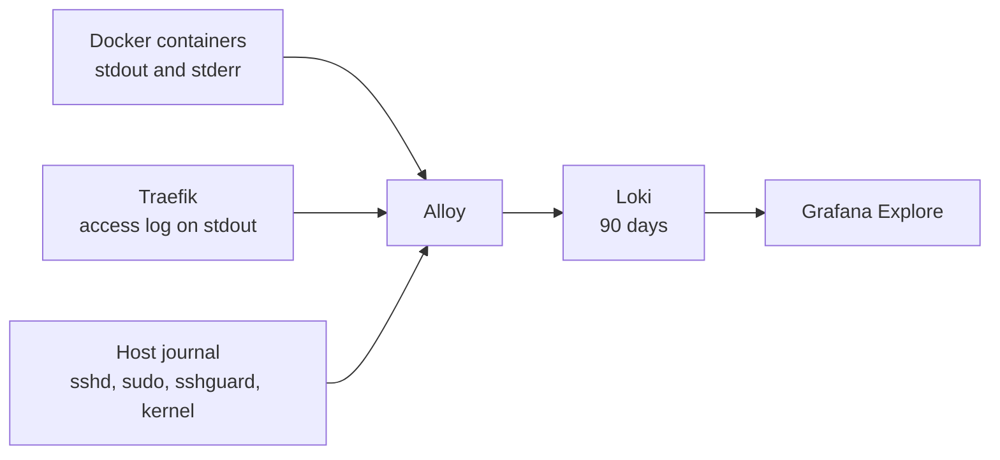

# Logging

Every container's output, Traefik's access log and the host's system journal go to Loki, are kept for 90 days, and are read in Grafana at `https://grafana.lilnas.io` (Explore, data source Loki).



## What is collected

| Source             | Loki selector                            | What it holds                                                  |
| ------------------ | ---------------------------------------- | -------------------------------------------------------------- |
| Container output   | `{service="<compose service>"}`          | Whatever each app prints                                       |
| Traefik access log | `{service="traefik", log_type="access"}` | One JSON line per HTTP request through Traefik                 |
| Traefik's own log  | `{service="traefik", log_type=""}`       | Traefik errors, such as a failed call to the auth service      |
| Host journal       | `{service="host"}`                       | System services: `sshd`, `sudo`, `sshguard`, `dockerd`, kernel |

The pipeline is `infra/monitoring/config.alloy`. The Alloy container and its mounts are in `infra/monitoring.yml`.

## Labels

Labels are the indexed part of a log line; everything else is found by searching the text.

| Label             | Set on           | Example values                               |
| ----------------- | ---------------- | -------------------------------------------- |
| `service`         | everything       | `traefik`, `download`, `host`                |
| `container`       | container output | `lilnas-traefik-1`                           |
| `compose_project` | container output | `lilnas`, `lilnas-dev`                       |
| `stream`          | container output | `stdout`, `stderr`                           |
| `level`           | where known      | `info`, `warning`, `error`                   |
| `logger`          | NestJS apps      | the Nest logger context                      |
| `log_type`        | Traefik          | `access`                                     |
| `job`             | host journal     | `journal`                                    |
| `identifier`      | host journal     | `sshd-session`, `sudo`, `sshguard`, `kernel` |

- **Do not add labels for IPs, paths or status codes.** Each distinct label value makes a new stream in Loki, and those have unbounded values. Filter on them with `| json` instead.
- **`identifier` is the program name, not the systemd unit.** `sudo` and login messages are filed under a per-login unit (`session-123.scope`), which would create a stream per login.

## Traefik access log

Turned on by the `--accesslog` flags in `infra/proxy.yml`. Every request through ports 80 and 443 is recorded, including ones rejected by `lilnas-auth` and ones for hostnames that do not exist.

| Field                                   | Meaning                                                        |
| --------------------------------------- | -------------------------------------------------------------- |
| `ClientHost`                            | The client's IP address                                        |
| `RequestHost`                           | Hostname asked for, such as `emby.lilnas.io`                   |
| `RequestMethod`, `RequestPath`          | Method, and path with query string                             |
| `DownstreamStatus`                      | Status code sent back to the client                            |
| `OriginStatus`                          | Status code the app returned; `0` when Traefik answered itself |
| `RouterName`, `ServiceName`             | Which route matched; absent when none did                      |
| `Duration`                              | Total time in nanoseconds                                      |
| `request_User-Agent`, `request_Referer` | The only two request headers kept                              |

After `| json` in a query, `request_User-Agent` becomes `request_User_Agent`.

### Secrets

- **Headers:** all request headers are dropped except `User-Agent` and `Referer`, so `Cookie` and `Authorization` are never written.
- **Query strings:** Alloy replaces the value of secret-looking parameters with `REDACTED` before sending to Loki. The list covers `apikey`, `api_key`, `token`, `access_token`, `refresh_token`, `id_token`, `code`, `key`, `password`, `secret`, `sig`, `signature`, `x-emby-token` and the S3 presigned parameters `x-amz-signature`, `x-amz-credential`, `x-amz-security-token`.
- **Gap:** the masking happens in Alloy, not in Traefik. The copy Docker keeps on disk for the Traefik container (up to 3 files of 10 MB, readable by root) is not masked.
- **Adding a parameter:** edit the `stage.replace` expression in `infra/monitoring/config.alloy`. Traefik writes `&` as `\u0026` in JSON, which is why the expression matches `u0026` as a separator.

## Host journal

Alloy reads `/var/log/journal` read-only. Docker containers log to files, not to the journal, so nothing is collected twice.

- **Kept:** everything from system services, plus `sudo` and anything else run inside a login session.
- **Dropped:** the nexus-code daemon's own output (`nexus-code-daemon-*.service`, a user unit). It wrote about 80% of the journal and its monitoring was removed on purpose.
- **First start:** Alloy reads the previous 72 hours (`max_age`). After that it resumes from a saved position in `/storage/app-data/alloy`.
- **Volume:** about 11,000 lines a day across roughly 50 streams, measured over 72 hours in November 2026.

## Queries

Paste into Grafana Explore. Set the time range in the picker; a `[24h]` inside a query is the window each count covers.

### SSH and sudo

```logql
# Successful SSH logins, with user, method and source IP
{service="host", identifier="sshd-session"} |= "Accepted"

# IPs that sshguard blocked
{service="host", identifier="sshguard"} |= "Blocking"

# Every sudo command
{service="host", identifier="sudo"} |= "COMMAND="
```

### Web requests

```logql
# The 20 IPs with the most rejected or failed requests in 24 hours
topk(20, sum by (ClientHost) (count_over_time({service="traefik", log_type="access"} | json | DownstreamStatus >= 400 [24h])))

# Scanner probes, one readable line each (matches the request path only, not the query string; our own nexus-code Vite dev servers, which serve /@fs/ assets, are left out)
{service="traefik", log_type="access"} |~ "(?i)\\.env|\\.git|\\.aws|wp-login|phpmyadmin|@fs/" | json | RequestPath =~ "(?i)[^?]*(/\\.(env|git|aws)\\b|wp-login|phpmyadmin|/@fs/).*" | RouterName !~ "nexus-code(-work)?@docker" or RequestPath !~ "[^?]*/@fs/.*" | line_format "{{.ClientHost}} {{.RequestHost}} {{.DownstreamStatus}} {{.RequestPath}}"

# Scanner probes that did NOT get an error back: the ones worth reading (dashcam answers every path with 200 and SABnzbd redirects to its login with 302, so both are left out)
{service="traefik", log_type="access"} |~ "(?i)\\.env|\\.git|\\.aws|wp-login|phpmyadmin|@fs/" | json | RequestPath =~ "(?i)[^?]*(/\\.(env|git|aws)\\b|wp-login|phpmyadmin|/@fs/).*" | RouterName !~ "nexus-code(-work)?@docker" or RequestPath !~ "[^?]*/@fs/.*" | DownstreamStatus < 400 | RouterName != "dashcam@docker" | RouterName != "sabnzbd@docker" or DownstreamStatus != 302

# Everything one IP did
{service="traefik", log_type="access"} | json | ClientHost="203.0.113.7"

# Failed logins against Emby
{service="traefik", log_type="access"} | json | RequestHost="emby.lilnas.io" | DownstreamStatus=401

# Requests per hostname
sum by (RequestHost) (count_over_time({service="traefik", log_type="access"} | json [1h]))
```

`dashcam` is excluded from the third query because it is a single-page app: it answers every path with its home page and status 200, so probes against it always look successful.

### Signs of a compromised container

```logql
# The July 2026 download incident: credential files checked from inside a container
{service=~".+", log_type=""} |~ "\\.aws/credentials|\\.git-credentials|RCE_RES"
```

- `log_type=""` leaves out the Traefik access log, where these strings only mean someone requested that path.
- `equations`, `turbo` and `dashcam` print their own request logs, so they match on probes too. A match there with `GET` in the line is a probe.
- A match from any other service means a process inside the container touched those files. Treat it as an incident.

### Hardware

```logql
# SATA errors and link resets
{service="host", identifier="kernel"} |~ "ata[0-9.]+: .*(error|failed)"
```

## Reading logs without Grafana

```bash
docker compose -p lilnas logs -f traefik             # container output, unmasked
sudo journalctl -u sshd --since -7d | grep Accepted   # host journal
last -i                                               # login history
```

The journal needs `sudo`, or membership in the `systemd-journal` group.

## Retention and storage

| What                         | Where                        | Kept                                     |
| ---------------------------- | ---------------------------- | ---------------------------------------- |
| Loki data                    | `/storage/app-data/loki`     | 90 days (`infra/monitoring/loki.yml`)    |
| Alloy read positions         | `/storage/app-data/alloy`    | until deleted                            |
| Docker's copy, per container | `/var/lib/docker/containers` | 3 files of 10 MB where `logging:` is set |
| Host journal                 | `/var/log/journal`           | journald's own size cap                  |

## What is not logged

- **Request and response bodies**, and all headers other than `User-Agent` and `Referer`.
- **Traffic that skips Traefik:** the game servers, RustDesk and SSH itself. SSH logins are covered by the journal; the others only by what each server prints.
- **Commands run inside containers.** They show up only if the app happens to print them, which is how the July 2026 incident was found.
- **Router and firewall events.** UniFi keeps those; port-forward logging is off.
- **Alerts.** Nothing watches these logs yet. They are for looking back.

## Changing the setup

Deploys happen by pushing to `main` (see `docs/deploy.md`).

| File changed                    | What the deploy does                                    |
| ------------------------------- | ------------------------------------------------------- |
| `infra/proxy.yml`               | Recreates Traefik: every site is down for a few seconds |
| `infra/monitoring.yml`          | Recreates the services whose definition changed         |
| `infra/monitoring/config.alloy` | Force-recreates Alloy                                   |

Check the Alloy config before pushing:

```bash
docker run --rm -v "$PWD/infra/monitoring/config.alloy:/c.alloy:ro" grafana/alloy:v1.21.0 fmt /c.alloy | diff infra/monitoring/config.alloy -
```

No output means the file parses and is formatted.

### Checking a deploy

Each of these should return lines within a minute of the deploy:

```logql
{service="traefik", log_type="access"}
{service="host", identifier="sshd-session"}
{service="host", identifier="sudo"}
```

- **No access log lines:** `docker inspect lilnas-traefik-1 --format '{{json .Config.Cmd}}'` should list the `--accesslog` flags. If not, Traefik was not recreated.
- **No host lines:** `docker compose -p lilnas logs alloy` shows journal read errors. The usual cause is a missing mount of `/var/log/journal` or `/etc/machine-id`.
