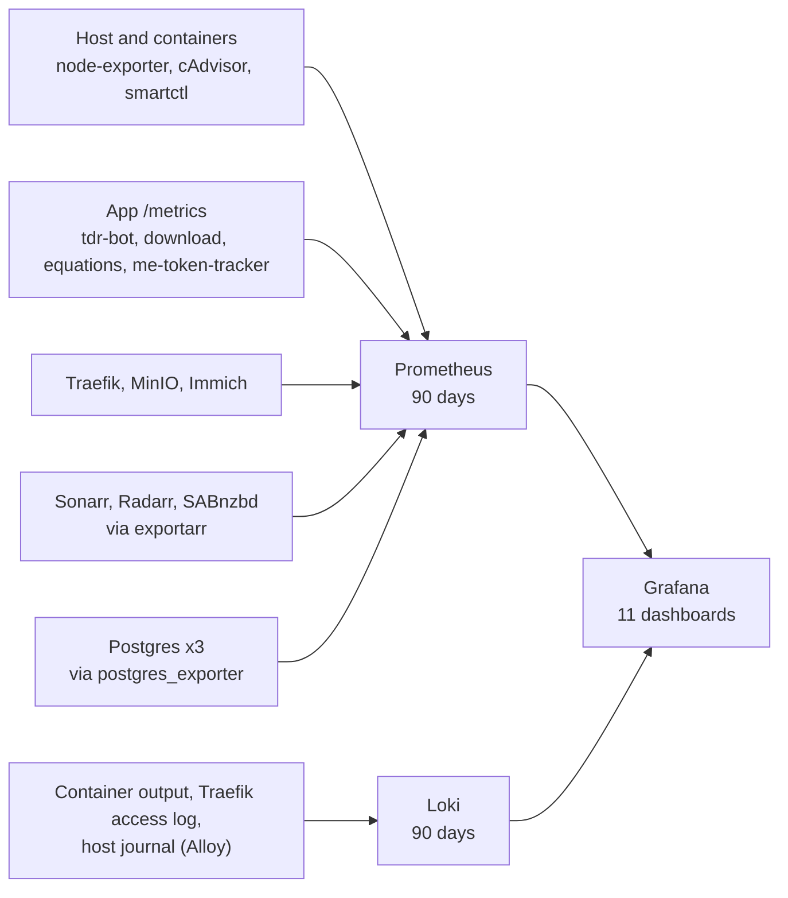

# Monitoring

Metrics go to Prometheus (kept 90 days), logs go to Loki (see `docs/logging.md`), and both are read in Grafana at `https://grafana.lilnas.io`. Eleven dashboards are provisioned from files in the repo; the Overview is the home page.



## Dashboards

Files are in `infra/monitoring/grafana/provisioning/dashboards/json/`. Data source uids are `prometheus` and `loki`.

| Title          | uid                     | File                  | Answers                                                                                                           | Data sources     |
| -------------- | ----------------------- | --------------------- | ----------------------------------------------------------------------------------------------------------------- | ---------------- |
| Overview       | `lilnas-overview`       | `overview.json`       | Does anything need attention? Each panel links to its detail page                                                 | Prometheus, Loki |
| Infrastructure | `lilnas-infrastructure` | `infrastructure.json` | Host CPU, memory, load, network, and per-container resource use                                                   | Prometheus       |
| Storage        | `lilnas-storage`        | `storage.json`        | Filesystem fill per mount, disk I/O, MinIO capacity and buckets                                                   | Prometheus       |
| Disk Health    | `lilnas-disk-health`    | `disk-health.json`    | SMART health of the SATA HDDs and NVMe drives, btrfs device errors, temperatures, kernel SATA/NVMe errors         | Prometheus, Loki |
| Traefik        | `lilnas-traefik`        | `traefik.json`        | Request rate, errors and latency per entrypoint and service, TLS expiry                                           | Prometheus       |
| App Detail     | `lilnas-app-detail`     | `app-detail.json`     | One app's Node.js runtime, real HTTP traffic, jobs and logs (variable `app`)                                      | Prometheus, Loki |
| TDR Bot        | `lilnas-tdr-bot`        | `tdr-bot.json`        | LLM cost, tokens, latency and errors for the Discord bot                                                          | Prometheus, Loki |
| Media Stack    | `lilnas-media`          | `media.json`          | Sonarr, Radarr, SABnzbd, Emby and Immich health, queues, libraries, download speed and logs                       | Prometheus, Loki |
| Postgres       | `lilnas-postgres`       | `postgres.json`       | Connections, cache, locks, size, vacuum, WAL/checkpoints and per-server error logs for the three Postgres servers | Prometheus, Loki |
| Security       | `lilnas-security`       | `security.json`       | SSH, sshguard and sudo activity, web errors and probes, sign-ins (variable `ip`)                                  | Loki             |
| Logs           | `lilnas-logs`           | `logs.json`           | Log volume and a searchable stream per service                                                                    | Loki             |

The home page is set by `GF_DASHBOARDS_DEFAULT_HOME_DASHBOARD_PATH` on the Grafana service. Grafana redirects `/` to `/d/default-home-dashboard/overview`, which is expected.

## Scrape jobs and exporters

Jobs are in `infra/monitoring/prometheus.yml`; the containers are in `infra/monitoring.yml`. None of the exporters publish a port: Prometheus reaches them on the compose network.

| Job                                                    | Target                                                                     | Image                                                   | Needs                                                                                                        |
| ------------------------------------------------------ | -------------------------------------------------------------------------- | ------------------------------------------------------- | ------------------------------------------------------------------------------------------------------------ |
| `prometheus`                                           | `localhost:9090`                                                           | `prom/prometheus:v3.15.0`                               |                                                                                                              |
| `node-exporter`                                        | `node-exporter:9100`                                                       | `prom/node-exporter:v1.12.1`                            | Host `/proc`, `/sys` and `/`; the `storage-volumes` sidecar writes the mount names it labels with            |
| `cadvisor`                                             | `cadvisor:8080`                                                            | `gcr.io/cadvisor/cadvisor:v0.55.1`                      | Privileged                                                                                                   |
| `traefik`                                              | `traefik:8082`                                                             | Traefik (`infra/proxy.yml`)                             |                                                                                                              |
| `minio`, `minio-bucket`                                | `storage:9000` (cluster and bucket metrics)                                | MinIO (`infra/shared.yml`)                              | Public metrics on the MinIO service                                                                          |
| `tdr-bot`, `equations`, `download`, `me-token-tracker` | each app's `/metrics` (8081, 8080, 8081, 8080)                             | the app's own image                                     |                                                                                                              |
| `smartctl` (60s)                                       | `smartctl-exporter:9633`                                                   | `prometheuscommunity/smartctl-exporter:v0.15.0`         | **Privileged**, `/dev` mounted read-only. Standby disks are not woken (`--smartctl.powermode-check=standby`) |
| `sonarr` (60s)                                         | `exportarr-sonarr:9707`                                                    | `ghcr.io/onedr0p/exportarr:v2.3.0`                      | API key file `infra/.env.exportarr-sonarr`                                                                   |
| `radarr` (60s)                                         | `exportarr-radarr:9708`                                                    | `ghcr.io/onedr0p/exportarr:v2.3.0`                      | API key file `infra/.env.exportarr-radarr`                                                                   |
| `sabnzbd` (60s)                                        | `exportarr-sabnzbd:9709`                                                   | `ghcr.io/onedr0p/exportarr:v2.3.0`                      | API key file `infra/.env.exportarr-sabnzbd`                                                                  |
| `immich`                                               | `immich:8081` (`component=api`), `immich:8082` (`component=microservices`) | Immich (`infra/immich.yml`)                             | `IMMICH_TELEMETRY_INCLUDE: all` on the Immich service                                                        |
| `postgres`                                             | `postgres-exporter-<server>:9187`, label `server`                          | `quay.io/prometheuscommunity/postgres-exporter:v0.21.1` | The `lilnas_monitor` role on each server; `.env.postgres-exporter`                                           |

- **Postgres servers:** `tdr-bot-db`, `icloud-backup-db` and `immich-database`, one exporter each. Download and auth use SQLite, so they have none. `pg_up` is `0` until the role exists.
- **Exportarr:** `ENABLE_ADDITIONAL_METRICS` stays off. For Sonarr it makes scrapes about 8x slower, and for Radarr it adds nothing.
- **Immich:** the exposed business metric is `immich_users_total`, plus per-repository duration histograms and the `system_*` and `process_*` OpenTelemetry metrics. There are no `http_server_*` series.

## Secrets

Each is an encrypted env file (see `docs/deploy.md`, Secrets). The container loads the `.decrypted` sibling through `env_file:`.

| File                           | Variables                              | Loaded by                                |
| ------------------------------ | -------------------------------------- | ---------------------------------------- |
| `infra/.env.exportarr-sonarr`  | `APIKEY`                               | `exportarr-sonarr`                       |
| `infra/.env.exportarr-radarr`  | `APIKEY`                               | `exportarr-radarr`                       |
| `infra/.env.exportarr-sabnzbd` | `APIKEY`                               | `exportarr-sabnzbd`                      |
| `infra/.env.postgres-exporter` | `DATA_SOURCE_USER`, `DATA_SOURCE_PASS` | the three `postgres-exporter-*` services |

- **A new Postgres server** needs a `postgres-exporter-<name>` service, a target in the `postgres` job, and the `lilnas_monitor` role on that server. Create the role with `infra/monitoring/scripts/postgres-monitor-roles.sh` (add the container name to its `CONTAINERS` list first). It reads the password from the decrypted env file and is safe to re-run. `--drop` removes the role and `--dry-run` prints the SQL.
- **The role** has `LOGIN`, `pg_monitor` and `CONNECT` on its own database. It is not a superuser and has no table grants.
- **Never** write `${VAR}` in `infra/*.yml`: Compose would fill it from the encrypted `infra/.env`. Secrets reach a container through `env_file:` only.

## Adding or changing a dashboard

Edit the JSON under `infra/monitoring/grafana/provisioning/dashboards/json/`, using `storage.json` as the style reference. The provider reads the whole directory, so a new file needs no registration.

Rules for every dashboard:

- `uid` is `lilnas-<name>`, the tags include `lilnas`, the title is set, and the top-level `id` is `null`.
- It has one dashboard link of type `dashboards` with tag `lilnas` and `asDropdown: true`, so the dashboards link to each other.
- Panels use datasource uid `prometheus` or `loki`, and only metrics and labels seen in live data.
- A panel that can be empty for a legitimate reason has a `description` starting `Event-driven:` that says what makes data appear (for example, a ban, or a failed sign-in).

Check it with the checker (Node standard library only):

```bash
node infra/monitoring/scripts/check-dashboards.mjs lint [file.json ...]
node infra/monitoring/scripts/check-dashboards.mjs live [--range 24h] [--var name=value ...] [file.json ...]
```

| Command | What it does                                                                                                             |
| ------- | ------------------------------------------------------------------------------------------------------------------------ |
| `lint`  | Offline. Checks uid, tag, title, `id`, one datasource uid per panel, non-empty queries and that every `$variable` exists |
| `live`  | Runs every panel query against production, read-only, and reports `OK`, `EMPTY`, `EMPTY (event-driven)` or `ERROR`       |

Both run on this host without arguments for every dashboard. `live` needs the `lilnas-prometheus-1` and `lilnas-grafana-1` containers. `ERROR` is a bug in the dashboard; `EMPTY` without an `Event-driven:` description needs either one or a fix.

### What a push redeploys

| Change                                                            | Deploy action                                           |
| ----------------------------------------------------------------- | ------------------------------------------------------- |
| A file under `infra/monitoring/grafana/provisioning/`             | Force-recreates Grafana                                 |
| `infra/monitoring/prometheus.yml`                                 | Force-recreates Prometheus                              |
| `infra/monitoring/config.alloy`, `loki.yml`                       | Force-recreates Alloy or Loki                           |
| `infra/monitoring.yml`                                            | `up -d` for its services; only changed ones restart     |
| An encrypted `infra/.env.exportarr-*` or `.env.postgres-exporter` | Re-decrypts, then `up -d` for the services that load it |

Validate before pushing:

```bash
docker run --rm -v "$PWD/infra/monitoring/prometheus.yml:/p.yml:ro" --entrypoint promtool prom/prometheus:v3.15.0 check config /p.yml
docker compose -f infra/monitoring.yml config -q --no-env-resolution
pnpm exec prettier -c infra/monitoring infra/monitoring.yml docs
```

## Checking a deploy

- **Targets:** `https://prometheus.lilnas.io/targets` lists every job. All should be `UP`. The Overview's "Targets that are down" panel shows the same.
- **Dashboards:** run `node infra/monitoring/scripts/check-dashboards.mjs live`. The summary should show no `ERROR`.
- **Provisioning:** `docker compose -p lilnas logs grafana` shows a rejected dashboard file with the reason.
- **Exporter logs:** `docker compose -p lilnas logs <service>` for `smartctl-exporter`, `exportarr-sonarr`, `exportarr-radarr`, `exportarr-sabnzbd` and `postgres-exporter-<server>`. The same output is in Loki as `{service="<service>"}`.
- **A job is down:** `pg_up` of `0` means the `lilnas_monitor` role is missing or the password differs from the env file; run the roles script again. A failing exportarr job usually means a wrong `APIKEY`.

## What is not monitored yet

- **Alerting.** There are no alert rules, contact points or Alertmanager. The dashboards are for looking, and nothing pages anyone.
- **valkey.** Immich's cache has no exporter.
- **Emby's own API.** Emby is only seen through Traefik and its container metrics.
